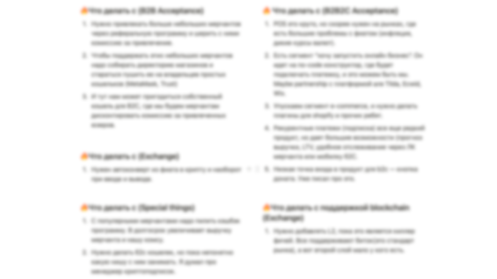
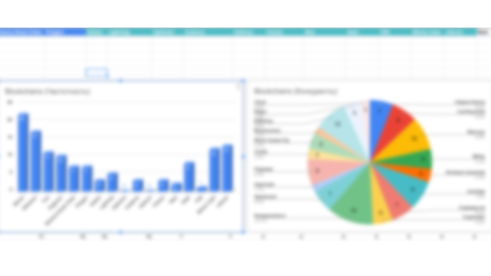
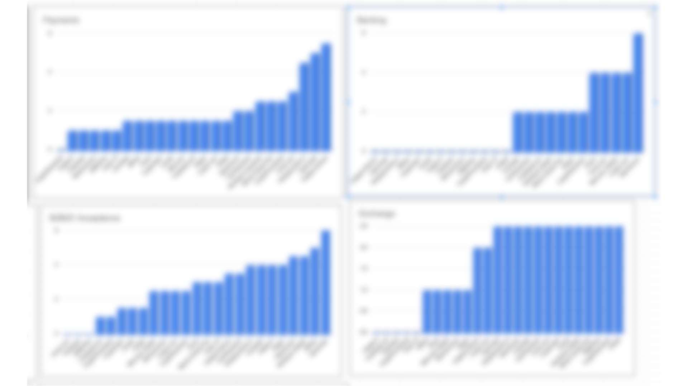
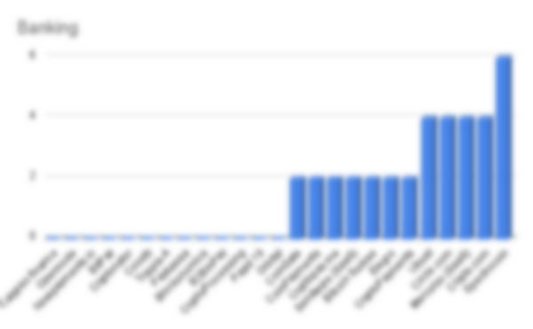
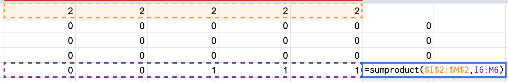
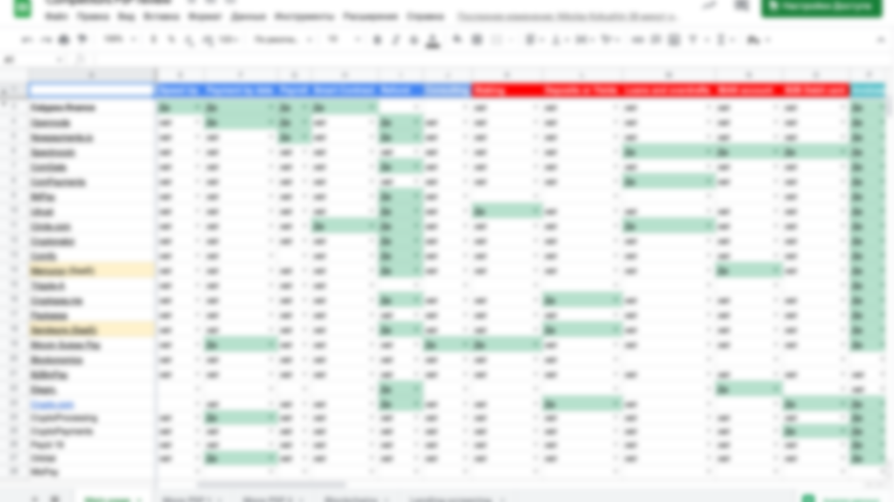
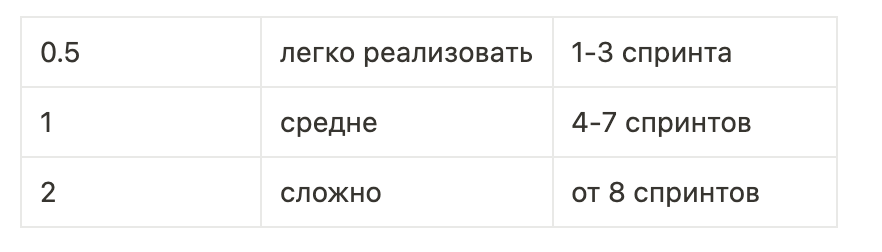

# Market research on crypto PSP market

Led a team to automate market research processes for Calypso, enhancing efficiency and accuracy. Implemented AI-driven tools to transform uncertainty into actionable business insights.

### What’s inside

- Situation
- Task
- How I conducted research
- Results

## Situation

When I joined the company, I didn't really understand how many competitors our payment product had, how we were different from our competitors, and what our value proposition was to them.

## Task

To solve this, the CEO set me the task of doing a full analysis of the competitors and comparing them to us.

## How I conducted research

1. **Compiled a list of the main competitors**

Taking the past research, scouring the tops on various sites, I compiled a list of 22 solutions similar to our product.

---

2. **Divided the product into separate areas**

To make it easier to analyze the information, I divided the product into subproducts: b2b, b2c, payment solutions, banking, etc. All in all there are six separate areas.

---

1. **Determined the difficulty of implementation**

Some of the functionality of the product is implemented longer and more complex, so it was necessary to distribute points: from 0.5 to 2 points for a single feature.

---

1. **Manual scoring**

Configured drop-down lists and went to manually look at competitors and our solution for the lack/availability of all this functionality.

---

1. **Made calculations**

After scoring, I added up the product of the two arrays - Weight of the feature + Presence/absence of the feature.

These calculations allowed me to create a ranking for each line of business

1. **Data visualization**

Having displayed this rating in the form of graphs, I was able to find out the following:

- Which competitors are strong in each area (by the number of features in each area)
- Where on this graph is our product

We were also able to compare ourselves in terms of supported blockchains:

- which blockchain is supported most often
- how many blockchains are supported by each competitor individually

1. **Conclusions on the whole work**

After analyzing each area individually, I created a list of recommendations to improve our product

1. **Presentation**

The last stage of the work was the presentation of the results to the main stakeholders

## Results

- Built a strategy for the product based on the research
- 20% of features ended up in the product roadmap
- 30% of features ended up in technical analysis for development
- We decided not to focus on the rest

---
