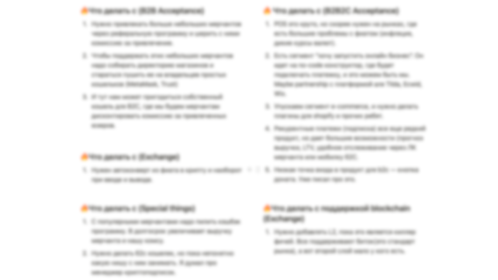
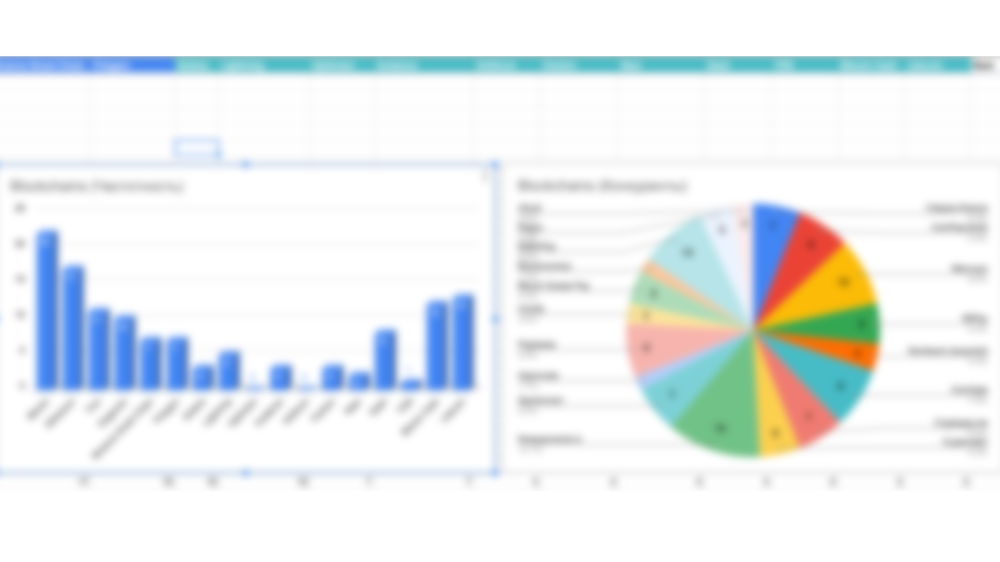
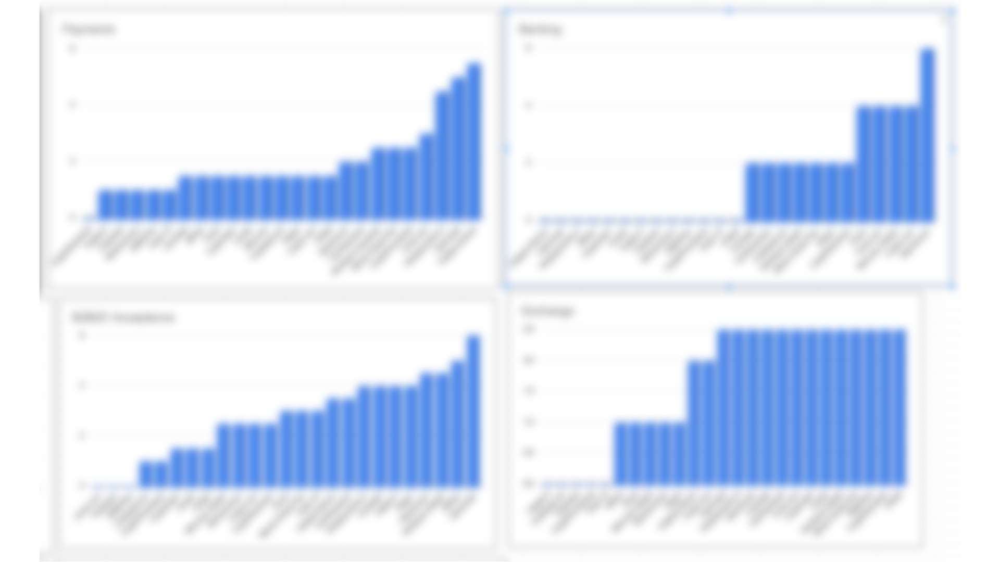
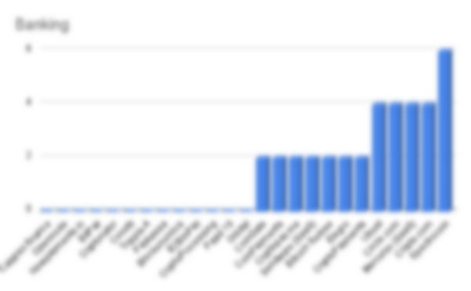
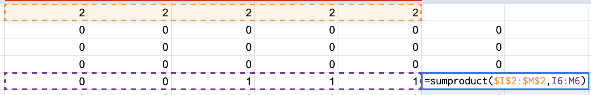
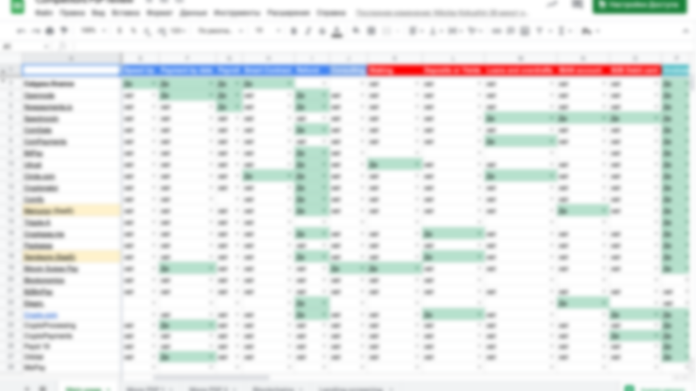
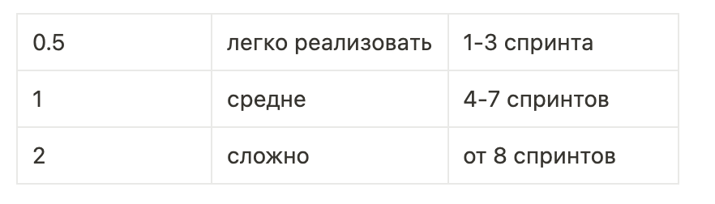

# Исследование рынка крипто-PSP

Руководил командой по автоматизации процессов исследования рынка для Calypso, повысив эффективность и точность. Внедрил инструменты на базе ИИ, чтобы превращать неопределённость в прикладные бизнес-выводы.

### Что внутри

- Ситуация
- Задача
- Как я проводил исследование
- Результаты

## Ситуация

Когда я пришёл в компанию, я толком не понимал, сколько конкурентов у нашего платёжного продукта, чем мы отличаемся от конкурентов и каким было наше ценностное предложение для них.

## Задача

Чтобы это решить, CEO поставил мне задачу провести полный анализ конкурентов и сравнить их с нами.

## Как я проводил исследование

1. **Составил список основных конкурентов**

Опираясь на прошлые исследования и просматривая топы на разных сайтах, я собрал список из 22 решений, похожих на наш продукт.

---

2. **Разделил продукт на отдельные направления**

Чтобы информацию было проще анализировать, я разделил продукт на подпродукты: b2b, b2c, платёжные решения, банкинг и т.д. Всего получилось шесть отдельных направлений.

---

1. **Определил сложность реализации**

Часть функциональности продукта реализуется дольше и сложнее, поэтому нужно было распределить баллы: от 0,5 до 2 баллов за одну функцию.

---

1. **Ручная оценка**

Настроил выпадающие списки и вручную смотрел конкурентов и наше решение на отсутствие или наличие всей этой функциональности.

---

1. **Сделал расчёты**

После оценки я просуммировал произведение двух массивов — вес функции и наличие или отсутствие функции.

Эти расчёты позволили мне составить рейтинг по каждому направлению бизнеса

1. **Визуализация данных**

Отобразив этот рейтинг в виде графиков, я смог выяснить следующее:

- Какие конкуренты сильны в каждом направлении (по числу функций в каждом направлении)
- Где на этом графике наш продукт

Мы также смогли сравнить себя по поддерживаемым блокчейнам:

- какой блокчейн поддерживается чаще всего
- сколько блокчейнов поддерживает каждый конкурент по отдельности

1. **Выводы по всей работе**

Проанализировав каждое направление по отдельности, я составил список рекомендаций по улучшению нашего продукта

1. **Презентация**

Последним этапом работы была презентация результатов основным стейкхолдерам

## Результаты

- Построили стратегию продукта на основе исследования
- 20% функций попали в дорожную карту продукта
- 30% функций ушли в технический анализ для разработки
- Остальное решили не брать в фокус

---
