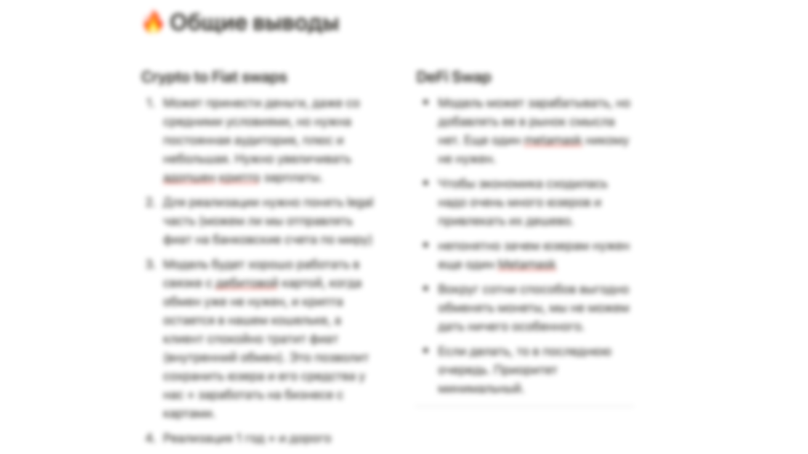
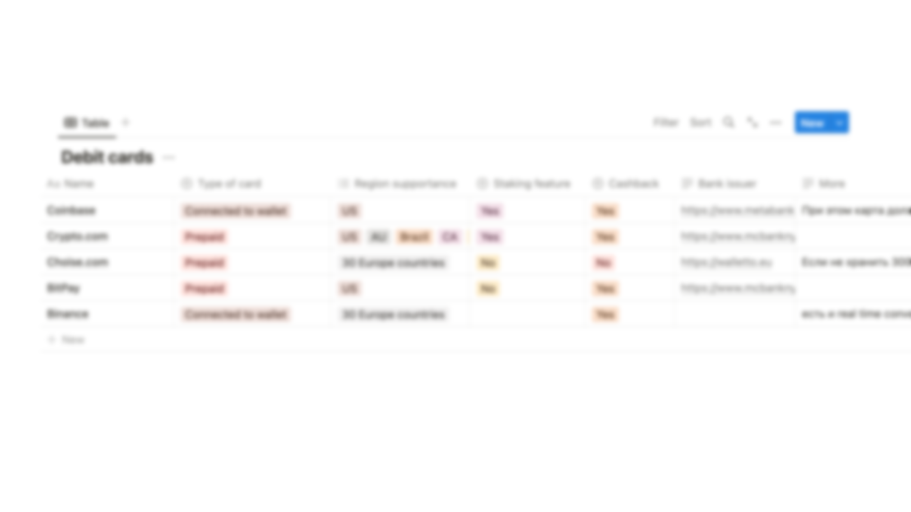
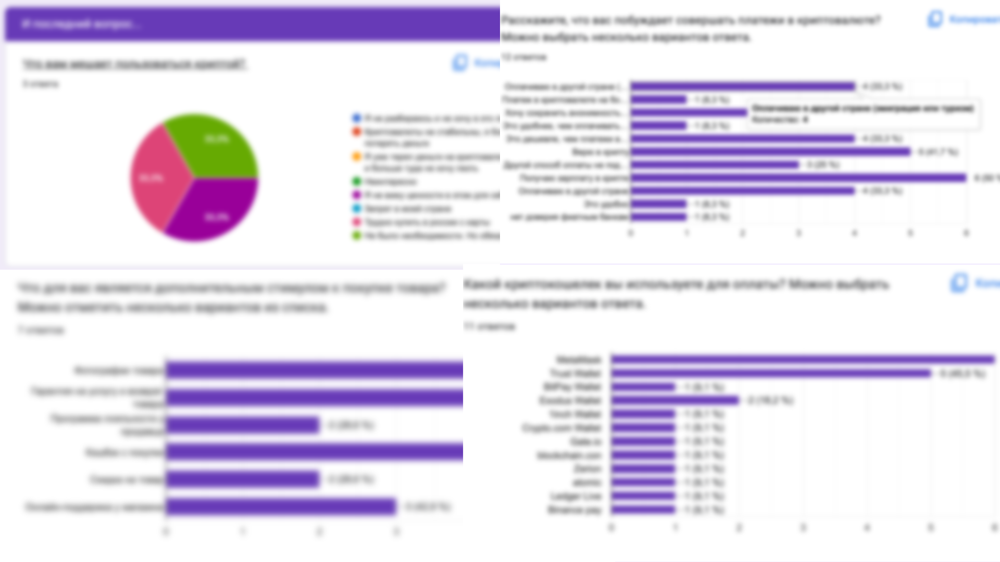

# Launching crypto wallet

Researched and developed a B2C crypto wallet to complement existing B2B services. Analyzed monetization strategies and user retention techniques, resulting in a user-friendly wallet that integrates seamlessly with existing payment processes.

### What’s inside?

- Situation
- Task
- How I conducted research
- Results

## Situation

At some point, the product team had the hypothesis of making a product not only for B2B, but also for B2C. This would make the payment process for end customers more convenient. Right now they're paying with Metamask, Trust Wallet, and they'll be able to pay with our wallet. So we would be able to take their clients to us.

---

## Task

This is how the task of researching cryptocurrencies came about. There were several things to understand:

- How they are monetized.
- How they keep users inside
- What are the problems in using them

## How I conducted research

---

1. **Wrote a script and conducted several interviews with employees**

At this stage, I talked to those who have experience using cryptocurrencies. It was important to understand:

- what use cases exist
- What problems do users face

---

1. **Created a survey and sent it out to the chats**

In order to get more representative results, I created a survey and sent it to cryptocurrency chats.

The survey made it possible to understand:

- which wallet is the most popular
- what problem occurs most often
- reasons why people use wallets

---

1. **Researched ways to monetize wallets**

1) At this stage, I downloaded about 20 applications of different wallets and manually looked at what functionality they have and what their earnings are hidden.

2) I read in research about the main business models of wallets

That's how I learned that almost all wallets are based on 2-3 sources of income

---

**4. Calculated the approximate economics**

After learning about the commissions, and the approximate number of users, I calculated the approximate level of income from each business model

**What I've learned from economics is this:**

- Most business models are not feasible without partnerships, on which we will lose margins.
- To compensate for the losses, we either need to develop our own solution or expand the funnel by spending on marketing
- Success requires partnerships with merchants that provide regular/frequency services. That's what Binance did, for example.

---

1. **Researched the user retention**

As a feature that could keep users in the wallet, I hypothesized a merchant directory. Tinkoff Bank has a tab where the client can spend money on movies, flights, medicine, and so on. I wanted to implement a similar thing in the wallet. To do this:

- researched the technical implementation of various solutions
- painted the user-flow of competitors with similar solutions

For the same feature also claimed: crypto debit card and cryptocurrency stacking/landing. So I compared some competitive solutions here as well.

---

1. **Wrote the conclusions of the study**

## Results

1. Based on the results of the study, the development of the wallet has started
