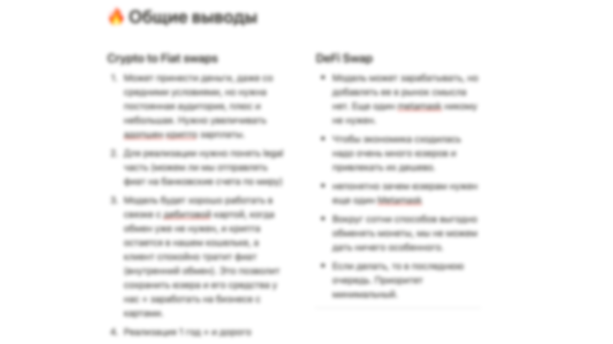
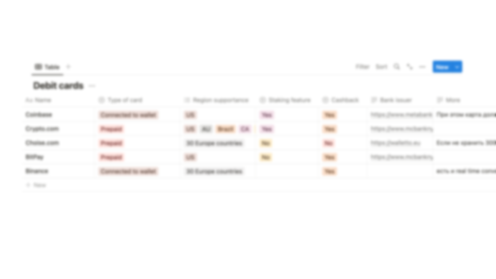
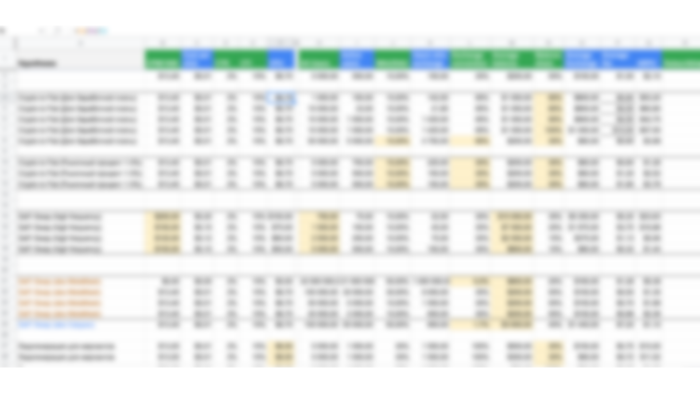
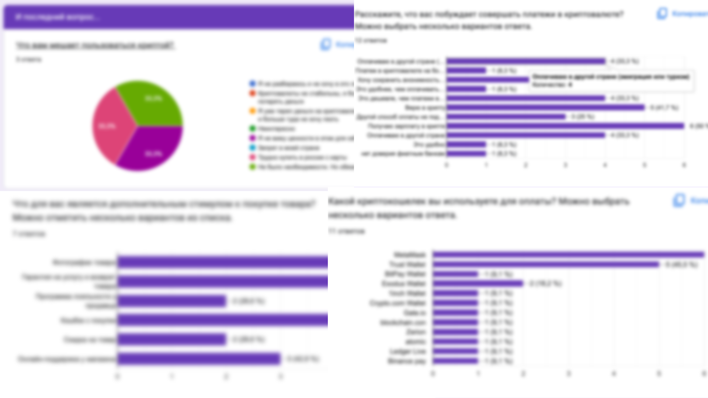

# Запуск криптокошелька

Исследовал и разработал B2C-криптокошелёк в дополнение к существующим B2B-сервисам. Проанализировал стратегии монетизации и способы удержания пользователей и в итоге получил удобный кошелёк, который бесшовно встраивается в текущие платёжные процессы.

### Что внутри?

- Ситуация
- Задача
- Как я проводил исследование
- Результаты

## Ситуация

В какой-то момент у продуктовой команды появилась гипотеза делать продукт не только для B2B, но и для B2C. Это сделало бы платёжный процесс для конечных клиентов удобнее. Сейчас они платят через Metamask и Trust Wallet, а смогут платить нашим кошельком. Так мы смогли бы забирать их клиентов себе.

---

## Задача

Так появилась задача исследовать криптовалюты. Нужно было понять несколько вещей:

- Как они монетизируются.
- Как они удерживают пользователей внутри
- Какие проблемы возникают при их использовании

## Как я проводил исследование

---

1. **Написал сценарий и провёл несколько интервью с сотрудниками**

На этом этапе я поговорил с теми, у кого есть опыт использования криптовалют. Важно было понять:

- какие сценарии использования существуют
- С какими проблемами сталкиваются пользователи

---

1. **Создал опрос и разослал его по чатам**

Чтобы получить более репрезентативные результаты, я создал опрос и отправил его в криптовалютные чаты.

Опрос позволил понять:

- какой кошелёк самый популярный
- какая проблема встречается чаще всего
- причины, по которым люди пользуются кошельками

---

1. **Исследовал способы монетизации кошельков**

1) На этом этапе я скачал около 20 приложений разных кошельков и вручную посмотрел, какая у них функциональность и где спрятана их выручка.

2) Прочитал в исследованиях об основных бизнес-моделях кошельков

Так я узнал, что почти все кошельки опираются на 2–3 источника дохода

---

**4. Посчитал примерную экономику**

Узнав о комиссиях и примерном числе пользователей, я посчитал примерный уровень дохода по каждой бизнес-модели

**Вот что я понял из экономики:**

- Большинство бизнес-моделей нежизнеспособны без партнёрств, на которых мы потеряем маржу.
- Чтобы компенсировать потери, нужно либо разработать собственное решение, либо расширять воронку, тратясь на маркетинг
- Для успеха нужны партнёрства с мерчантами, которые дают регулярные/частые услуги. Так, например, сделала Binance.

---

1. **Исследовал удержание пользователей**

В качестве функции, которая могла бы удерживать пользователей в кошельке, я предположил каталог мерчантов. У Тинькофф Банка есть вкладка, где клиент может тратить деньги на кино, авиабилеты, медицину и так далее. Я хотел сделать похожую вещь в кошельке. Для этого:

- изучил техническую реализацию разных решений
- нарисовал пользовательский сценарий конкурентов с похожими решениями

На ту же функцию также претендовали криптодебетовая карта и стейкинг/лендинг криптовалюты. Поэтому здесь я тоже сравнил несколько конкурентных решений.

---

1. **Написал выводы исследования**

## Результаты

1. По результатам исследования началась разработка кошелька
