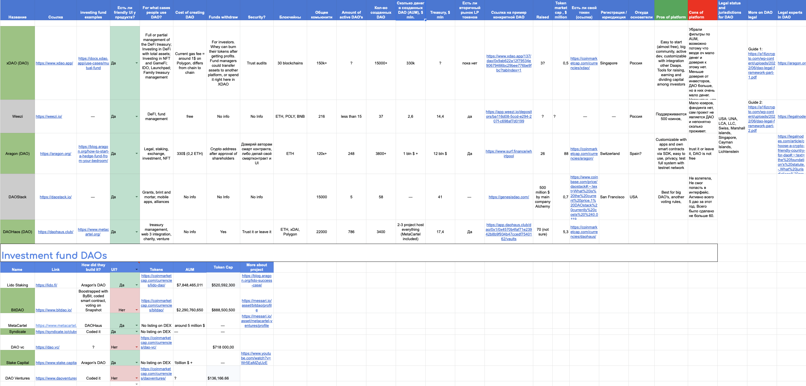
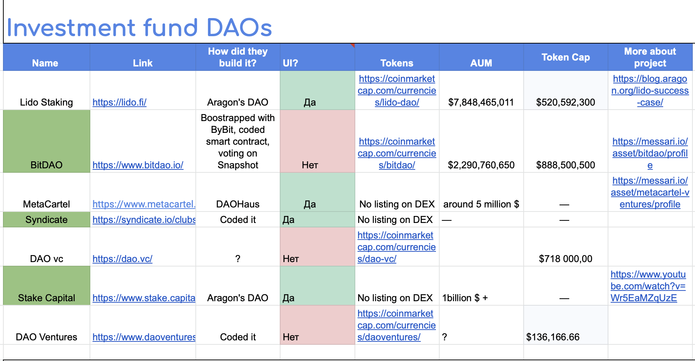
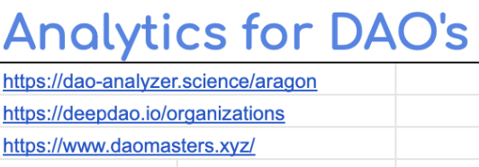

# What is DAO and how to launch one

Conducted comprehensive research on DAO platforms and investment-focused DAOs for a founder exploring the creation of a DAO-based fund. Evaluated various platforms by registering accounts, testing functionalities, and comparing features to provide actionable insights for informed decision-making.

### What’s inside?

- Situation
- Task
- How I conducted research
- Results

## Situation

After researching investment funds, a founder I know had a hypothesis about creating a fund based on DAO. We decided to test it through research.

---

## Task

The founder gave me the task to find all the platforms for creating DAOs and compare them according to my own criteria, which will help to see the picture objectively. And also to find examples of DAOs aimed at investments and structured as funds.

---

## How I conducted research

---

1. **Finding all the DAO platforms**

Moving from link to link, I've collected all the working platforms that allow you to build a smart contract organization.

---

2. **Registered accounts everywhere**

To see if they work at all, I plugged test networks into a cryptocurrency wallet, minted test tokens and went to create DAOs on different platforms.

---

1. **Found analytics platforms**

In order to assess the reliability of platforms, I decided to look for platforms like Crunchbase, only for DAOs: to look at revenue, funding, and customers. Such an analysis would make it possible to assess the general state of this niche.

---

1. **Identified criteria for evaluating DAO platforms**

My reasoning is that in DAOs money is stored, so one of the criteria should be the funds inside the created DAOs (treasury), as well as: the cost of creating the Dao, assets under management (AUM), supported blockchains, the size of the community, the number of clients, and the working support.

---

1. **I found examples of investment DAOs**

Since it was originally planned to make an investment fund, it was necessary to find examples of similar organizations launched in the format of DAO.

---

1. **Selected favorites based on identified criteria**

The number of active DAOs, the amount of money inside the smart contracts, a large community and working support. This made it possible to choose the two leading platforms.

---

1. **Structured the data into one table**

---

1. **Presented the result of the study to the funder**

---

## Results

- To create an investment fund, the DAO structure was chosen
- The fund was successfully launched

---

The whole amount of work looked something like this.
