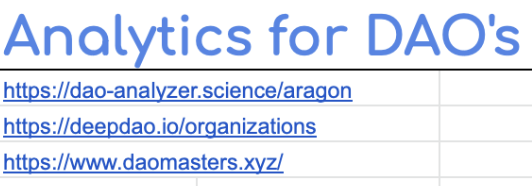
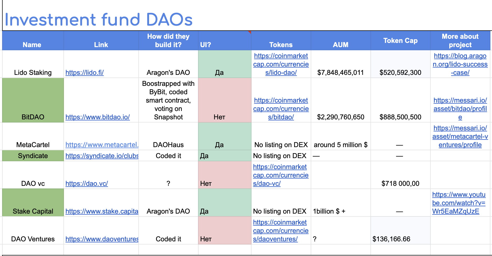
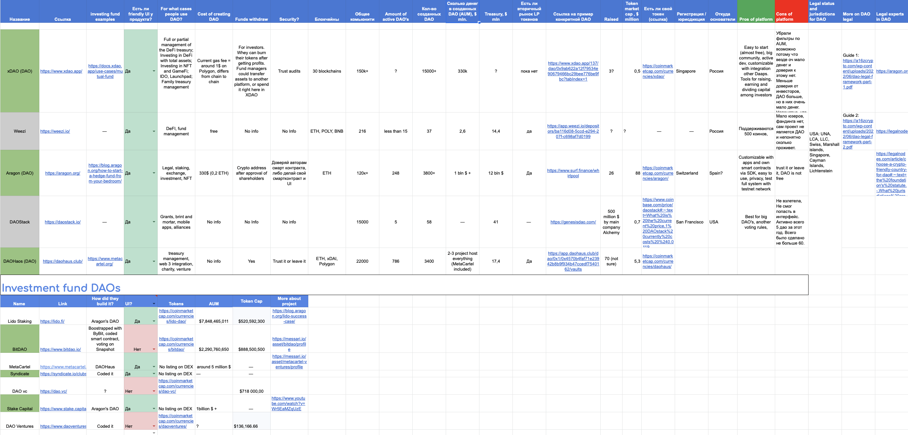

# What is DAO and how to launch one

Conducted comprehensive research on DAO platforms and investment-focused DAOs for a founder exploring the creation of a DAO-based fund. Evaluated various platforms by registering accounts, testing functionalities, and comparing features to provide actionable insights for informed decision-making.

### What’s inside?

- Situation
- Task
- How I conducted research
- Results

## Situation

After researching investment funds, a founder I know had a hypothesis about creating a fund based on DAO. We decided to test it through research.

## Task

The founder gave me the task to find all the platforms for creating DAOs and compare them according to my own criteria, which will help to see the picture objectively. And also to find examples of DAOs aimed at investments and structured as funds.

## How I conducted research

1. Finding all the DAO platforms

Moving from link to link, I've collected all the working platforms that allow you to build a smart contract organization.

2. Registered accounts everywhere

To see if they work at all, I plugged test networks into a cryptocurrency wallet, minted test tokens and went to create DAOs on different platforms.

1. Found analytics platforms

In order to assess the reliability of platforms, I decided to look for platforms like Crunchbase, only for DAOs: to look at revenue, funding, and customers. Such an analysis would make it possible to assess the general state of this niche.

| Name | Link | Investing fund examples | Friendly UI | Use cases | Cost to create | Funds withdraw | Security | Blockchains | Community | Active DAOs | DAOs created | AUM, $ mln | Treasury, $ mln | Secondary LP market | Example DAO |
| --- | --- | --- | --- | --- | --- | --- | --- | --- | --- | --- | --- | --- | --- | --- | --- |
| xDAO (DAO) | https://www.xdao.app/ | https://docs.xdao.app/use-cases/mutual-fund | Да | Full or partial management of the DeFi treasury; Investing in DeFi with total assets; Investing in NFT and GameFi; IDO, Launchpad; Family treasury management | Current gas fee = around 1$ on Polygon, differs from chain to chain | For investors. They can burn their tokens after getting profits. Fund managers could transfer assets to another platform, or spend it right here in XDAO | Trust audits | 30 blockchains | 150k+ | ? | 15000+ | 330k | ? | пока нет | https://www.xdao.app/137/dao/0x9ab622a12f79534e90679466bc29bee776be9fbc?tabIndex=1 |
| Weezi | https://weezi.io/ | — | Да | DeFi, fund management | free | No info | No Info | ETH, POLY, BNB | 216 | less than 15 | 37 | 2,6 | 14,4 | да | https://app.weezi.io/depositors/ba116d08-5ccd-e294-207f-c698af7d0199 |
| Aragon (DAO) | https://aragon.org/ | https://blog.aragon.org/how-to-start-a-hedge-fund-from-your-bedroom/ | Да | Legal, staking, exchange, investment, NFT | 330$ (0,2 ETH) | Crypto address after approval of shareholders | Доверяй авторам смарт контракта, либо делай свой смартконтракт и UI | ETH | 120k+ | 248 | 3800+ | 1 bln $ + | 12 bln $ | Да | https://www.surf.finance/whirlpool |
| DAOStack | https://daostack.io/ | — | Да | Grants, brint and mortar, mobile apps, alliances | No info | No Info | No info | | 15000 | 5 | 58 | — | 41 | — | https://genesisdao.com/ |
| DAOHaus (DAO) | https://daohaus.club/ | https://www.metacartel.org/ | Да | treasury management, web 3 integration, charity, venture | No info | Yes | Trust it or leave it | ETH, xDAI, Polygon | 22000 | 786 | 3400 | 2-3 project host everything (MetaCartel included) | 17,4 | Да | https://app.daohaus.club/dao/0x1/0x4570b4faf71e23942b8b9f934b47ccedf7540162/vaults |

1. Identified criteria for evaluating DAO platforms

My reasoning is that in DAOs money is stored, so one of the criteria should be the funds inside the created DAOs (treasury), as well as: the cost of creating the Dao, assets under management (AUM), supported blockchains, the size of the community, the number of clients, and the working support.

1. I found examples of investment DAOs

| Name | Link | How did they build it? | UI? | Tokens | AUM | Token Cap | More about project |
| --- | --- | --- | --- | --- | --- | --- | --- |
| Lido Staking | https://lido.fi/ | Aragon's DAO | Да | https://coinmarketcap.com/currencies/lido-dao/ | $7,848,465,011 | $520,592,300 | https://blog.aragon.org/lido-success-case/ |
| BitDAO | https://www.bitdao.io/ | Boostrapped with ByBit, coded smart contract, voting on Snapshot | Нет | https://coinmarketcap.com/currencies/bitdao/ | $2,290,760,650 | $888,500,500 | https://messari.io/asset/bitdao/profile |
| MetaCartel | https://www.metacartel. | DAOHaus | Да | No listing on DEX | around 5 million $ | — | https://messari.io/asset/metacartel-ventures/profile |
| Syndicate | https://syndicate.io/clubs | Coded it | Да | No listing on DEX | — | — | |
| DAO vc | https://dao.vc/ | ? | Нет | https://coinmarketcap.com/currencies/dao-vc/ | | $718 000,00 | |
| Stake Capital | https://www.stake.capita | Aragon's DAO | Да | No listing on DEX | 1billion $ + | — | https://www.youtube.com/watch?v=Wr5EaMZqUzE |
| DAO Ventures | https://www.daoventures | Coded it | Нет | https://coinmarketcap.com/currencies/daoventures/ | ? | $136,166.66 | |

Since it was originally planned to make an investment fund, it was necessary to find examples of similar organizations launched in the format of DAO.

1. Selected favorites based on identified criteria

The number of active DAOs, the amount of money inside the smart contracts, a large community and working support. This made it possible to choose the two leading platforms.

1. Structured the data into one table

1. Presented the result of the study to the funder

## Results

- To create an investment fund, the DAO structure was chosen
- The fund was successfully launched

The whole amount of work looked something like this.
