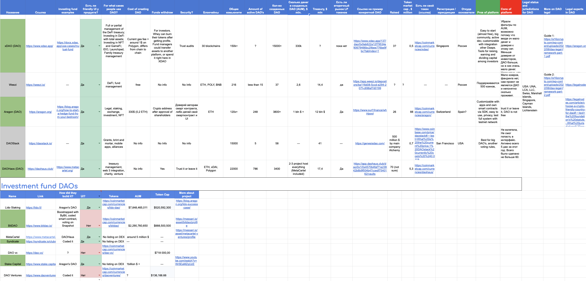
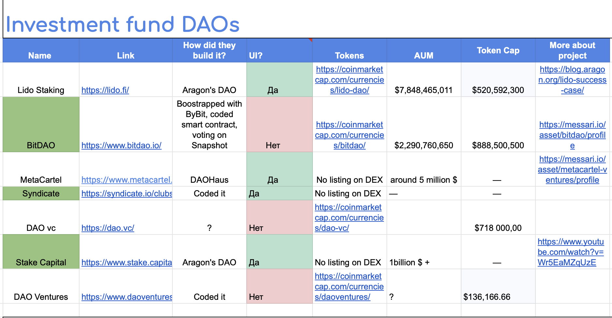
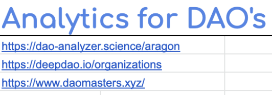

# Что такое DAO и как запустить

Провёл комплексное исследование DAO-платформ и инвестиционных DAO для основателя, который рассматривает создание фонда на базе DAO. Оценил разные платформы: регистрировал аккаунты, проверял функциональность и сравнивал возможности, чтобы дать прикладные выводы для взвешенного решения.

### Что внутри?

- Ситуация
- Задача
- Как я проводил исследование
- Результаты

## Ситуация

После исследования инвестиционных фондов у знакомого мне основателя появилась гипотеза создать фонд на базе DAO. Мы решили проверить её исследованием.

## Задача

Основатель поставил мне задачу найти все платформы для создания DAO и сравнить их по моим собственным критериям, которые помогут увидеть картину объективно. А также найти примеры DAO, нацеленных на инвестиции и устроенных как фонды.

## Как я проводил исследование

1. **Поиск всех DAO-платформ**

Переходя от ссылки к ссылке, я собрал все работающие платформы, которые позволяют собрать организацию на смарт-контракте.

2. **Зарегистрировал аккаунты везде**

Чтобы понять, работают ли они вообще, я подключил тестовые сети к криптовалютному кошельку, наминтил тестовые токены и пошёл создавать DAO на разных платформах.

1. **Нашёл аналитические платформы**

Чтобы оценить надёжность платформ, я решил поискать платформы вроде Crunchbase, только для DAO: посмотреть выручку, финансирование и клиентов. Такой анализ позволил бы оценить общее состояние этой ниши.

| Name | Link | Investing fund examples | Friendly UI | Use cases | Cost to create | Funds withdraw | Security | Blockchains | Community | Active DAOs | DAOs created | AUM, $ mln | Treasury, $ mln | Secondary LP market | Example DAO |
| --- | --- | --- | --- | --- | --- | --- | --- | --- | --- | --- | --- | --- | --- | --- | --- |
| xDAO (DAO) | https://www.xdao.app/ | https://docs.xdao.app/use-cases/mutual-fund | Да | Full or partial management of the DeFi treasury; Investing in DeFi with total assets; Investing in NFT and GameFi; IDO, Launchpad; Family treasury management | Current gas fee = around 1$ on Polygon, differs from chain to chain | For investors. They can burn their tokens after getting profits. Fund managers could transfer assets to another platform, or spend it right here in XDAO | Trust audits | 30 blockchains | 150k+ | ? | 15000+ | 330k | ? | пока нет | https://www.xdao.app/137/dao/0x9ab622a12f79534e90679466bc29bee776be9fbc?tabIndex=1 |
| Weezi | https://weezi.io/ | — | Да | DeFi, fund management | free | No info | No Info | ETH, POLY, BNB | 216 | less than 15 | 37 | 2,6 | 14,4 | да | https://app.weezi.io/depositors/ba116d08-5ccd-e294-207f-c698af7d0199 |
| Aragon (DAO) | https://aragon.org/ | https://blog.aragon.org/how-to-start-a-hedge-fund-from-your-bedroom/ | Да | Legal, staking, exchange, investment, NFT | 330$ (0,2 ETH) | Crypto address after approval of shareholders | Доверяй авторам смарт контракта, либо делай свой смартконтракт и UI | ETH | 120k+ | 248 | 3800+ | 1 bln $ + | 12 bln $ | Да | https://www.surf.finance/whirlpool |
| DAOStack | https://daostack.io/ | — | Да | Grants, brint and mortar, mobile apps, alliances | No info | No Info | No info | | 15000 | 5 | 58 | — | 41 | — | https://genesisdao.com/ |
| DAOHaus (DAO) | https://daohaus.club/ | https://www.metacartel.org/ | Да | treasury management, web 3 integration, charity, venture | No info | Yes | Trust it or leave it | ETH, xDAI, Polygon | 22000 | 786 | 3400 | 2-3 project host everything (MetaCartel included) | 17,4 | Да | https://app.daohaus.club/dao/0x1/0x4570b4faf71e23942b8b9f934b47ccedf7540162/vaults |

1. **Определил критерии оценки DAO-платформ**

Моя логика такая: в DAO хранятся деньги, поэтому одним из критериев должны быть средства внутри созданных DAO (treasury), а также стоимость создания DAO, активы под управлением (AUM), поддерживаемые блокчейны, размер сообщества, число клиентов и работающая поддержка.

1. **Нашёл примеры инвестиционных DAO**

| Name | Link | How did they build it? | UI? | Tokens | AUM | Token Cap | More about project |
| --- | --- | --- | --- | --- | --- | --- | --- |
| Lido Staking | https://lido.fi/ | Aragon's DAO | Да | https://coinmarketcap.com/currencies/lido-dao/ | $7,848,465,011 | $520,592,300 | https://blog.aragon.org/lido-success-case/ |
| BitDAO | https://www.bitdao.io/ | Boostrapped with ByBit, coded smart contract, voting on Snapshot | Нет | https://coinmarketcap.com/currencies/bitdao/ | $2,290,760,650 | $888,500,500 | https://messari.io/asset/bitdao/profile |
| MetaCartel | https://www.metacartel. | DAOHaus | Да | No listing on DEX | around 5 million $ | — | https://messari.io/asset/metacartel-ventures/profile |
| Syndicate | https://syndicate.io/clubs | Coded it | Да | No listing on DEX | — | — | |
| DAO vc | https://dao.vc/ | ? | Нет | https://coinmarketcap.com/currencies/dao-vc/ | | $718 000,00 | |
| Stake Capital | https://www.stake.capita | Aragon's DAO | Да | No listing on DEX | 1billion $ + | — | https://www.youtube.com/watch?v=Wr5EaMZqUzE |
| DAO Ventures | https://www.daoventures | Coded it | Нет | https://coinmarketcap.com/currencies/daoventures/ | ? | $136,166.66 | |

Поскольку изначально планировалось сделать инвестиционный фонд, нужно было найти примеры похожих организаций, запущенных в формате DAO.

1. **Отобрал фаворитов по выявленным критериям**

Число активных DAO, объём денег внутри смарт-контрактов, большое сообщество и работающая поддержка. Это позволило выбрать две лидирующие платформы.

1. **Свёл данные в одну таблицу**

1. **Представил результат исследования фаундеру**

## Результаты

- Для создания инвестиционного фонда выбрали структуру DAO
- Фонд успешно запустили

Весь объём работы выглядел примерно так.
