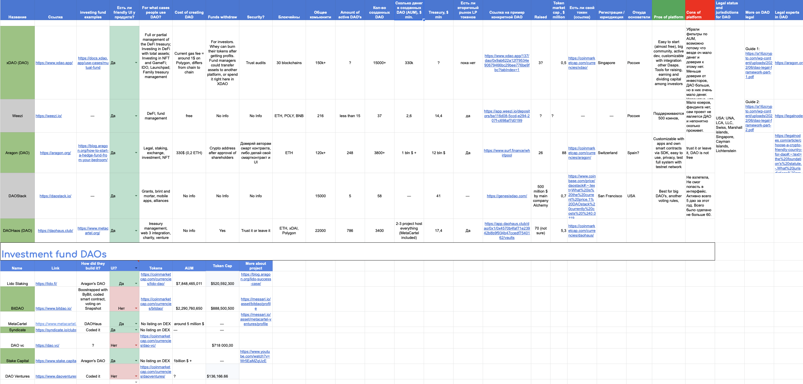
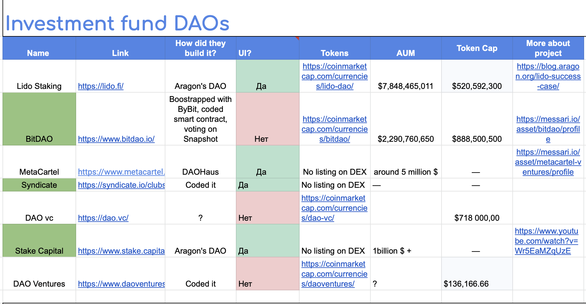
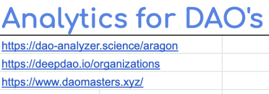

# Что такое DAO и как запустить

Провёл комплексное исследование DAO-платформ и инвестиционных DAO для основателя, который рассматривает создание фонда на базе DAO. Оценил разные платформы: регистрировал аккаунты, проверял функциональность и сравнивал возможности, чтобы дать прикладные выводы для взвешенного решения.

### Что внутри?

- Ситуация
- Задача
- Как я проводил исследование
- Результаты

## Ситуация

После исследования инвестиционных фондов у знакомого мне основателя появилась гипотеза создать фонд на базе DAO. Мы решили проверить её исследованием.

---

## Задача

Основатель поставил мне задачу найти все платформы для создания DAO и сравнить их по моим собственным критериям, которые помогут увидеть картину объективно. А также найти примеры DAO, нацеленных на инвестиции и устроенных как фонды.

---

## Как я проводил исследование

---

1. **Поиск всех DAO-платформ**

Переходя от ссылки к ссылке, я собрал все работающие платформы, которые позволяют собрать организацию на смарт-контракте.

---

2. **Зарегистрировал аккаунты везде**

Чтобы понять, работают ли они вообще, я подключил тестовые сети к криптовалютному кошельку, наминтил тестовые токены и пошёл создавать DAO на разных платформах.

---

1. **Нашёл аналитические платформы**

Чтобы оценить надёжность платформ, я решил поискать платформы вроде Crunchbase, только для DAO: посмотреть выручку, финансирование и клиентов. Такой анализ позволил бы оценить общее состояние этой ниши.

---

1. **Определил критерии оценки DAO-платформ**

Моя логика такая: в DAO хранятся деньги, поэтому одним из критериев должны быть средства внутри созданных DAO (treasury), а также стоимость создания DAO, активы под управлением (AUM), поддерживаемые блокчейны, размер сообщества, число клиентов и работающая поддержка.

---

1. **Нашёл примеры инвестиционных DAO**

Поскольку изначально планировалось сделать инвестиционный фонд, нужно было найти примеры похожих организаций, запущенных в формате DAO.

---

1. **Отобрал фаворитов по выявленным критериям**

Число активных DAO, объём денег внутри смарт-контрактов, большое сообщество и работающая поддержка. Это позволило выбрать две лидирующие платформы.

---

1. **Свёл данные в одну таблицу**

---

1. **Представил результат исследования фаундеру**

---

## Результаты

- Для создания инвестиционного фонда выбрали структуру DAO
- Фонд успешно запустили

---

Весь объём работы выглядел примерно так.
