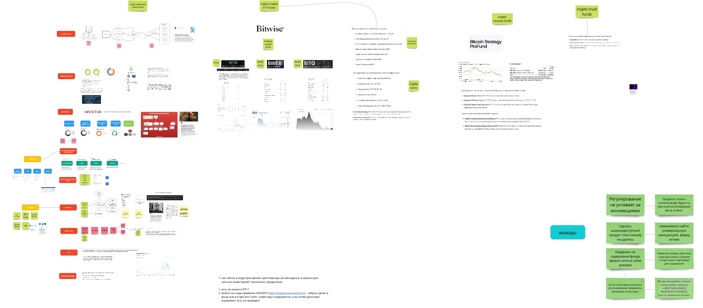
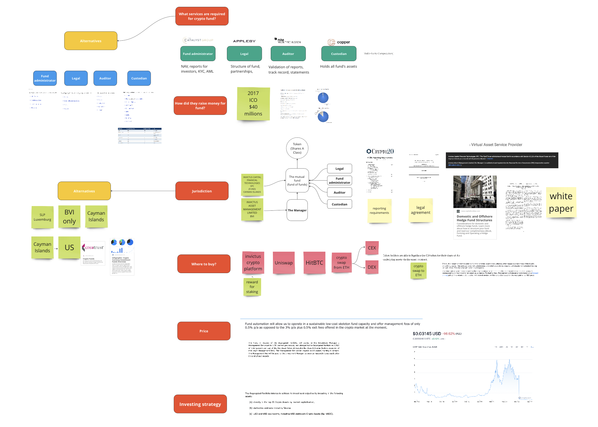
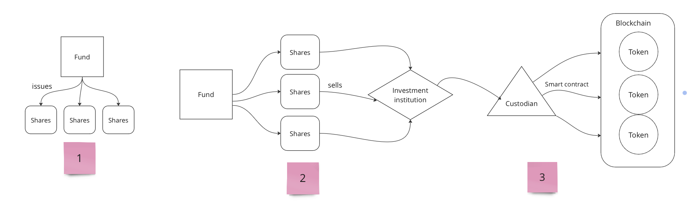

# GTM Strategy for Crypto Investment Fund

Developed a comprehensive go-to-market strategy for a crypto investment fund by researching global best practices and analyzing leading companies' strategies and asset compositions. Delivered actionable insights and a structured plan, enabling the founder to successfully launch the fund.

### What’s inside?

- Situation
- Task
- How I conducted research
- Results

## Situation

Through old contacts, I was approached by an investtech founder I knew who wanted to launch a cryptocurrency investment fund. He came to me because we knew each other from my past work, and he knew that I was doing research.

## Task

The founder had a working investment strategy and wanted to launch a fund on it. To do this, he instructed me to research all possible ways to implement a cryptocurrency investment fund, gathering "best practices" from around the world and then present it in the form of a presentation.

## How I conducted research

---

1. **Collected links from the top results**

First, I just opened all the links that the search engine showed for the result "crypto investment funds". From there I managed to find out the following:

- Examples of such projects exist and are implemented even in the US (where regulation is at a serious level)

---

2. **I highlighted the main providers**

After following a dozen links, I managed to find out:

- What companies are in the business of creating crypto funds
- What is their strategy and what assets are contained in the fund

---

1. **Discovered how these products differ from each other**
- For example, that some funds invest in blockchain companies, some in cryptocurrencies, and others in crypto derivatives.
- Some funds are available to any investor through traditional brokers, and some have tokenized shares in the form of a coin on the blockchain.

---

1. **Getting into asset tokenization**

Here I had to figure out what asset tokenization is, and how such funds attract and manage assets. It turns out that:

- Money is raised in the fund through ICO/IDO/IEO
- Found [guides](https://www.theia.org/fundoperations/tokenisedfunds) on asset tokenization from an entire financial association
- Drew a schematic drawing of tokenization and gave an example of a provider who uses such a scheme

---

1. **Identified the parameters without which an investment fund cannot exist**

Gradually I gathered more parameters that relate to the creation of an investment fund: listing, jurisdiction, custodians, market makers, asset structure, fund administrators, auditors, etc.

---

1. **Structured this information on the Miro board.**

I did this so that the story would be coherent and consistent, and it would be easier to present the research.

---

1. **Made conclusions for myself.**

---

1. **Presented the result of the work to the partners**

Started with examples of funds in traditional finance and gradually switched to tokenized funds, in which the entire infrastructure and the stock itself is on blockchain in the form of a smart contract

---

## Results

- The partners of the founder decided to launch an investment fund, but to find a different legal and technical structure.

---

On the board below is a complete picture along with the conclusions

