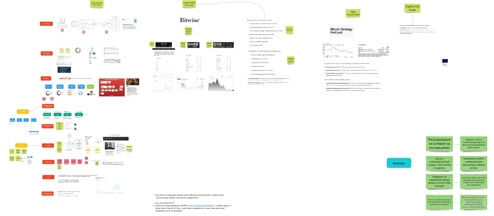
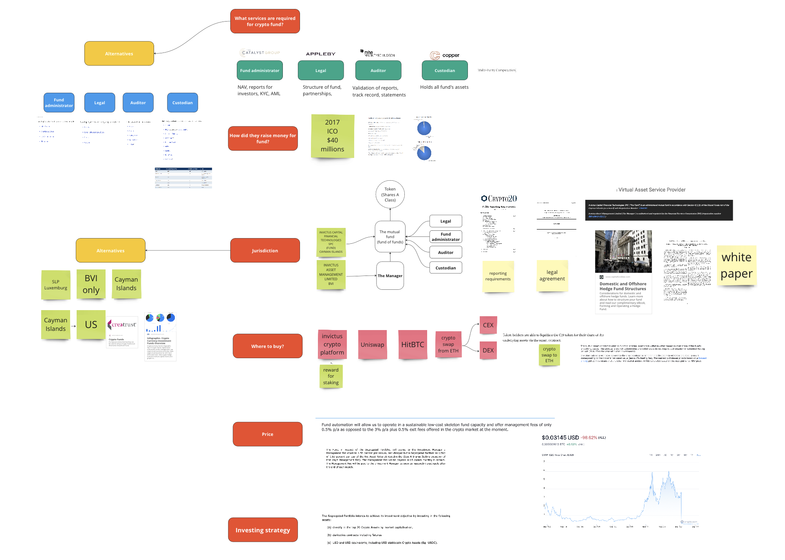
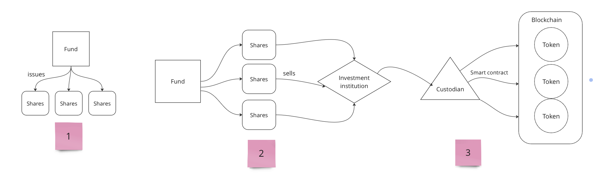

# GTM-стратегия для криптоинвестиционного фонда

Разработал комплексную go-to-market стратегию для криптоинвестиционного фонда, изучив лучшие мировые практики и разобрав стратегии и состав активов ведущих компаний. Подготовил прикладные выводы и структурированный план, благодаря которым основатель смог успешно запустить фонд.

### Что внутри?

- Ситуация
- Задача
- Как я проводил исследование
- Результаты

## Ситуация

Через старые контакты ко мне обратился знакомый основатель из investtech, который хотел запустить криптовалютный инвестиционный фонд. Он пришёл ко мне, потому что мы были знакомы по моей прошлой работе, и он знал, что я занимаюсь исследованиями.

## Задача

У основателя была рабочая инвестиционная стратегия, и он хотел запустить на ней фонд. Для этого он поручил мне исследовать все возможные способы реализовать криптовалютный инвестиционный фонд, собрать «лучшие практики» со всего мира и затем представить это в виде презентации.

## Как я проводил исследование

---

1. **Собрал ссылки из топа выдачи**

Сначала я просто открыл все ссылки, которые поисковик показывал по запросу «crypto investment funds». Оттуда удалось выяснить следующее:

- Примеры таких проектов существуют и реализованы даже в США (где регулирование на серьёзном уровне)

---

2. **Выделил основных провайдеров**

Пройдя по десятку ссылок, удалось выяснить:

- Какие компании занимаются созданием криптофондов
- Какова их стратегия и какие активы входят в фонд

---

1. **Выяснил, чем эти продукты отличаются друг от друга**
- Например, одни фонды инвестируют в блокчейн-компании, другие в криптовалюты, третьи в криптодеривативы.
- Одни фонды доступны любому инвестору через традиционных брокеров, а у других токенизированные доли в виде монеты на блокчейне.

---

1. **Разобрался в токенизации активов**

Здесь нужно было понять, что такое токенизация активов и как такие фонды привлекают активы и управляют ими. Оказалось, что:

- Деньги в фонд привлекают через ICO/IDO/IEO
- Нашёл [гайды](https://www.theia.org/fundoperations/tokenisedfunds) по токенизации активов от целой финансовой ассоциации
- Нарисовал схему токенизации и привёл пример провайдера, который использует такую схему

---

1. **Определил параметры, без которых инвестиционный фонд не может существовать**

Постепенно я собрал ещё параметры, которые относятся к созданию инвестиционного фонда: листинг, юрисдикция, кастодианы, маркетмейкеры, структура активов, администраторы фонда, аудиторы и т.д.

---

1. **Структурировал эту информацию на доске Miro.**

Я сделал это, чтобы история была связной и последовательной и исследование было проще презентовать.

---

1. **Сделал выводы для себя.**

---

1. **Представил результат работы партнёрам**

Начал с примеров фондов в традиционных финансах и постепенно перешёл к токенизированным фондам, у которых вся инфраструктура и сама доля находятся на блокчейне в виде смарт-контракта

---

## Результаты

- Партнёры основателя решили запустить инвестиционный фонд, но найти другую юридическую и техническую структуру.

---

На доске ниже полная картина вместе с выводами

