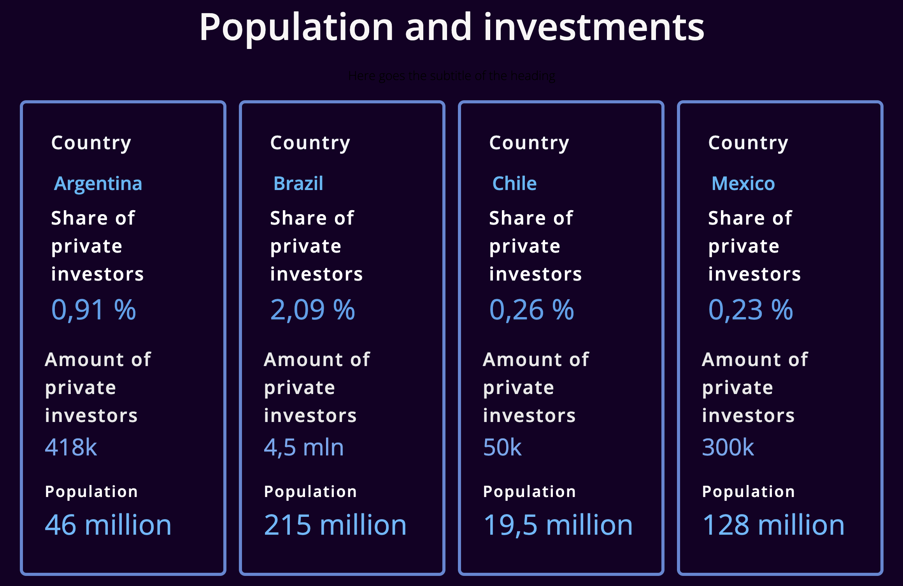

# Market Discovery for a Tech Startup Expansion in Latin America

Conducted market research on five Latin American countries for a fintech expansion. Identified Argentina as the best opportunity, leading to a successful startup launch in the stock market prediction space.

---

### **Problem**

A fintech entrepreneur with experience in **crypto, stock exchanges, and financial markets** wanted to expand into **Latin America** but lacked **data-driven insights** on which country offered the best opportunity. His goal was to identify:

- The **fastest-growing economies** with strong fintech potential.
- The **level of banking and brokerage adoption** in different markets.
- The **ease of doing business** and competitive landscape in top LATAM countries.

Given my expertise in **fintech market research and product discovery**, he hired me to **analyze five Latin American countries** and determine the best location for his tech startup.

### **Action**

To conduct a **comprehensive market assessment**, I:

1. **Collected & Analyzed Macroeconomic Data**
    - Researched **central bank reports** and **government statistics** for key metrics:
        - **Population, GDP, financial assets, stock market participation, banking adoption, and fintech growth rates.**
    - Used **translations** to extract and compare data across countries.
2. **Evaluated Competitive Landscape**
    - Analyzed **existing fintech players** and the **level of market saturation** in Brazil, Mexico, Argentina, Chile, and Colombia.
    - Considered **regulatory frameworks, business costs, and expansion challenges.**
3. **Recommended the Best Market: Argentina**
    - **Brazil and Mexico were too competitive and expensive** for an early-stage launch.
    - **Argentina had a growing fintech adoption rate** and a favorable business environment at the time.
    - The **political and economic climate** under the new president made it a promising bet.

### **Result**

- **Argentina was chosen as the launch market**, providing an optimal balance of growth potential and business feasibility.
- The entrepreneur successfully launched a fintech platform that allows users to **trade with virtual currency** based on stock market predictions.
- The startup has since evolved, adapting to market dynamics and user demand.

This project enabled a **data-driven expansion strategy**, ensuring the entrepreneur entered **a market with strong fintech potential and minimal competition risks**.

---

### Links:

Dashboard with collected numbers & sources: [https://monty208.softr.app/latam-investtech-copy?recordId=recOvMSCoSPqQWVkj](https://monty208.softr.app/latam-investtech-copy?recordId=recOvMSCoSPqQWVkj)

