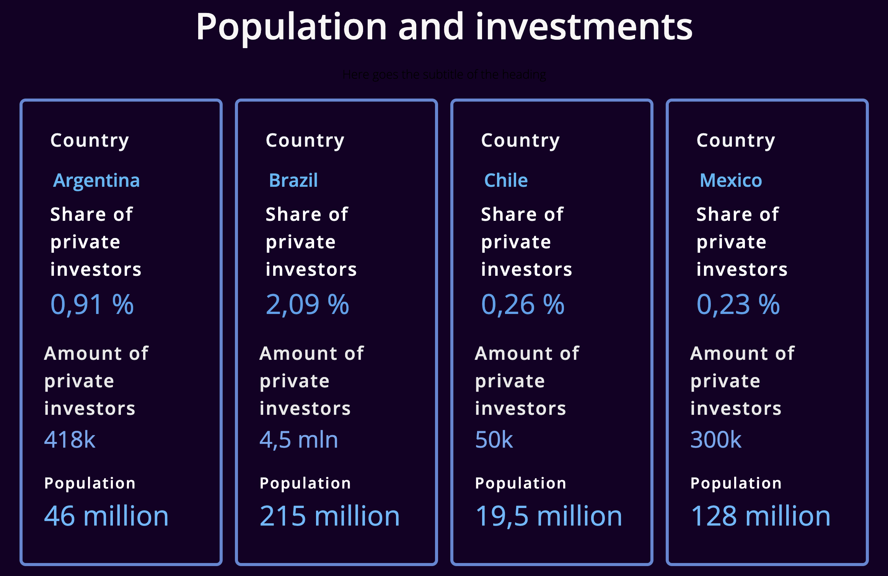

# Исследование рынка для экспансии технологического стартапа в Латинскую Америку

Провёл исследование рынка пяти стран Латинской Америки для финтех-экспансии. Определил Аргентину как лучшую возможность, что привело к успешному запуску стартапа в сфере прогнозов фондового рынка.

---

### **Проблема**

Финтех-предприниматель с опытом в **крипте, фондовых биржах и финансовых рынках** хотел выйти в **Латинскую Америку**, но ему не хватало **выводов на основе данных** о том, какая страна даёт лучшую возможность. Его цель была определить:

- **Самые быстрорастущие экономики** с сильным финтех-потенциалом.
- **Уровень проникновения банков и брокеров** на разных рынках.
- **Простоту ведения бизнеса** и конкурентный ландшафт в ведущих странах LATAM.

С учётом моей экспертизы в **исследовании финтех-рынков и продуктовом поиске** он нанял меня, чтобы **проанализировать пять стран Латинской Америки** и определить лучшее место для его технологического стартапа.

### **Действия**

Чтобы провести **комплексную оценку рынка**, я:

1. **Собрал и проанализировал макроэкономические данные**
    - Изучил **отчёты центральных банков** и **государственную статистику** по ключевым метрикам:
        - **Население, ВВП, финансовые активы, участие в фондовом рынке, банковское проникновение и темпы роста финтеха.**
    - Использовал **переводы**, чтобы извлечь и сопоставить данные по странам.
2. **Оценил конкурентный ландшафт**
    - Проанализировал **действующих финтех-игроков** и **степень насыщенности рынка** в Бразилии, Мексике, Аргентине, Чили и Колумбии.
    - Учёл **регуляторные рамки, стоимость бизнеса и сложности экспансии.**
3. **Рекомендовал лучший рынок: Аргентину**
    - **Бразилия и Мексика были слишком конкурентными и дорогими** для запуска на ранней стадии.
    - **В Аргентине росло проникновение финтеха**, и на тот момент была благоприятная бизнес-среда.
    - **Политический и экономический климат** при новом президенте делал её перспективной ставкой.

### **Результат**

- **Аргентину выбрали рынком запуска**: она давала оптимальный баланс потенциала роста и реализуемости для бизнеса.
- Предприниматель успешно запустил финтех-платформу, на которой пользователи могут **торговать виртуальной валютой** на основе прогнозов фондового рынка.
- С тех пор стартап развивался, подстраиваясь под динамику рынка и спрос пользователей.

Этот проект дал **стратегию экспансии на основе данных** и позволил предпринимателю выйти на **рынок с сильным финтех-потенциалом и минимальными конкурентными рисками**.

---

### Ссылки:

Дашборд с собранными цифрами и источниками: [https://monty208.softr.app/latam-investtech-copy?recordId=recOvMSCoSPqQWVkj](https://monty208.softr.app/latam-investtech-copy?recordId=recOvMSCoSPqQWVkj)

