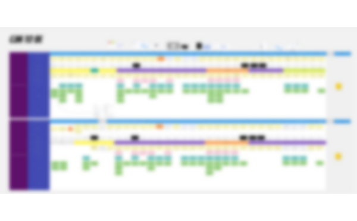
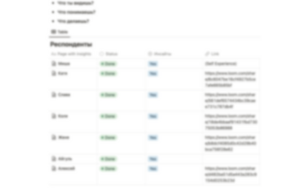
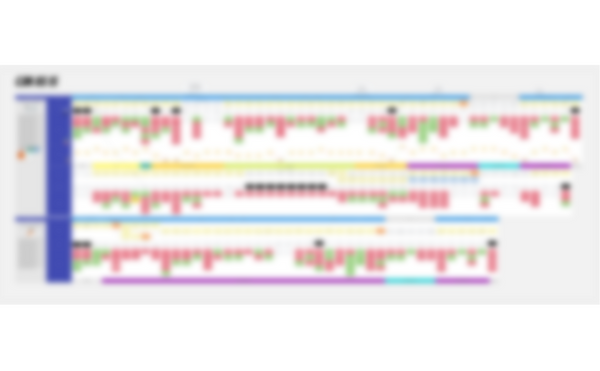
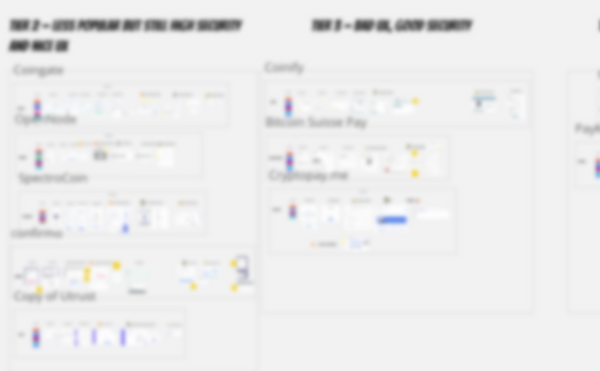

# Designing merchant onboarding

Revamped the merchant onboarding process to expedite Know Your Business (KYB) procedures. Studied competitor practices and streamlined registration, significantly reducing activation time and improving user satisfaction.

### Что внутри?

- Situation
- Task
- What I have done
- Results

## Situation

To use our product, businesses need to go through KYB. And this process with us takes a long time. The user loses a lot of time on registration, authenticators, and doesn't even get into the product yet. Next thing he has to do is upload documents, a process that lasts for days. All this causes him pain.

## Task

We talked to our customers and measured the onboarding time and decided to improve the onboarding process in our product. We measured these changes in onboarding speed in the product + KYB.

## What I have done

1. **Passed the onboarding proccess of our competitors**

In the process, the hypothesis emerged that best practices could be spied on by our major competitors. So I registered everywhere and worked my way up to key product scenarios.

Also, going through onboarding with them allowed me to do several things:

- Know all the steps a customer goes through when registering with a competitor for a product
- determine the step-by-step process that affects the speed of activation and the customer experience as a whole
- understand what steps should be swapped out or eliminated from the registration process to make it easier and more convenient

---

1. **Participated in the process of creating the current CJM**

To understand the bottlenecks in the current process, I gathered information about the process from different teams, including accounts, compliance, and support. We tried to build an overall picture

---

1. **Running product tours and testing them on usability studies**

In addition to the manual onboarding process, the customer could register on the platform himself, and then he had to learn about the product himself. To simplify this process, the hypothesis emerged of adding guides (product tours) to the product, which lead the user to the A-ha moment. To add them:

- I compared different onboarding platforms with each other
- created the first rounds and added them to the test environment with the help of a developer
- called company employees as respondents for testing
- recorded 10 usability studies and wrote out insights

The usability test insights served as fuel for updating the product design and the product tours themselves.

1. **Participated in the design of the new flow onboarding**

Given best practices, I, along with other teams, rebuilt the CJM of the new onboarding process

---

1. **Worked with the registration process**

I had a hypothesis that by adding verification of emails we would reduce the number of "fake registrations". But after spending some time analyzing third-party solutions and the same competitors, I came to the conclusion that fake registrations don't bother us and we should focus on expanding the inbound funnel rather than fighting fakes.

---

## Result

- As a result of the implemented solutions, the time to go through the onboarding process has been reduced several times
- Product tours were launched in our product to support independent customers.
