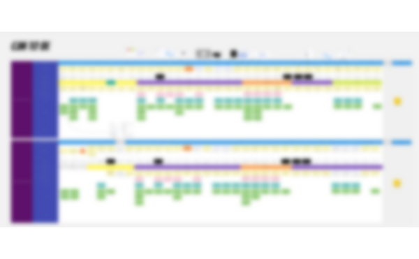
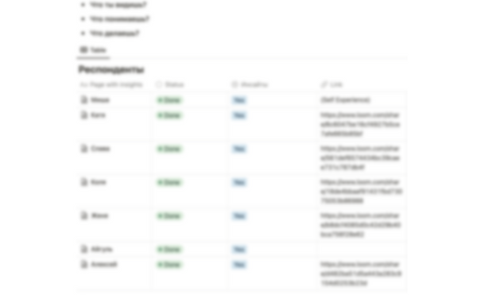
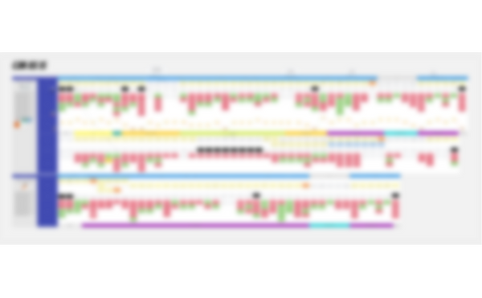
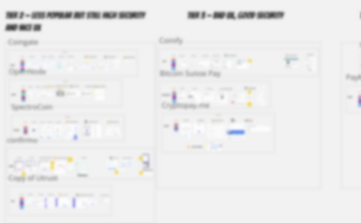

# Проектирование онбординга мерчантов

Переработал процесс онбординга мерчантов, чтобы ускорить процедуры Know Your Business (KYB). Изучил практики конкурентов и упростил регистрацию, существенно сократив время активации и повысив удовлетворённость пользователей.

### Что внутри?

- Ситуация
- Задача
- Что я сделал
- Результаты

## Ситуация

Чтобы пользоваться нашим продуктом, бизнесу нужно пройти KYB. И у нас этот процесс занимает много времени. Пользователь тратит много времени на регистрацию, аутентификаторы и ещё даже не попадает в продукт. Дальше ему нужно загрузить документы, процесс, который длится днями. Всё это причиняет ему боль.

## Задача

Мы поговорили с клиентами, измерили время онбординга и решили улучшить процесс онбординга в нашем продукте. Эти изменения мы измеряли по скорости онбординга в продукте и KYB.

## Что я сделал

1. **Прошёл процесс онбординга наших конкурентов**

В процессе появилась гипотеза, что лучшие практики можно подсмотреть у крупных конкурентов. Я зарегистрировался везде и дошёл до ключевых продуктовых сценариев.

Прохождение онбординга у них также позволило мне сделать несколько вещей:

- Узнать все шаги, которые клиент проходит при регистрации на продукт у конкурента
- определить пошаговый процесс, который влияет на скорость активации и клиентский опыт в целом
- понять, какие шаги стоит поменять местами или убрать из регистрации, чтобы сделать её проще и удобнее

---

1. **Участвовал в создании текущей CJM**

Чтобы понять узкие места текущего процесса, я собрал информацию о процессе у разных команд, включая аккаунты, комплаенс и поддержку. Мы попытались собрать общую картину

---

1. **Запускал продуктовые туры и проверял их на юзабилити-исследованиях**

Помимо ручного процесса онбординга клиент мог зарегистрироваться на платформе сам, а затем ему приходилось разбираться в продукте самостоятельно. Чтобы упростить этот процесс, появилась гипотеза добавить в продукт гайды (продуктовые туры), которые ведут пользователя к моменту «ага». Чтобы их добавить:

- сравнил разные платформы онбординга между собой
- создал первые туры и с помощью разработчика добавил их в тестовую среду
- позвал сотрудников компании как респондентов для тестирования
- записал 10 юзабилити-исследований и выписал инсайты

Инсайты юзабилити-теста стали материалом для обновления дизайна продукта и самих продуктовых туров.

1. **Участвовал в проектировании нового флоу онбординга**

С учётом лучших практик я вместе с другими командами пересобрал CJM нового процесса онбординга

---

1. **Работал с процессом регистрации**

У меня была гипотеза, что проверка email сократит число «фейковых регистраций». Но, потратив некоторое время на анализ сторонних решений и тех же конкурентов, я пришёл к выводу, что фейковые регистрации нас не беспокоят и стоит сосредоточиться на расширении входящей воронки, а не на борьбе с фейками.

---

## Результат

- В результате внедрённых решений время прохождения онбординга сократилось в несколько раз
- В продукте запустили продуктовые туры, чтобы поддерживать самостоятельных клиентов.
