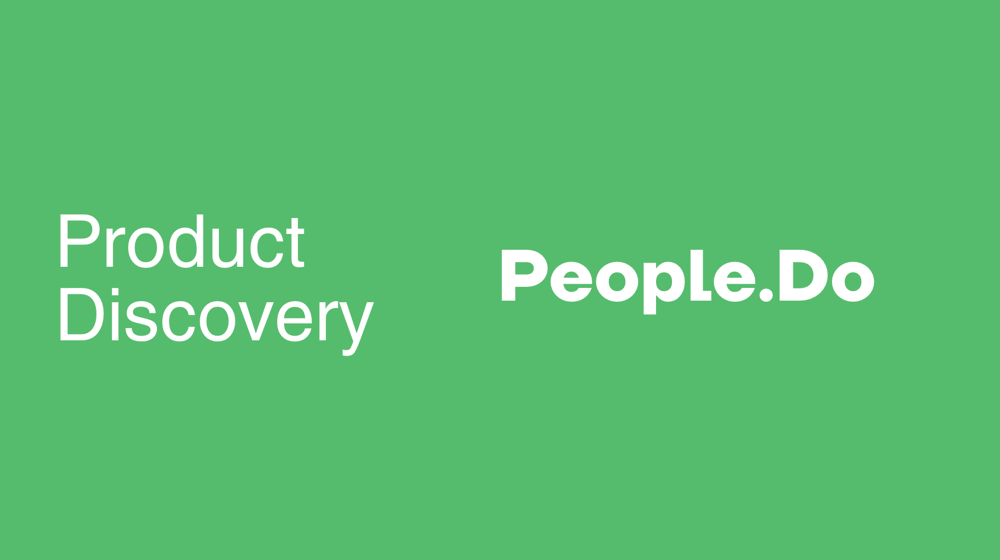
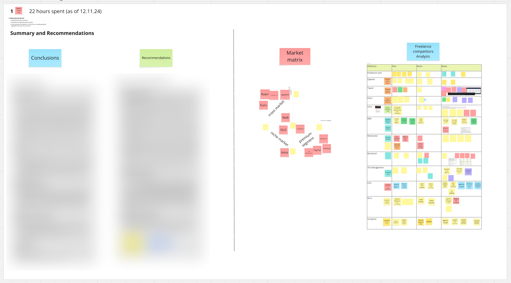
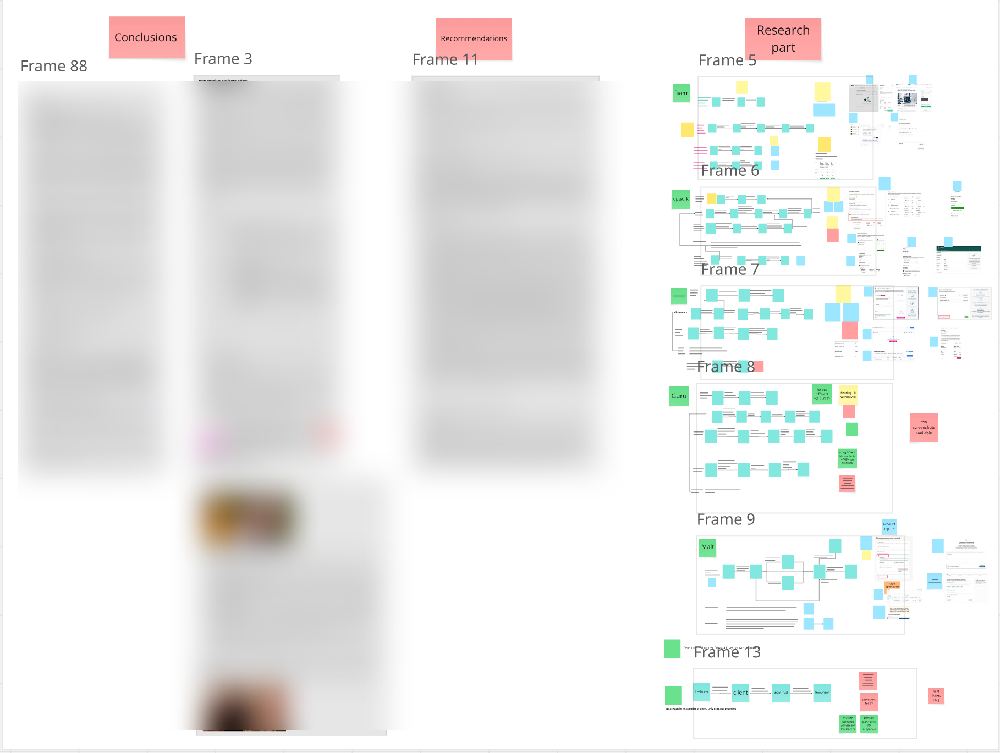
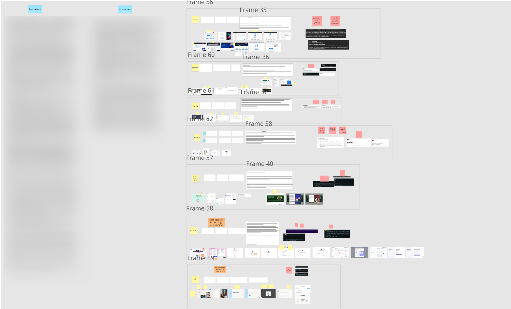
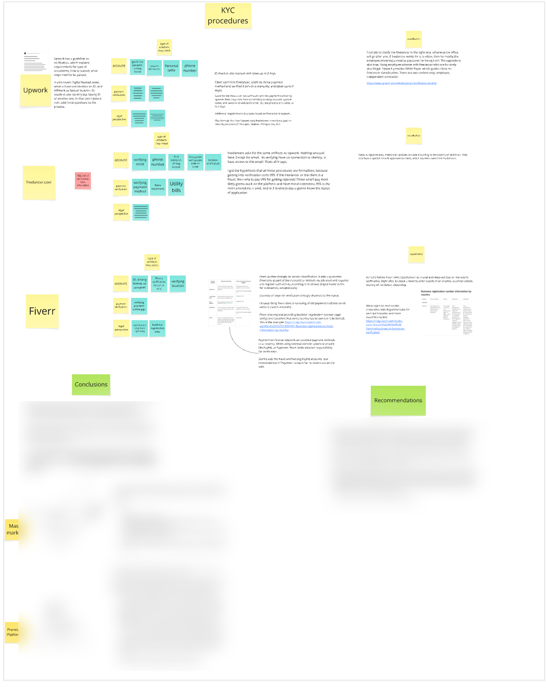
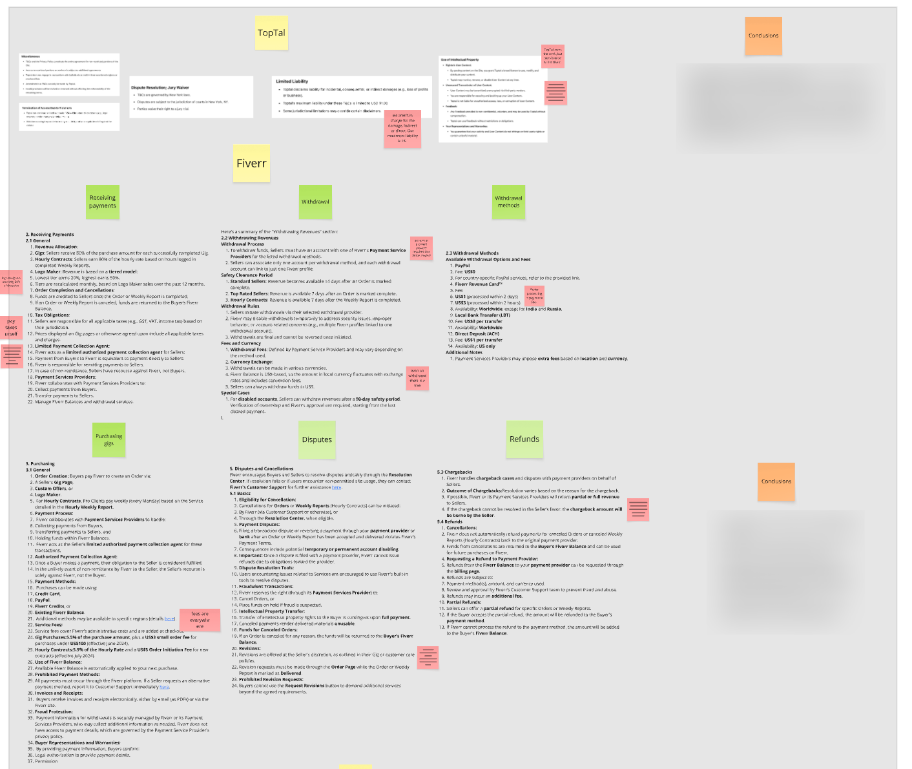
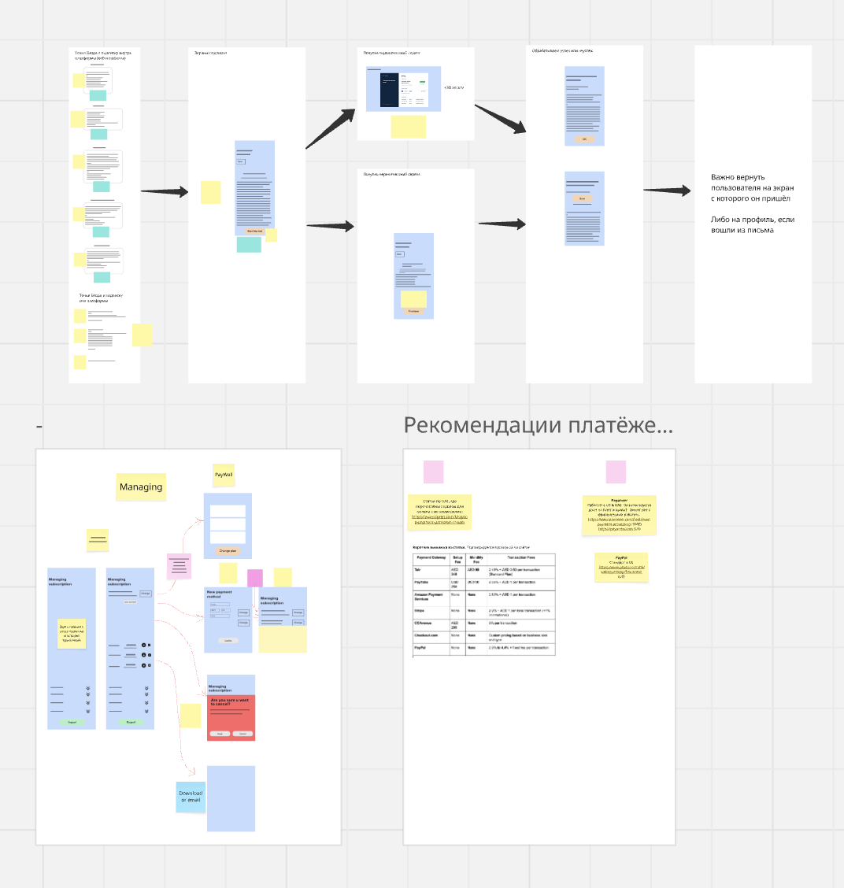

# PeopleDo Discovery

Industry: gigeconomy  
End Date: 2025

**1. Where does the fee sit?**

- Exploring client-paid commission
- Comparing it to freelancer-paid commission
- Actual examples of the platforms. Pros and cons, considering possible regulations in the UAE, UK, EU, and US.

**Definition of Done:** product recommendations with examples of real platforms and best practices.

**2. Paying money to freelancers. Based on one type or profession (e.g. designer)**

- Holding money for freelancers and clients
- Solving disputes, sending money to bank accounts, etc.
- Actual examples of the platforms. Pros, cons.
- Questionnaire for External Cust Dev Researchers + results assessment

**Definition of Done:** examples of real platforms, best practices and user flow diagrams.

**3. Charging for subscription**

- Funnel for charging freelancers/clients.
- Actual examples of the platforms. Pros, cons.
- UX practices, value proposition, etc.
- Questionnaire for External Cust Dev Researchers + Results Assessment

**Definition of Done:** UX references and best development practices.

