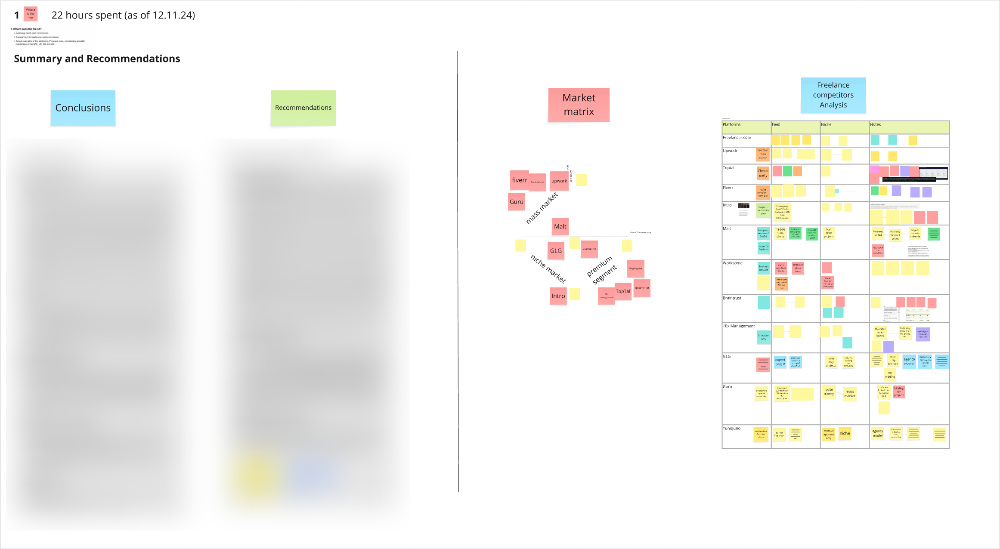
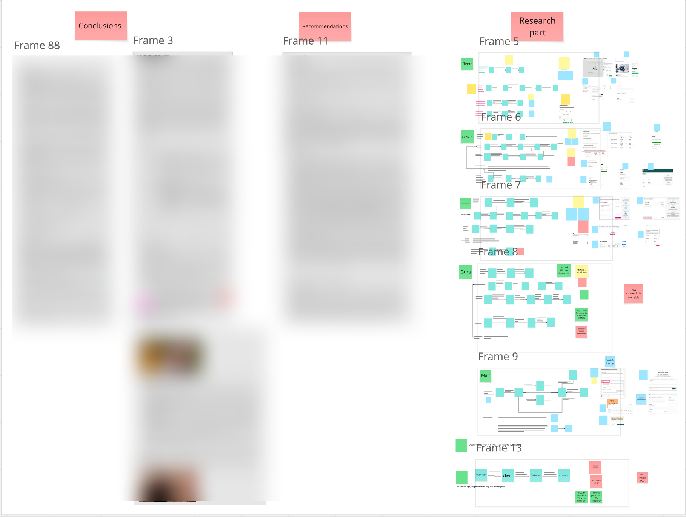
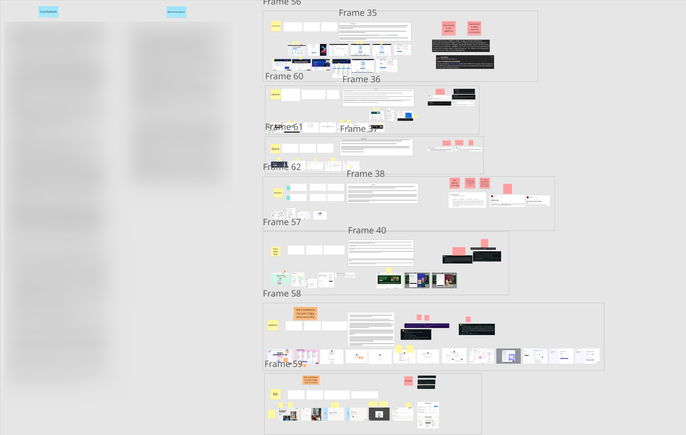
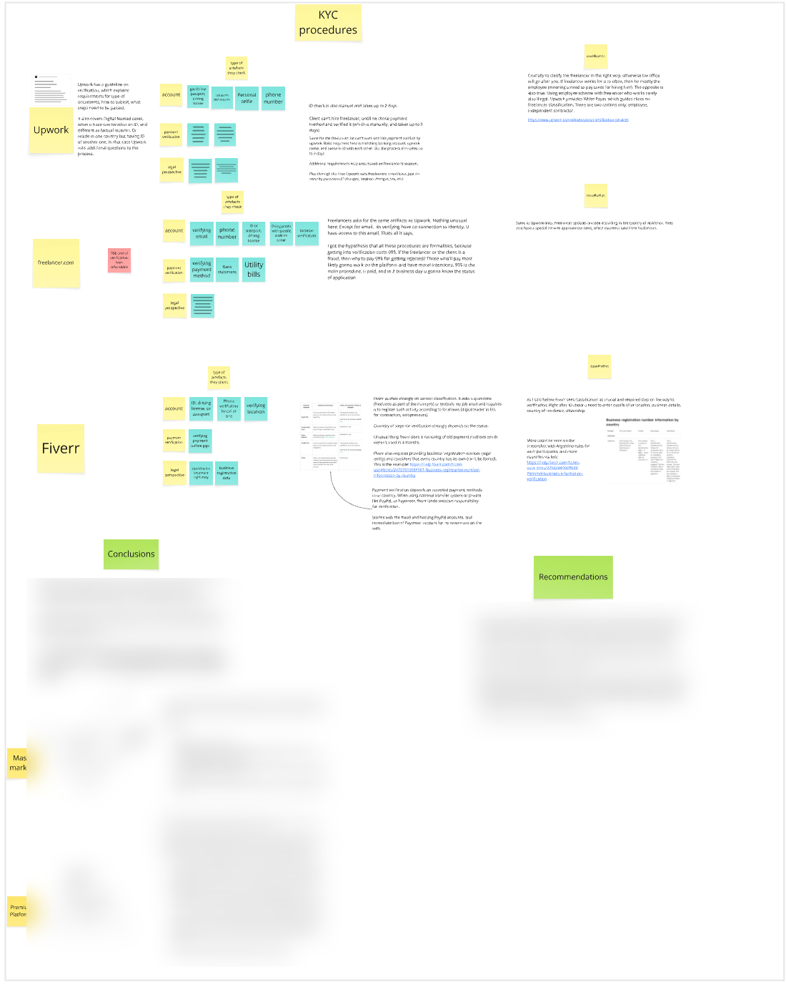
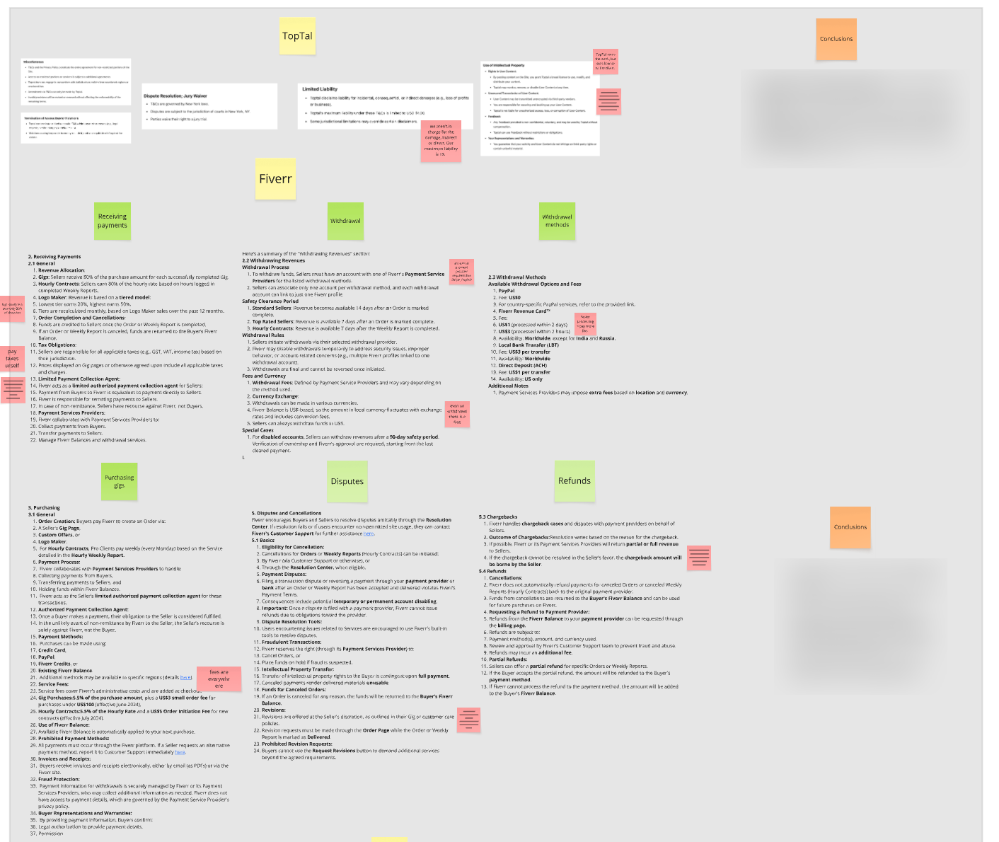
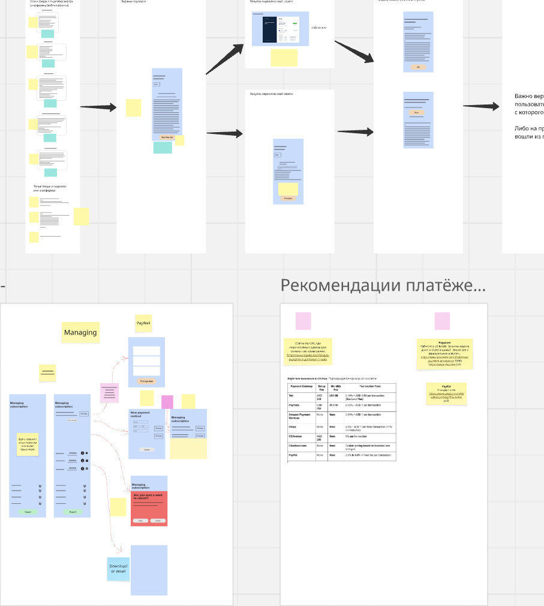

# PeopleDo Discovery

**1. Где сидит комиссия?**

- Изучение комиссии, которую платит клиент
- Сравнение с комиссией, которую платит фрилансер
- Реальные примеры платформ. Плюсы и минусы с учётом регулирования в ОАЭ, Великобритании, ЕС и США

**Definition of Done:** продуктовые рекомендации с примерами реальных платформ и best practices.

**2. Выплаты фрилансерам. На примере одного типа/профессии (например, дизайнер)**

- Хранение денег для фрилансеров и клиентов
- Решение споров, отправка денег на банковские счета и т.д.
- Реальные примеры платформ. Плюсы и минусы
- Опросник для внешних исследователей + оценка результатов

**Definition of Done:** примеры реальных платформ, best practices и user flow диаграммы.

**3. Подписочная модель**

- Воронка списания с фрилансеров/клиентов
- Реальные примеры платформ. Плюсы и минусы
- UX-практики, value proposition и т.д.
- Опросник для внешних исследователей + оценка результатов

**Definition of Done:** UX-референсы и best practices по разработке.

