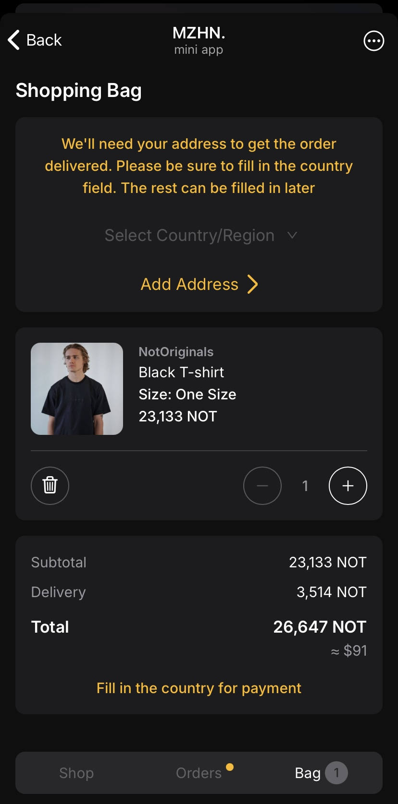
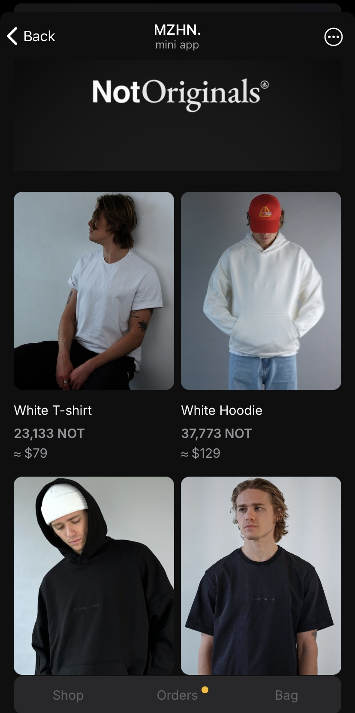
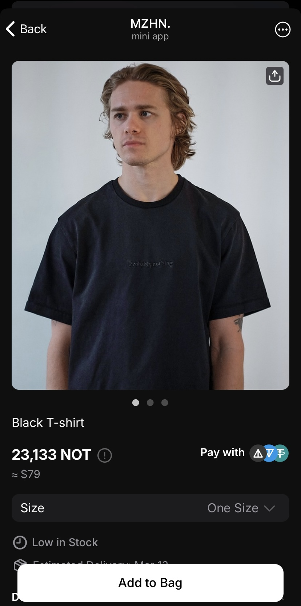

### Problem

After a successful public offering and token listing, notcoin had gathered a massive, highly engaged community. Many users held notcoin from Airdrops and wanted to either sell or hold for future value. However, the project’s team sought a way to monetize the community and create real-world utility for the token beyond speculative trading.

Their vision was to allow users to spend notcoin on official merchandise—essentially functioning like a stock buyback system but in a Web3 ecosystem. To achieve this, they needed to:

- Build a merchandise store inside Telegram as a mini-app.
- Integrate crypto payments while navigating legal and tax complexities.
- Manage production, delivery, and fulfillment logistics at scale.
- Handle customer support efficiently for a large and engaged user base.

Given my expertise in crypto wallets, fintech infrastructure, and product development, they brought me in to design, build, and execute the entire merchandise ecosystem.

### Action

I led the end-to-end development and launch of notcoin’s Telegram-based merchandise store, tackling both technical and operational challenges:

1. Built the Mini-App Store in Telegram
    - Designed and launched a fully functional Telegram e-commerce platform.
    - Collaborated with designers and engineers to ensure seamless user experience.
2. Integrated Crypto Payments & Wallets
    - Developed a crypto payment gateway, allowing users to pay with notcoin and other cryptocurrencies.
    - Overcame legal challenges by setting up an entity in Hong Kong, where accepting crypto payments for physical goods is legally viable and cheaper than alternatives like the UAE.
3. Managed Logistics & Supply Chain
    - Coordinated with suppliers, manufacturers, and fulfillment partners to ensure efficient production and delivery.
4. Handled Customer Support at Scale
    - After the store launched, we received thousands of orders in the first week, overwhelming the support system.
    - I personally jumped into support operations, answering hundreds of customer tickets myself. I even downloaded the support app on my iPhone and responded to customers while on the sofa or having breakfast.

### Result

- Thousands of merchandise orders in the first week, proving strong demand and user engagement.
- Seamless crypto payment integration, making notcoin a spendable asset rather than just a speculative token.
- Operational success despite high volume, with real-world logistics and fulfillment running smoothly.
- Direct customer engagement, resolving hundreds of support issues personally and ensuring a positive user experience.

This initiative transformed notcoin from a viral meme token into a functional ecosystem where users could spend crypto in real-world commerce, setting a new precedent for Telegram mini-apps and Web3 integration.

### Links

Notcoin: [https://notcoin.org/](https://notcoin.org/)

The merchandise shop: [https://t.me/mozhnostore_bot](https://t.me/mozhnostore_bot)

### Screenshots from the app.

