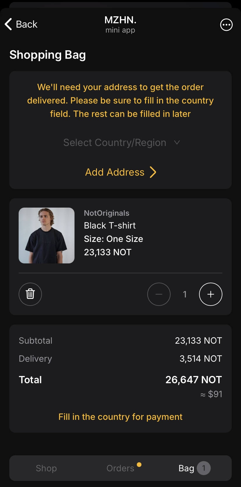
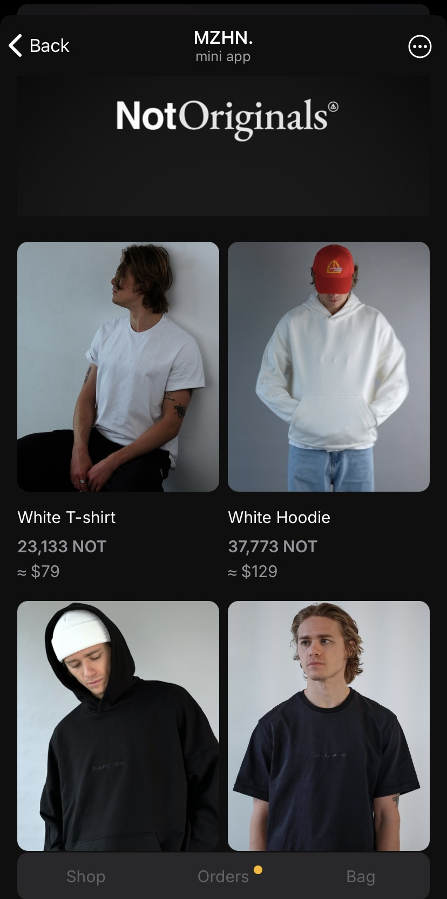
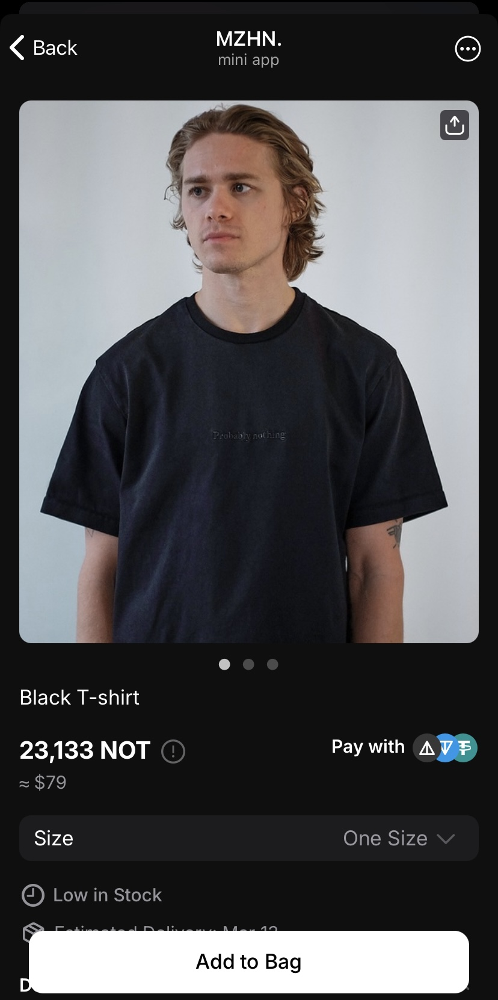

### Проблема

После успешного публичного размещения и листинга токена у notcoin собралось большое и вовлечённое сообщество. Многие держали notcoin с аирдропов и хотели либо продать его, либо держать в расчёте на будущую стоимость. Команда проекта искала способ монетизировать сообщество и дать токену прикладную пользу за пределами спекулятивной торговли.

Идея была в том, чтобы люди могли тратить notcoin на официальный мерч — по сути как обратный выкуп акций, только в Web3. Для этого нужно было:

- Собрать магазин мерча внутри Telegram как мини-приложение.
- Подключить криптооплату и при этом разобраться с юридическими и налоговыми сложностями.
- Вести производство, доставку и фулфилмент на масштабе.
- Держать поддержку для большой и активной аудитории.

Меня позвали спроектировать, собрать и запустить всю эту систему мерча: у меня был опыт с криптокошельками, финтех-инфраструктурой и продуктовой разработкой.

### Что сделал

Я вёл разработку и запуск магазина мерча notcoin в Telegram от начала до конца и закрывал и технические, и операционные задачи:

1. Собрал магазин как мини-приложение в Telegram
    - Спроектировал и запустил полноценную торговую площадку внутри Telegram.
    - Работал с дизайнерами и инженерами, чтобы пользоваться магазином было просто.
2. Подключил криптооплату и кошельки
    - Сделал криптоплатёжный шлюз: платить можно было notcoin и другими криптовалютами.
    - Юридически это закрыли компанией в Гонконге: там принимать крипту за физические товары можно, и это дешевле альтернатив вроде ОАЭ.
3. Вёл логистику и цепочку поставок
    - Координировал поставщиков, производство и фулфилмент, чтобы товар делали и доставляли без сбоев.
4. Держал поддержку на потоке
    - После запуска за первую неделю пришли тысячи заказов, и поддержка не справлялась.
    - Я сам встал в поддержку и ответил на сотни обращений. Поставил приложение поддержки на iPhone и отвечал клиентам с дивана и за завтраком.

### Результат

- Тысячи заказов мерча за первую неделю: спрос и вовлечение были настоящими.
- Криптооплата работала без разрывов, и notcoin стало можно потратить, а не только держать как спекулятивный токен.
- Операция выдержала объём: производство, логистика и фулфилмент шли штатно.
- Прямой контакт с клиентами: сотни обращений закрыты лично, без просадки опыта.

Запуск превратил notcoin из вирусного мем-токена в рабочую систему, где крипту можно потратить на реальный товар, и задал образец для мини-приложений Telegram и связки с Web3.

### Ссылки

Notcoin: [https://notcoin.org/](https://notcoin.org/)

Магазин мерча: [https://t.me/mozhnostore_bot](https://t.me/mozhnostore_bot)

### Скриншоты приложения.

