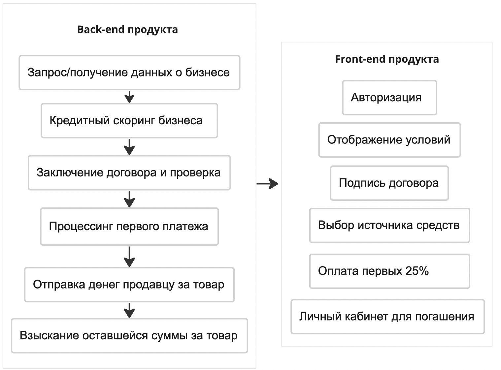
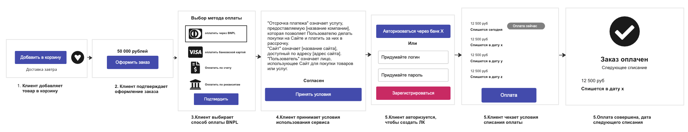
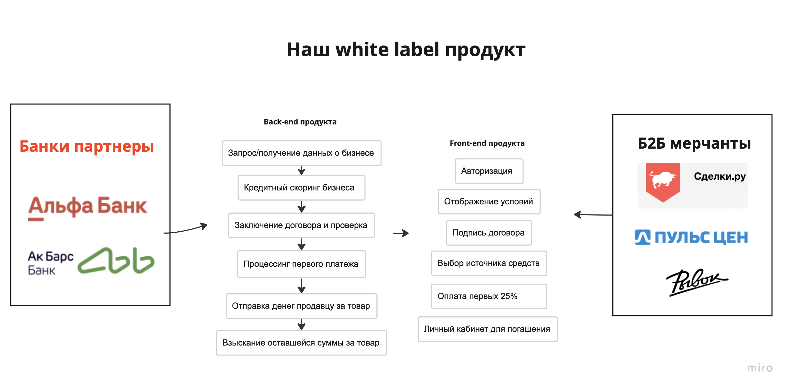
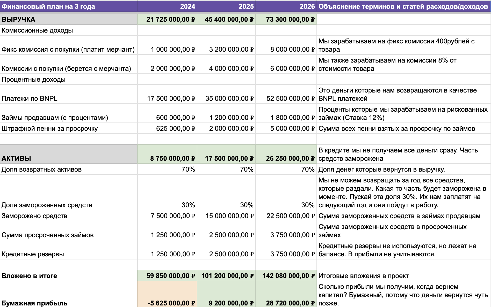
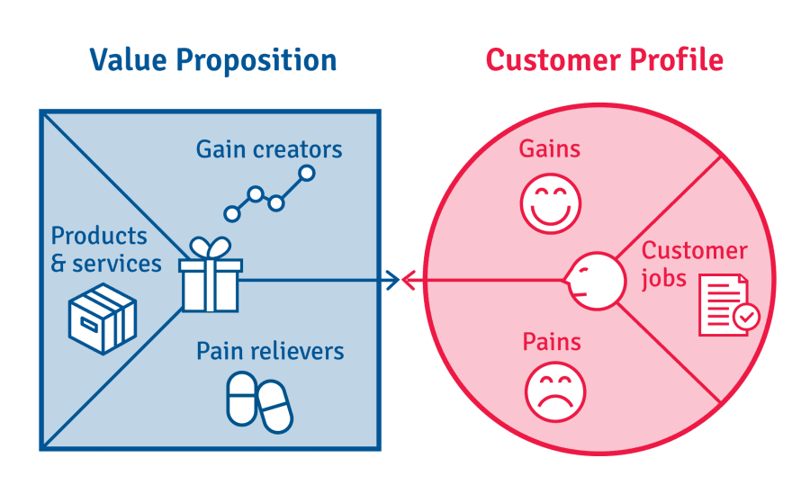

1. So we work in Kontur.Extern, and the service lets companies file financial reports with the tax office online. What does that give us? **We know a lot about the financial health of our clients — revenue, profit, capital, and liabilities (in other words, assets).**
2. We also know about a new trend in finance — BNPL. These products let you pay only part of the amount, get the goods immediately, and pay the rest on a set schedule. The hardest part of BNPL is credit scoring. We do not have as much data as a bank. That will be the challenge. Here is what will help us handle it:
    - There is a direct channel to clients. A fast channel for testing hypotheses and getting feedback.
    - We already know a lot about the businesses (clients). We will be able to build credit scoring.
3. We should start by looking at best practices. What solutions are on the market? What job are these products hired for?

### The BNPL market in B2C

1. First I suggest looking at the market of B2C solutions abroad, where the trend came from. We need to understand how the model works on tens of millions of clients and what nuances it has.

B2C Solutions (Worldwide) Part 1

1. There are also others on the market: AfterPay, Sezzle, Affirm, ZipPay, and more. I analyzed them too, but decided not to put them in the table (it takes a lot of space). Globally they do not differ much. The business model rests on a commission from the seller and late fees.
2. We know the business model and the value for clients on both sides (B2C and B2B). But how do they assess creditworthiness, and what risks does this business have? Let’s look.

B2C BNPL Solutions (Worldwide) Part 2

1. Overall, all of the services listed — AfterPay, Sezzle, Affirm, ZipPay — use a similar payment schedule and score the same way: a soft inquiry.
2. The only difference is that Sezzle reports to the credit bureau and thereby lets people improve their credit history. A plus for clients.

### BNPL in B2B

1. And now B2B solutions. These are products that let one business pay another by splitting payments into equal parts.
2. The value here is different for both sides, but the risks are roughly the same as in the B2C segment. The business model is not different. There is just one more new product, like trade credit. Relevant for business.

B2B BNPL solutions

1. I also looked at Biller.ai, Mondu.ai, and Two.inc, but did not find serious differences. So I did not put them in the table.
2. We have a general picture of the market and want to lay it onto Russian reality. For that we look at competitors here.

### The market in Russia

17. For now we are talking about launching a product in Russia. And it is important to say what the market is like here.

- In B2C there are several competitors — Flexipay, Tinkoff’s “Dolyami”, and Yandex’s “Split”. The other competitors are indirect — installment plans, a loan with an interest-free period, an overdraft.
- In B2B there are no direct competitors, but there are products hired for the same job, “Spend money effectively while solving the business’s tasks”. Since our focus is now B2B, we want to understand in more detail what we compete with. Here we go through every payment method.

Current B2B alternatives (RU)

And now, from the information we have, we can propose concepts for possible products for Extern.

- why do we need a team? how can we use it effectively?
- how do we prove the product works?

---

### Product concept No. 1 — BNPL for B2B businesses

1. At the very beginning I mentioned a few factors that make it easier for us to test this solution, but I’ll repeat them: established relationships with clients, and an understanding of the audience we can test hypotheses on.
2. So we have an SMB segment in trade, construction, and agriculture. And we know a lot about these clients, because they file reports with the tax office and other agencies through our solution.
3. Any of these business segments needs resources — livestock, building materials, feed, ingredients for production. All of this can be bought on special B2B marketplaces. The idea is this:

BNPL B2B, SMB

1. Our main competitors are loans and credit lines. **How will we differ from competitors?** There will be no collateral, approval will be instant (right in checkout), and interest will be charged only for high risk and for breaking the contract (a late payment).
2. **What difficulties and risks can come up?**
- A B2B credit business needs a lot of capital, because business checks are large. Where do we get the money?
- How will we do credit scoring? Who will train the model to assess a business’s risk? For now there are only ideas for the model’s parameters (years in operation, revenue, profit, change in dynamics, margin, headcount growth year over year)
- What about our margin? We need to borrow cheaply and lend to business even more cheaply (without charging interest). If we take 5% from the marketplace, the rate on our own funds has to be even lower, otherwise we go negative.
1. How it would be built. Here are the processes on the front and back of our product.

1. And here is how the process will look for the client

### Product concept No. 2 — BNPL B2B white label (a SaaS solution)

1. Something made me stop. We are not a credit institution, and this is not our business. We sell software, and if we stick to that, we will sell a different product.
2. We will sell a ready-made solution to those who are already in the credit business — marketplaces, banks, MFOs, and other lenders. The logic is simple: banks and lenders have money, resources they want to use effectively. On the other side, a B2B business needs financial stability, a convenient way to pay, high conversion, and larger checks. I see two ways this can go.
3. The first option — we can sell this as a standalone white-label solution to banks and marketplaces. Then the lenders sell it to their own clients, put their logo on it, and earn however they want. We own only the technology and charge for it. Banks have the money and the other resources. They can earn themselves.
4. The second option — we become an intermediary between banks and B2B merchants and earn from both segments. Banks provide the money for BNPL, we agree with the B2B merchant, and we connect them with our IT product.

BNPL B2B white label

1. Our main competitors are a bank’s own development. That is, a bank can just build something like this itself. **How will we differ from competitors?** Decisions are hard in a bank, and adopting technology is quite slow (there are exceptions). We will be flexible, stay in constant contact with clients, and build the relationship in advance (for example by making integration simple)
2. **What difficulties and risks can come up?**
- Banks care about security and are afraid of external software. They may refuse to integrate. We may have to sell only the code with a way to customize it, or make it open source, where the income comes from adapting it for the client.
- We will not have unique technology, and after a while the bank or lender will build the same solution itself, because it has the resources. Tinkoff already runs Dolyami, which can be rolled out to B2B.
- Every bank is built differently. We are unlikely to create a universal way to integrate
1. The build looks like this. The product for banks and lenders will look like this. Each merchant will be able to choose which bank to work with, and the bank can agree or refuse.

    

2. And for the end client, the same as the previous concept.

### Choosing the more promising concept

1. So we have 2 ideas, and now we have to choose between them. I suggest a small scoring. Write the criteria in a table, score them on a 10-point scale, and use the average to see which idea wins. Each score will be backed by facts, and those facts are below.

💡 10 points means a good match with us, many facts in favor. More yes than no.

0 points means a bad match, few facts in favor. More no than yes.

**The criteria for scoring the ideas will be:**

Cost to launch, match of the current business with the new product (business market fit), market size, market growth rate, risk level, acquisition cost,

BNPL B2B

All the statistics are taken from the Central Bank report “Lending to small and medium businesses, February 2022. [Link here](http://www.cbr.ru/collection/collection/file/40935/stat_bulletin_lending_22-2_21.pdf)

**How I sized the market:**
**PAM** — The market in February 2022 was 179k SMB businesses with loans. If growth for the year is 10% (the previous year was +70%), then next year there will already be 196k businesses with loans. The average loan size is 4.4 million. The average SMB loan rate is 11%. So the whole SMB credit market is 196000 * 4400000 * 0.11 = **95 billion rubles**

**TAM** — the whole market our BNPL can take. The calculations are the same, but the BNPL rate is lower than a loan, and we do not charge it the way a bank does. For simplicity, say it averages 3%. We will lend to some at 10% and to some at 0%. That is for the calculation. Our market here is 196000 * 4400000 * 0.03 = **26 billion rubles**

**SAM** — how much of TAM can we take? 1% of all SMB. That is 1960 businesses. At the same 3% rate and a loan size of 4.4 million, our market is 1960 * 4400000 * 0.03 = **259 million rubles**

**SOM** — how much will we actually take in the first year? I think 30% of 1960 companies. That is, of SAM. The same inputs — (1960 * 0.3) * 4400000 * 0.03 = **77 million rubles

33.** Now let’s look at the second concept, and then compare them. The scoring criteria stay the same. There will be explanations.

BNPL B2B White label

**Market sizing:**

I had a few ideas for how to size this market, but I did not find any external data. I would like to know how much banks and lenders spend on any external software at all, just to understand what our product costs.

As of January 2023, Central Bank statistics say 326 banks are operating.

Our business model will be:

- Selling a software license — 7.2 million a year, or 600k a month.
- A commission of 0.1% of BNPL turnover inside the merchant.

**PAM** — 326 banks are operating in total. It is hard to say how many B2B businesses are operating. Suppose B2B online sales turnover in Russia is 800 billion rubles, and add the assumption that 10% of all sales go through BNPL. That is 80 billion. That is where our 0.1% comes from. That is 80 million. Then we multiply the number of banks by the license price and add the commission from merchants. The result is 326 banks * 7,200,000 rubles + 80 million = **2.4 billion rubles (2,427)**

**TAM** — Now we remove the top banks with strong IT, like Tinkoff, where we definitely will not get in. And the very small ones. About 300 banks remain. And 80 million is the whole market. Not everyone needs this solution. Cut it to 40%. That is 32 million. Then our market is 300 * 7,200,000 + 32,000,000 = the market shrinks to **2.2 billion**

**SAM** — But 300 banks is impossible to cover. Over the whole life of the product, 10% at most. And we cut sales volume by another 50%. Then 16 million rubles from merchants. Our market is 30 banks * 7,200,000 + 16,000,000 = **232 million rubles**

**SOM** — Banks take a very long time to decide, and the deal cycle will be long (up to one year). It would be great to take 10% of SAM. That is 3 banks a year. Merchants are hard too. Cut turnover by another 50% — that will be 8 million rubles. Our market is 3 * 7,200,000 + 8,000,000 = **29.6 million rubles, our market for the year**

### The final scoring of the concepts

We add up the numbers by criterion and pick a winner. This does not guarantee any result for us. We just need to choose which idea to test first.

Result

**On the scoring, the winning idea is BNPL B2B. So we will test that concept.**

### Why we do not go into B2C

We are discussing the BNPL trend, and it seems obvious that we should go into B2C. But I am not proposing that concept, and here is why:

- Banks have already launched B2C BNPL, and it will be hard for us to compete with them. Also, unlike the US market, Russia has interest-free installment plans. So what is the value proposition for individuals? It is not clear yet. Business, though, has a clear pain around acquisition, financing, and lending.
- Banks in Russia adapt technology quite fast. They have already made Dolyami, Split, and other BNPL
- Banks have a monopoly on financial information about individuals. A full name is enough to learn the financial position of a whole family line. We will not be able to score better than banks.
- again, it is not our line of business

### A 3-year financial plan (BNPL B2B)

The details are in the tables. I strongly recommend looking at them to understand the numbers.

🔥 The full calculations are here:
[https://docs.google.com/spreadsheets/d/1XBFCadiH_mENjAWkdYzzQYhLoK8-tBqOV_8f-GuI6Gc/edit?usp=sharing](https://docs.google.com/spreadsheets/d/1XBFCadiH_mENjAWkdYzzQYhLoK8-tBqOV_8f-GuI6Gc/edit?usp=sharing)

**A short 3-year summary (income + expenses)**

| Money needed | 303,130,000 rubles |
| --- | --- |
| Revenue we will earn | 140,425,000 rubles |
| Profit we will earn | 32,295,000 rubles |
| Market share we will take (3 years) | 0.28% |

Loans are not treated as expenses, because they are assets that stay in circulation. The market share is small because the market is large in volume (95 billion)

| Payroll | 137,000,000 rubles |
| --- | --- |
| Marketing | 9,930,000 rubles |
| Written-off loans | 5,500,000 rubles |
| Lending to merchants (not counted as expenses) | 150,000,000 rubles |

### 5 hypotheses for testing the concept

The hypothesis template suggested in the assignment fits poorly here, because this is not a feature in a live product or a split test, but a product that does not exist. It is hard to talk about a lift in money, or about specific metrics. There is a lot of uncertainty.

How to test the concept

In the end I chose the 2nd hypothesis: **“If we make a clickable prototype of paying through BNPL and show it to our clients in a meeting, we will learn how interested they are in the product.” And here is why.**

### Why I chose testing with a prototype

1. A credit and financial product means regulatory risk. Any appearance on the site, in an announcement, and so on, is a risk. You cannot just launch it and start taking money. I do not know what the Central Bank would do about it, but the fact remains. So every version of a public MVP is set aside immediately.
2. A prototype can be tested in private. We can show it only to a narrow audience, take a non-disclosure promise, and if nothing works, nothing terrible happens.
3. We are making a product for B2B, and a business is easier to validate in person, because people openly share their problems. In B2B any problem is money not earned or money lost.
4. If we understand the client’s jobs and pains correctly, a prototype is enough to explain the value. We do not need an MVP with logic on the backend.
5. A prototype lets us understand not only “what is happening”, but also ask right away “why it is happening”. We cannot do that in a split test or with a cold button on the site.
6. The resources to build it are not that large. From the team we only need a designer and a product manager, plus the research work.

### What risks and problems can prototype testing run into?

1. People may like the prototype, but that does not mean they will like the real product and pay
2. We do not understand the legal side of the project, and clients may ask about the legal nuances. It is not certain we will be able to answer.
3. We will need to spend money on a legal study of this business. Without that we cannot move further toward a launch.

### How do we validate this hypothesis properly? An implementation plan

1. To be sure our hypothesis is correct, we need to understand whether we correctly understand the substance of the client’s current tasks and problems. If the problems match our solution, that is a signal to act.
2. To get this information out of clients, we do not need a prototype. It is enough to arrange, through managers, a meeting with clients and run in-depth interviews. As I said, in B2B any problem is expressed in money, so clients will not mind talking.
3. To structure the information I will use the Value Proposition Canvas framework. The interviews will let us fill in the circle (the client’s problems) and form the square (the right solution to those client problems). Right now we think it is BNPL, but we may be wrong.

1. Before we start the interviews, we should fill this framework ourselves with hypotheses about the problem and the solution. That will make it clearer how close we were to the real understanding, or how far off we were. Do clients have the problem we think they have? Will this solution close it? Or is something else needed.
2. Then we start recruiting respondents. We write a short but vivid message: “We have a hypothesis about this problem. It seems you run into it, and we want to solve it for you. Let’s talk.” The product can be mentioned only at the end.
3. Then we need to run at least 12 interviews. We need to ask questions that show how much money the business is losing right now without our solution. It is important not to mention the product during the interview (it is allowed at the end). We are here to validate the problem, not to sell the BNPL idea.
4. Out of 12 interviews, at least 6 respondents should confirm that the problem exists, whether or not it matches our understanding. What matters is that the problem exists, and a solution can be invented.
5. We write an interview script and send a manager to recruit respondents.
6. We run the interviews and, from the insights, adjust our understanding of the value proposition and of the client’s existing problem.
7. If it is confirmed, we go work on the prototype. If not, we restate it and go talk again, this time with possible solutions.
8. To work out the prototype we write the user stories that will happen in the prototype and the user flow the client will go through in the meeting.
9. We draw the mockup ourselves and give the designer a brief for drawing the prototype.
10. Then the meetings themselves, with a demonstration of the solution.
11. If it is confirmed, we do legal research. We may need external lawyers with expertise in loans and banks, who can explain all the risks, the legal requirements, and the other requirements.
12. This may affect our financial understanding of the business. If it does, we adjust. (for example we need larger financial reserves, or loan write-offs will be higher)
13. We prepare a presentation for the investment committee
14. If it is approved, we launch an MVP of the real product.
