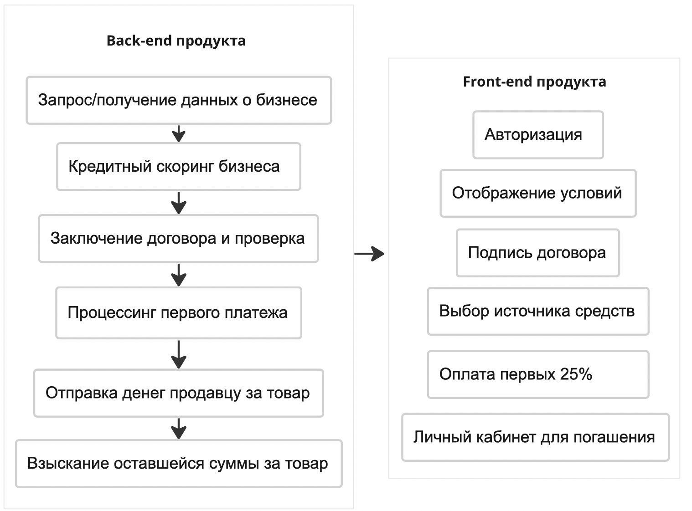
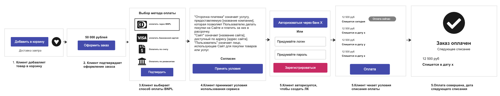
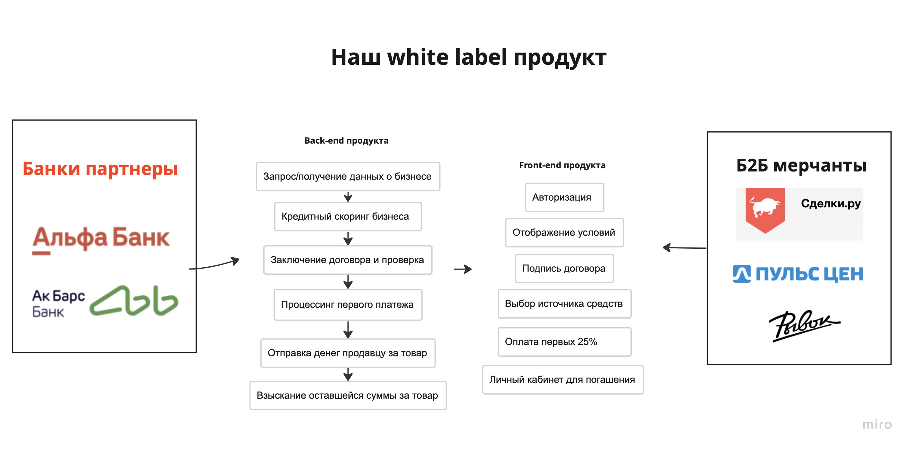
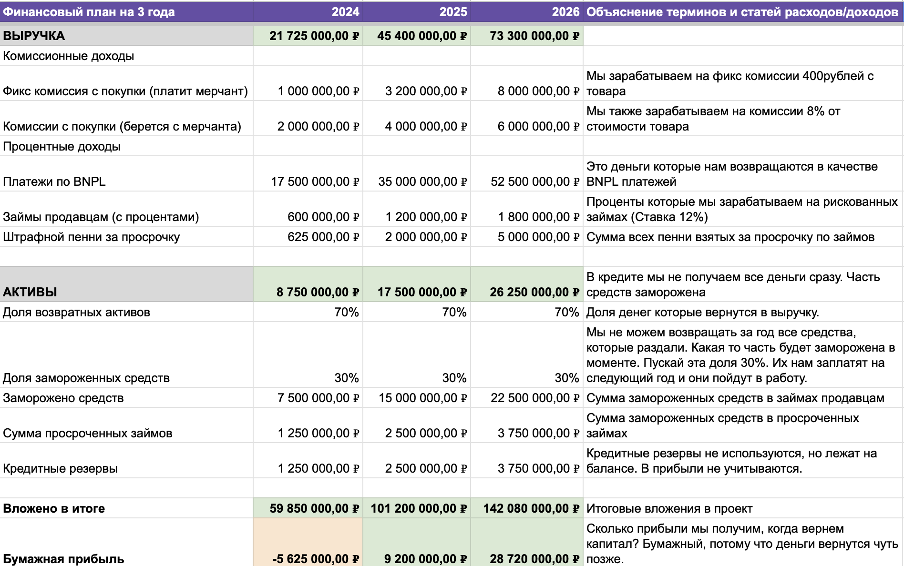
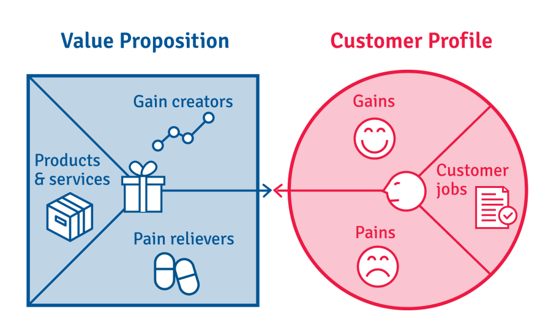

1. Итак мы работаем в Контур.Экстерне и сервис позволяет компаниям загружать финансовую отчетность в налоговую онлайн. Что это нам дает? **Мы знаем много о финансовом здоровье наших клиентов — выручка, прибыль, капитал и обязательства (другими словами активы).**  
2. Мы также знаем о новом тренде в финансах — BNPL. Такие продукты позволяют заплатить только часть суммы, получить товар сразу, а остальное доплатить по определенному расписанию. А самое сложное в BNPL — кредитный скоринг. У нас нет так много данных как у банка. Это и будет челленджем. И вот что там поможет с ним справиться: 
    - Есть прямой канал коммуникации с клиентами. Быстрый канал тестирования гипотез и получения фидбэка.
    - Уже много знаем о бизнесах(клиентах). Сможем строить кредитный скоринг.
3. Начать стоит с того, чтобы посмотреть лучшие практики. Какие решения есть на рынке?  На какую работу нанимают эти продукты? 

### Рынок BNPL в B2C

1. Для начала предлагаю взглянуть на рынок B2C решений за рубежом, откуда и пришел тренд. Нам важно понять как работает модель на десятках миллионов клиентов и какие у нее есть нюансы. 

B2C Solutions (Worldwide) Часть 1

1. Еще на рынке есть: AfterPay, Sezzle, Affirm, ZipPay и другие. Я их тоже проанализировал, но решил не вставлять в таблицу (много места). Глобально они не сильно отличаются. Бизнес модель держится на комиссии с продавца и штрафах за просрочку. 
2. Мы знаем о бизнес моделе, ценности для клиентов с обоих сторон (б2с и б2б). Но как они оценивают кредитоспособность и какие риски есть у этого бизнеса? Разбираемся. 

B2C BNPL Решения (Worldwide) Часть 2

1. В целом все перечисленные сервисы — AfterPay, Sezzle, Affirm, ZipPay используют похожее расписание платежей и делают скоринг одинаково — soft inquiry. 
2. Из отличий только то, что Sezzle репортит в кредитное бюро и позволяет тем самым улучшить кредитную историю. Плюс для клиентов. 

### BNPL в B2B

1. А теперь и B2B решения. Речь о продуктах, которые позволяют одним бизнесам платить другим через разделение платежей на равные части. 
2. Ценность тут другая для обоих сторон, а вот риски примерно те же, что и в B2C сегменте. Бизнес модель не отличается. Только появляется еще один новый продукт, как торговый кредит. Актуально для бизнеса. 

B2B BNPL решения

1. Также рассмотрел Biller.ai, Mondu.ai, Two.inc, но серьезных отличий не нашел. Поэтому в таблицу не стал вставлять. 
2. Общее понимание рынка у нас есть и хочется наложить это на российские реалии. Для этого посмотрим конкурентов тут. 

### Рынок в РФ

17. Мы пока говорим о реалиях запуска продукта в России. И важно сказать о рынке здесь.

- В B2C есть несколько конкурентов — Flexipay, “Долями” от Тинькофф, и “Сплит” от Яндекс. Остальные конкуренты косвенные — рассрочка, кредит с беспроцентным периодом, овердрафт.
- В B2B прямых конкурентов нет, но есть продукты, которые нанимают на ту же работу “Эффективно расходовать средства, решая задачи бизнеса”.  Так как наш фокус сейчас на B2B, хочется понять детальнее, с чем мы конкурируем. Тут разберем все способы оплаты.

Текущие альтернативы B2B (RU) 

И вот теперь исходя из полученной информации можно предложить концепции возможных продуктов для Экстерна.

- зачем нам команда? как мы можем ее эффективно использовать?
- как доказать эффективность продукта?

---

### Концепция продукта №1 — BNPL для B2B бизнесов

1. В самом начале я упомянул несколько факторов, благодаря которым нам проще тестировать такое решение, но напомню: выстроенные отношения с клиентами, понимание аудитории на которой можно тестировать гипотезы. 
2. Итак у нас есть сегмент СМБ в сфере торговли, строительства и сельского хозяйства. И мы много знаем про этих клиентов, так как они подают через наше решение отчетность в налоговую и прочие ведомства. 
3. Любой из перечисленных сегментов бизнеса нуждается в ресурсах — живом скоте, строительных материалах, кормах, ингредиентах для производства. Все это можно купить на специальных B2B маркетплейсах. Так вот идея следующая: 

BNPL B2B, СМБ

1. Наши основные конкуренты это кредиты и кредитные линии. **Как мы будем отличаться от конкурентов?**  У нас не будет залога, одобрение будет мгновенным (сразу в чекауте), проценты будут взиматься только с высокого риска и при нарушение условий договора (просрочка). 
2. **Какие сложности и риски могут возникнуть?** 
- Для поддержания кредитного бизнеса в B2B нужен большой капитал, так как чеки в бизнесе большие. Откуда мы возьмем деньги?
- Как мы будем делать кредитный скоринг? Кто обучит модель оценивать риск бизнеса? Пока есть только идеи по параметрам для модели (лет работы, выручка, прибыль, изменение динамики, маржа, рост штата год к году)
- Что с нашей маржинальностью? Нам нужно дешево кредитоваться и еще дешевле кредитовать бизнес (не взимая проценты). Если мы берем 5% с маркетплейса, то ставка по нашим средствам должна быть еще ниже, иначе мы уходим в минус.
1. Способ реализации. Вот какие процессы будут происходить на фронте и беке нашего продукта. 

1. А вот как процесс будет выглядеть для клиента

### Концепция продукта №2 BNPL B2B White label (SaaS решение)

1. Кое что заставило меня задуматься. Мы не кредитная организация и это не наш бизнес. Мы продаем софт и если придерживаться этой парадигмы, то продавать мы будем другой продукт. 
2. Мы продадим готовое решением тем, кто уже занимается кредитным бизнесом — маркетплейсы, банки, мфо, и прочие кредиторы. Логика тут простая — у банков/кредиторов есть деньги, это ресурсы, которые они хотят эффективно использовать. С другой стороны б2б бизнес нуждается в финансовой стабильности, удобном способе оплаты, высокой конверсии и росте чеков. Я вижу тут два варианта развития. 
3. Первый вариант —мы можем продавать это как самостоятельное white label решение банкам/маркетплейсам. Тогда кредиторы сами продают его своим клиентам, ставят свой лого, зарабатывают как хотят. Мы владеем только технологией и берем за это деньги. У банков ведь есть деньги и прочие ресурсы. Могут сами зарабатывать. 
4. Второй вариант — Мы становимся посредниками между банками и б2б мерчантами и зарабатывать с обоих сегментов. Банки предоставляют деньги для BNPL, мы договариваемся с Б2Б мерчантом и соединяем их своим айти продуктом. 

BNPL B2B white label 

1. Наши основные конкуренты — это собственная разработка банка. То есть банк, может взять и разработать подобное сам. **Как мы будем отличаться от конкурентов?** В банке тяжело с принятием решений и адоптацией технологий идет довольно медленно (есть исключения). Мы будем гибкими, постоянно быть в контакте с клиентами и заранее наладим с ними отношения (сделав простой способ интеграции например) 
2. **Какие сложности и риски могут возникнуть?** 
- Банки дорожат безопасностью и боятся внешнего софта. Они могут отказаться интегрироваться. Возможно нам придется продавать лишь код с возможностью кастомизации, или делать опенсорс, где доход будет идти от адаптации под клиента.
- У нас не будет уникальных технологий и спустя время банк/кредитор сделает такое же решение сам, ведь ресурсы у него есть. У Тинькофф уже работает сервис Долями, который можно раскатить на Б2Б.
- Все банки устроены по разному. Вряд ли мы сможем создать универсальный способ интеграции
1. Способ реализации следующий. Продукт для банков/кредитов будет выглядеть во так. Каждый мерчант сможет выбрать с каким банком работать, а банк может согласиться/отказать.
    
    
    
2. А для конечного клиента также, как предыдущий концепт. 

### Выбор перспективной концепции

1. Итак у нас есть 2 идеи, и теперь между ними надо выбрать. Предлагаю сделать небольшой скоринг. В табличку выписать отдельные критерии, оценить их по 10 бальной шкале, и по среднему определить, какая идея выигрывает. Каждая оценка будет подкреплена фактами, и они будут ниже. 

💡 10 очков значит — хороший мэтч с нами, много фактов за. Скорее да, чем нет.

0 очков значит — плохой мэтч, мало фактов за. Скорее нет, чем да. 

**Критерии оценки идей будут следующие:** 

Расходы на запуск, мэтч текущего бизнеса с новым продуктом(business market fit) , размер рынка, скорость роста рынка, уровень риска, acquisition cost, 

BNPL B2B 

Вся статистика взята из отчета ЦБ “Кредитование субъектов малого и среднего предпринимательства, Февраль 2022. [Ссылка тут](http://www.cbr.ru/collection/collection/file/40935/stat_bulletin_lending_22-2_21.pdf)

**Как я посчитал рынок:**  
**PAM** — Рынок в феврале 2022 года — 179к закредитованных СМБ бизнесов. Если рост за год составит 10%(прошлый +70%), то в следующем году закредитованных бизнесов будет уже 196к. Средний размер кредита — 4,4 млн. Средняя ставка по кредиту СМБ — 11 %. То есть весь кредитный рынок СМБ — 196000 *4400000 * 0,11 = **95 млрд рублей**

**TAM** — весь рынок, который мы можем занять нашим BNPL. Расчеты все те же, но у BNPL ставка ниже, чем у кредита и взимаем ее мы не так как банк. Для простоты допустим, что  в среднем это 3%. Кого то мы будем кредитовать под 10%, кого то под 0%. Это для расчетов. Наш рынок тут— 196000 *4400000 * 0,03= **26 млрд рублей** 

**SAM** — сколько мы можем забрать от TAM? 1% всего СМБ. это 1960 бизнесов. При той же ставке 3% и размере кредита в 4,4 млн, наш рынок — 1960*4400000*0,03= **259 млн рублей**

**SOM** — сколько мы реально заберем в первый год? Я думаю что, 30% от 1960 компаний. То есть от SAM. Вводные те же — (1960*0,3)*4400000*0,03= **77 млн рублей

33.** Теперь разберемся со второй концепцией, а дальше сравним их. Критерии оценки у нас остаются те же. Пояснения будут. 

BNPL B2B White label 

**Расчет рынка:** 

У меня было несколько идей как можно посчитать тут рынок, но никаких внешних данных я не нашел. Хотелось бы знать, сколько банки/кредиторы в принципе тратят на любой внешний софт, чтобы хотя бы понимать сколько стоит наш продукт. 

На январь 2023 по статистике ЦБ работают 326 банко. 

Бизнес модель у нас будет следующая: 

- Продажа лицензии на софт — 7,2 млн в год или 600к в месяц.
- Комиссия 0,1% от оборота BNPL сервиса внутри мерчанта.

**PAM** — Всего работают 326 банков. Сколько работает б2б бизнесов сказать сложно. Предположим, что оборот б2б онлайн продаж в РФ — 800 млрд руб и добавим предположение, что 10% всех продаж происходят через BNPL. То есть 80 млрд. Откуда мы берем свои 0,1%. То есть 80 млн. В итоге перемножаем количество банков, стоимость лицензии и суммируем с комиссией от мерчантов. В итоге — 326 банков * 7 200 000 руб + 80 млн  = **2,4 млрд рублей (2 427)** 

**TAM** — Теперь убираем топ банки с хорошим IT, вроде Тинькофф, куда мы точно не зайдем. И супер мелкие. Остается около 300 банков. Да и 80 млн это весь рынок. Не всем нужно это решение. Срежем до 40%. То есть 32 млн. Тогда наш рынок — 300 * 7 200 000 + 32 000 000 = Рынок сократился до **2,2 млрд** 

**SAM** — Но 300 банков, охватить нереально. За всю жизнь продукта максимум 10%. А объем продаж срежем еще на 50%. Тогда от мерчантов 16 млн рублей. Наш рынок — 30 банков * 7 200 000 + 16 000 000 = **232 млн рублей**

**SOM** — Банки очень долго принимают решения и цикл сделки будет длинным (до одного года) Супер если получится взять 10% от SAM. То есть 3 банка за год. С мерчантами тоже сложно. Срежем еще 50% от оборота — будет 8 млн рублей. Наш рынок — 3 * 7 200 000 + 8 000 000 = **29,6 млн рублей наш рынок за год**

### Конечная оценка концепций

Суммируем цифры по критериям и выбираем победителя. Это не гарантирует никакого результата нам, просто нужно выбрать какую идею тестировать первой. 

Итог

**По скорингу выигрывает идея — BNPL B2B. Значит будем проверять эту концепцию.** 

### Почему не идем в B2C?

Мы обсуждаем тренд на BNPL и кажется очевидным, что надо идти в Б2С. Но я не предлагаю такую концепцию И вот почему: 

- Банки уже запустили Б2С BNPL и с ними нам будет трудно конкурировать. Плюс в отличие от рынка US, в РФ есть беспроцентные рассрочки. Так в чем ценностное предложение для физических лиц? Пока непонятно. А вот у бизнеса есть явная боль по привлечению, финансированию и кредитованию.
- Банки в РФ довольно быстро адаптируют технологии. Они уже сделали Долями, Сплит и другие BNPL
- Монополия на финансовую информацию о физических лицах у банков. ФИО достаточно, чтобы узнать фин. положение всей родословной. Мы не сможем делать скоринг лучше банков.
- опять же не наш профиль бизнеса

### Финансовый план на 3 года (BNPL B2B)

Подробности в таблицы. Очень рекомендую ознакомиться для понимания цифр. 

🔥 Полные расчеты можно посмотреть тут:
[https://docs.google.com/spreadsheets/d/1XBFCadiH_mENjAWkdYzzQYhLoK8-tBqOV_8f-GuI6Gc/edit?usp=sharing](https://docs.google.com/spreadsheets/d/1XBFCadiH_mENjAWkdYzzQYhLoK8-tBqOV_8f-GuI6Gc/edit?usp=sharing)

**Краткие итоги на 3 года (доходы + расходы)**  

| Нужно денег | 303 130 000руб |
| --- | --- |
| Заработаем выручки | 140 425 000 руб |
| Заработаем прибыли | 32 295 000 руб |
| Займем долю рынка (3 года) | 0,28% |

Кредиты не идут в расходы, так как являются активами, которые постоянно в обороте. Доля рынка маленькая, потому что рынок большой в объеме (95 млрд) 

| ФОТ | 137 000 000 руб |
| --- | --- |
| Маркетинг | 9 930 000 руб |
| Списанные кредиты | 5 500 000 руб |
| Кредитование мерчантов (не учитываются в расходах)  | 150 000 000 руб |

### 5 гипотез для проверки концепции

Шаблон гипотезы предложенный в задании плохо сюда подходит, потому что речь идет не о фиче в действующем продукте или сплит тесте, а о продукте, который не существует. Сложно говорить о приросте денег, или конкретных метриках. Много неопределенности. 

Как проверить концепцию

В итоге я выбрал 2-ую гипотезу: **“Если мы сделаем кликабельный прототип оплаты через BNPL и покажем его нашим клиентам на встрече, то узнаем об их заинтересованности в продукте”. И вот почему.** 

### Почему я выбрал тестирование прототипом?

1. Кредитный и финансовый продукт это — регуляторные риски. То есть любое появление на сайте, анонсе и тд, это риски. Его нельзя просто запустить и начать принимать деньги. Не знаю, что будет за это от ЦБ, но факт есть факт. То есть все вариации публичного MVP сразу отметаем в сторону. 
2. Прототип можно протестировать не публично. То есть мы можем показать его только определенной узкой аудитории, взять слово за неразглашение и если ничего не сработает, то ничего страшного. 
3. Мы делаем продукт для B2B, а бизнес проще валидировать вживую, потому что люди открыто делятся своими проблемами. В б2б любая проблема это недозаработок или потеря денег. 
4. Если мы правильно понимаем джобы/боли клиента, то прототипа будет достаточно, чтобы объяснить ценность. Нам не нужен MVP с логикой на бэкэнде. 
5. Прототип позволит понять не только “что происходит”, но также и сразу спросить “а почему так происходит”. Мы не сможем сделать так в сплит тесте, холодной кнопке на сайте.
6. Ресурсы на создание не такие большие. Из команды нужен только дизайнер и продакт + провести исследовательскую работу. 

### Какие риски и проблемы могут возникнуть у тестирования прототипа?

1. Прототип может понравится,  но не факт что понравится реальный продукт и заплатят
2. Мы не понимаем legal сторону проекта, а клиенты могут спросить о юридических нюансах. Не факт, что мы сможем ответить. 
3. Понадобится потратится на юридическое исследование такого бизнеса. Без этого невозможно будет дальше продвинуться в запуске.  

### Как качественно валидировать эту гипотезу? План по реализации

1. Чтобы убедиться, что наша гипотеза корректна, надо понять, правильно ли мы понимаем суть текущих задач/проблем клиента. Если проблемы мэтчатся с нашим решением, то это сигнал к действию. 
2. Чтобы вытащить эту информацию из клиентов, не нужно делать прототип. Достаточно договориться через менеджеров о встрече с клиентами и провести глубинные интервью. Как я говорил, в б2б любые проблемы выражаются в деньгах, поэтому клиенты будут непротив поговорить. 
3. Чтобы структурировать информацию я воспользуюсь фреймворком Value Proposition Canvas. Интервью позволят нам заполнить круг (проблемы клиента) и сформировать квадрат (правильное решение этих проблем клиента). Сейчас мы думаем, что это BNPL, но можем ошибаться.

1. Перед тем, как начать проводить интервью, надо самостоятельно заполнить этот фреймворк гипотезами проблемы и решения. Так будет нагляднее, насколько мы были близки к реальному пониманию или сильно ошибались. Есть ли та проблема у клиентов, о которой мы думаем? А закроется ли она вот таким решением? Или нужно нечто другое. 
2. Далее приступаем к рекрутингу респондентов. Пишем короткое, но яркое сообщение, что “У нас есть гипотеза вот такой проблемы. Кажется вы с ней сталкиваетесь и мы хотим ее решить для вас. Давайте пообщаемся”. О продукте можно рассказывать только в конце.
3. Далее нам нужно провести минимум 12 интервью. Нужно задавать вопросы, которые позволят понять, сколько денег теряет бизнес сейчас без нашего решения. Важно во время интервью не упомянать продукт(можно в конце). Мы тут для валидации проблемы, а не для продажи идеи BNPL. 
4. Из 12 интервью, минимум 6 респондентов должны подтвердить наличие проблематики, соответствующей нашему пониманию или нет. Главное, что проблема есть, а решение можно придумать. 
5. Пишем скрипт интервью и отправляем менеджера на рекрутинг респондентов. 
6. Проводим интервью и на основе инсайтов из интервью корректируем наше понимание value proposition и существующей проблемы клиента.
7. Если все подтвердилось, то идем прорабатывать прототип, если нет, то переформулируем и идем общаться снова, уже с возможными решениями.  
8. Для проработки прототипа прописываем user stories, которые будут происходить в прототипе и прописываем user flow, который пройдет наш клиент на встрече.  
9. Рисуем макет сами, и даем дизайнеру ТЗ на рисование прототипа. 
10. Дальше сами встречи с демонстрацией решения. 
11. Если все подтвердилось, то проводим legal research. Возможно понадобятся внешние юристы, с экспертизой в кредитах, банках, кто сможет нам объяснить все риски, требования закона и прочие требования. 
12. Это может повлиять на наше финансовое понимание бизнеса, если да, то корректируем. (например нужно больше финансовых резервов, или списание кредитов будет больше)
13. Готовим презентацию для демонстрации инвесткомитету
14. При одобрении запускаем MVP реального продукта.
