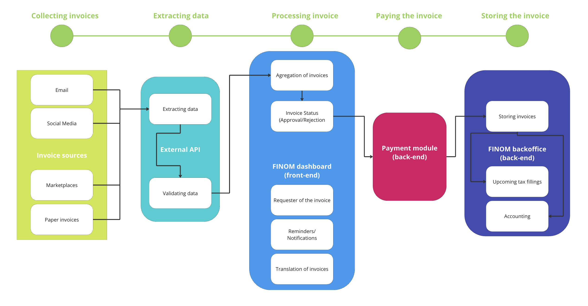
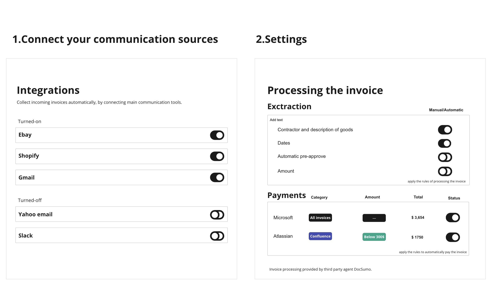
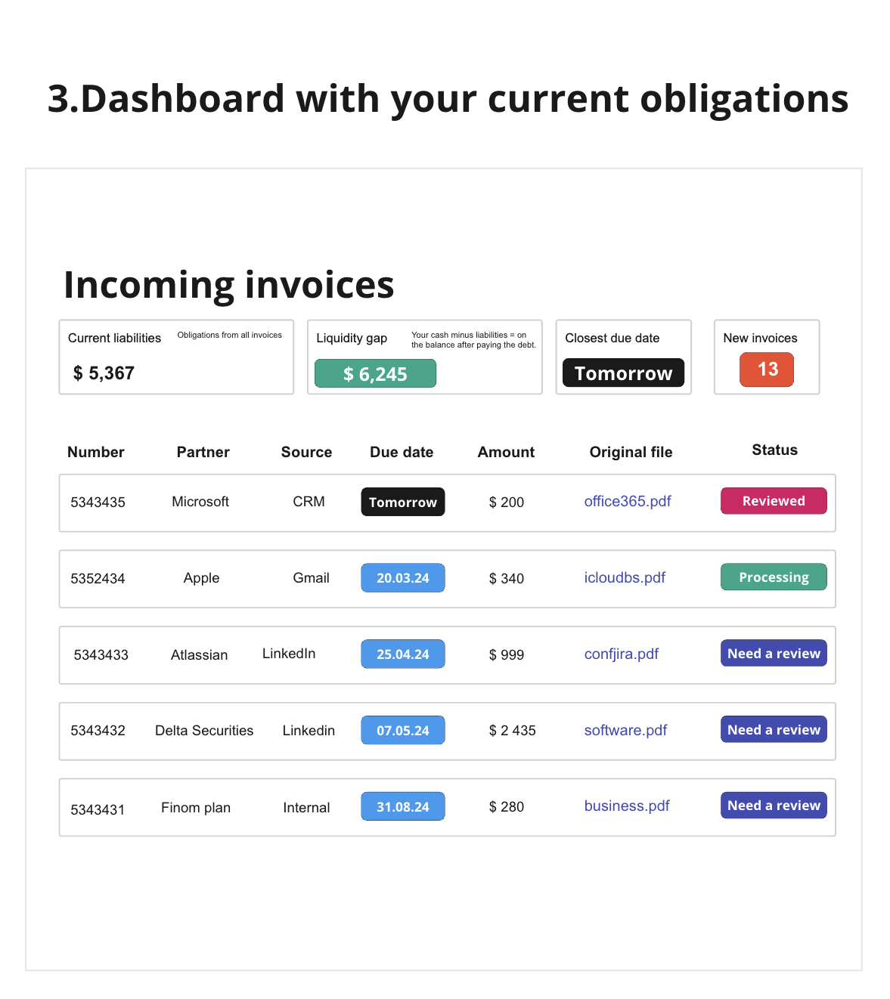

Created a technical specification for FINOM's automatic invoice collection system. Emphasized reducing manual data entry and ensuring an intuitive interface, leading to efficient invoice management for SMEs.

# Task 1 — Technical Specification

## 1 step. Understanding the assignment

1. First of all, I would like to decompose the task and make it clear what we need to provide. I’m assuming that I'm a new product manager on this project, and never worked with invoices before. You just hired me and delegated this task. 
2. At Finanza, we have product, that allows SMEs to generate invoices and banking accounts to send and receive payments. We need to design a solution for invoice collecting, according to our commitments as reducing manual data and making the interface simple. What does it mean for this assignment? 
3. It means we have requirements, deliverables, current functionality, and the goal itself: 

### Current functionality (What we have)

- generating outgoing invoices
- payment account to send and receive payments

### Implementation (Our goal)

- effective incoming invoice collecting

### Requirements (Our border conditions)

- reducing manual data entry to maximum
- intuitive interface

### Deliverables (Results at the end of the assignment)

- technical specification
- visual flowchart solution
- interface prototypes (optional but better to do)
- description of measuring the success of the feature.

1. Now we know what we need to accomplish. The next step is discovering the implementation way. 

## Step 2. Discovery process.

1. I knew what an invoice was before the assignment, but I didn’t know the specifics of transactions, technologies, use, and roles for the business. **So I decided to understand the subject first.** 
2. We need to understand why incoming invoices are important and what are the jobs here. Why collect them in the first place? 
    - Accounting and taxes— Our client needs to control the financial health of his venture: liabilities, money-in, money-out, overall cash flow, cash in the bank, and file taxes after getting profit.
    - Legal protection— Invoice serves as proof of payment in case of non-payment, refusal, or any other occasion, which could be presented in court as evidence.

Plus: financial analysis, marketing, trends and patterns. **So this process is crucial for business, mandatory, and can’t be compromised.**  

1. Now we’ll gather info, on how this process of “collecting incoming invoices” looks. Let’s do a bit of market research. For that goal, I would go:
    - Check the competitors, such as Stripe, Wise, Square, and Revolut Business, (more accurate, but takes more time than simple googling)
    - Simply ask Google, ChatGPT, and Perplexity (easy but, results are wide, not specific, accuracy is under question)
    - Interview our current customers about incoming invoices: jobs, pains, and gains (takes a lot of time and is expensive)
    - I combined competitors’ research and simple “googling via AI tools”.

## Step 3. Market Research

My conclusions. Here is what I learned after market research: 

**Service providers**

- There are standalone invoice solutions such as GetMyInvoice Wave, Freshbook, and Microsoft Invoice Capture (D365), which require you to connect communication portals (such as Email, and Shopify) and your banking account to automate the process of collecting.
- Qunto, Square, and SumUp Stripe? have the OCR technology, which allows them to scan documents on different resources and import them into the merchant’s dashboard, where they can approve, reject, and pay.
- Plus there are services that focus on extracting data, and invoices are one of their cases — DocuSumo, Laserfiche, or Nanonets. You can use their API for extracting, and approval, but other processes should be on your side.

**Form of invoice**

- Paper invoice, e-invoice.

**Channels**

- Email, mail, Invoicing tools.

**Legal Requirements**

- Invoices have mandatory fields, must follow guidelines and

**Provided automation**

- Services allow flexible automation (You can automate everything, or just import of invoices, the payment itself, approval, reconciliation, etc.)

**The technical flow for invoice collecting**

1. Collect invoices from the source in supported format PDF, XML, docx. 
2. Extract key information (amount, due date, goods, etc) from invoice, using OCR technology (optical character recognition). 
3. List all invoices on the dashboard. Display due date, and amounts.
4. Allow your customer to approve, reject, and pay the invoice. 

## Step 4. Designing the solution

1. Now we know a bit more about the invoices themselves, our competitors, and best practices, and we can brainstorm how we could implement this solution on our side. I’ll propose a few options: 

- **Integration with the external OCR tech provider —** We (as Finom) connect with providers like DocSumo via API, which will extract incoming invoices from Email, marketplaces, and shops and store them in our system, where we can display them in the dashboard and customer can process them in different ways (pay, approve, request more info, send a reminder).
- **Build everything in-house —**  For security reasons, we build everything on our side. It means our own trained AI algorithms, our OCR, scalable infrastructure of the system (more clients, more capacity on AI), and the whole unit of engineers to support this infrastructure.
- **No-code set-up —** Using Zapier, Docupilot, and Typeform we design the flow code-free.

1. How to choose the right one? Let’s set up criteria and give every option from 1 to 3 points and then sum them. The option that will get less = requires fewer resources and is more appropriate right now. 

**Less overall - better**

|  | Cost of Development | Cost of service | Security | Customer Effort  | Allegiance with our requirements | How long to implement | Overall |
| --- | --- | --- | --- | --- | --- | --- | --- |
| **Integration with external OCR** | **1/3** | **2/3** | **2/3** | **1/3** | **2/3** | **2/3** | **10** |
| In-house development | 3/3 | 3/3 | 1/3 | 1/3 | 1/3 | 3/3 | 12 |
| No code set-up | 1/3 | 1/3 | 3/3 | 3/3 | 3/3 | 1/3 | 12 |

- cost of development — how much to develop?
- cost of service — how much to support?
- security — how secure is it for our clients? It’s their banking account, business and money
- customer effort — how hard it would be for our client? approach, onboard him, activate,
- alliance with our requirements — reducing data entry to 0 and intuitive design
- how long to implement — how long will it take to release? weeks? months?

1. **So I chose integration with external OCR based on screening.** I did it also for several reasons: 
- we still don’t know, whether will customers use this feature or not. It’s better not to spend a lot on the hypothesis.
- we don’t have a lot of time to code our own or guarantee the security of a no-code solution.
- Our solution would be to experiment, but we aren’t tolerate mistakes,  we must provide appropriate quality, we are a banking service. So it’s better to take the solution which already working and has many similar clients like us.

It’s time to prepare a Specification for our solution. We will integrate with an external provider to extract invoices. 

## Step 5. Specification

### Frontmatter

| **Author** | Leonid Mikhalev |
| --- | --- |
| **Approvers** | Product Lead, CPO |
| **Contributors** | Product Manager, System Architect |
| Team | Invoicing Team |
| **Informed** | Devs, QA, CPO, Product Lead, CEO |
| Created  | 10.02.2024 |

### Summary

In order to pay the incoming invoice, you leave FINOM, and go to an external source, like an email provider, Shopify, Amazon, etc. Then you need to find and download the invoice, copy all the information, and use it on the appropriate payment method’s page. It takes valuable time to find and download an invoice, scrape data from it, verify, fill the forms, and then pay. We want to automate the process, by automating invoice collecting via external API.

### 📰Glossary

invoice — a commercial document issued by a seller to the buyer, relating to a sale transaction. Invoice used in order to confirm the purchase, validate terms of the deal, agree on payment method, and exchange credentials.  

incoming invoice — invoice which was received by the buyer (FINOM’s client) and requires to pay the seller a specific amount of money for the specific goods. 

OCR — Optical Character Recognition, technology that allows to convert images or text into a machine-readable format. We can extract all fields from Invoice, and fill the form automatically, because of OCR. 

Zapier — Popular tool for automating processes, like sending emails, and collecting logs.

DocSumo — enterprise solution with OCR technology, which can be used by us in order to collect incoming invoices

Microsoft Invoice Capture (365D) — part of the 365 Microsoft Subscription, which also allows to collect and identify invoices.  

### Context

**Origin of the problem** — invoices come from different channels, plus the account manager on the customer’s side has other counterparties, so it becomes a real mess, to manage sources, and customers in different channels just to reconcile and pay invoices. 

**How the problem affects users** — business owners spend additional time (estimated in hours) collecting, aggregating reconciliation, and payment. Eventually, they lose money on this ineffective process. 

**Affecting company goals** — It affects FINOM’s business in the way, that invoice volume doesn’t increase, so the transaction volume, which means, no additional revenue from fees for us. Plus there is a risk of customer churn, as our competitors have this feature

**Reasons why the problem is worth solving** — it potentially give us an opportunity to increase our revenue, and enhance customer satisfaction.

 

### Product Requirements

1. The system should accurately extract relevant data fields from invoices, including invoice number, vendor details, invoice date, due date, line items, amounts, and any other pertinent information. It cannot make mistakes during this process. It’s forbidden. 
2. The system should be able to handle various invoice formats (XML, JSON, CSV, UBL), file formats (doc, pdf, epub), and support different languages (ES, EN, DE, NE).
3. The system should be able to seamlessly with FINOM’s existing systems, such as accounting software, CRM, and ERP systems. This integration should allow for easy transfer of extracted data to relevant forms or databases. Old invoices also should be exported into the system. 
4. The system should support various input channels for invoices: auto-extracting, and manual upload via phone/web. 
5. The system must adhere to local laws, and international compliance standards, especially regarding sensitive financial data. The system should be audited and use all available security technologies, such as encryption, cloning data, and storing it locally. 
6. The system should have reporting and analytics tools to track how customers handle invoices after release, like the error rate, and time to process. We will use Insights from these subjects, to identify areas for improvement and optimization.
7. The system should have a user-friendly interface for users interacting with the system. Make it intuitive and easy to use, with features like drag-and-drop functionality, search capabilities, and notifications/alerts.
8. The system should be covered with guides, FAQs, and articles, the support team must be educated. 
9. The system should exclude manual data entry, as it adds the risk of mistakes, and takes more time and money eventually. 

### Technical Requirements

1. The system should be scalable to handle a growing volume of invoices as FINOM’s customer's businesses are growing. More customers = more invoices, more sales = more invoices.  It should also be able to accommodate seasonal fluctuations or spikes in invoice processing.
2. The system should be able to handle the current user volume and be ready to process even more. In terms of speed, performance must be perfect. 
3. The system shouldn’t be costly, as we’ll pay for every invoice.  
4. The system must be integrated with the main accounting, ERP, and CRM systems, to ensure seamless adoption of the feature.  

### Out of scope

- Outgoing invoices — not a part of this project, our current functionality covers this.

### **Assumptions**

- We have the budget to experiment with this feature.
- Our security department agrees to integrate external software inside our system
- We find suitable partnership terms with external providers and internal stakeholders.

## **Step 6. Current and suggested solution.**

**Client-side** — Customer goes to communication channels such as messengers, social media, email, and marketplaces, and manually downloads all invoices. After downloading, he copies mandatory information manually, paste it into the payment form, reconciliation, and pays the invoice. 

**Business side** — We see only successful, and unsuccessful payments to invoices, but we can’t help our customers any other way with incoming requests. 

**Pros of this solution** —  it’s free (psychologically) for us and for customers, the security of those communication channels is not our concern, easy to adopt, and everyone knows the flow. 

**Cons of this solution** — takes a lot of time, lack of attention leads to mistakes, eventually losing both time and money. 

### **Suggested Solution / Design**

**Client-side** — Customer connects his communication channels (Email, CRM, Facebook) to his FINOM account once. When someone sends him an invoice, there is no need to check any source except the dashboard inside of FINOM. Invoices will appear there automatically and customers will be able to identify: the source of the invoice, communication channel, due date, requested amount, etc. If the customer desires to pay the invoice, when all mandatory data will be extracted from the invoice to the payment page, as he’ll choose a recipient. So there is no need to download, copy data, and fill forms manually. Plus this algorithm helps with reconciliation, checking the correctness of data. 

**Business side** — We can train the ORC model to change accuracy and check the amount of invoices collected automatically, and the time spent to pay for the invoice (automation should decrease it). We have more control, can influence metrics, and help our customers approach the feature as it happens on our side.  

**Pros of this solution** — no need to enter any data, customer can manage everything from the simple dashboard inside of FINOM. Our initial requirements are met. 

**Cons of this solution** — it will cost money for us (probably need to recalculate unit economics), and we accept the security risk of an external provider. 

## Step 7. Business logic and design.

The system captures invoices in different channels, extracts data from them, and uploads data to the customer’s dashboard, where he’ll be able to process them (reject, approve, store, leave for later).

### UX/UI presentation

Customers will be able to integrate the most popular communication tools and customize borders for automation. If they don’t trust us with amounts, we can handle other stuff, and they’ll be able to fill financials manually. 

Customers also will be able to set up autopay, which allows them to automatically pay for goods, subscriptions, and services. If the amount is low, and the requester is trusty, then it’s possible to automate this payment. These rules are customizable. 

Customers will be able to see all invoices from different channels, with original files, amounts, and due dates. Closest due date, funds after paying all invoices, etc. 

## Step 8. Risks

1. **Data Security —** Integrating external systems means sharing sensitive financial data with our OCR provider. But we (as FINOM) are a bank, and our data is the financials of real companies. I have concerns about data security, including the risk of unauthorized access, data breaches, or leaks of confidential information.

**Mitigation action —** Conducting a security assessment of the external solution provider, including their security policies, practices, and certifications. Ensuring that the provider employs encryption and access controls. Implement data anonymization techniques where possible to reduce the risk of exposing sensitive information.

---

1. **Data Privacy —** Every location has its own requirements according to privacy, and our customers are from different countries, so we should be able to comply with local laws and standards, such as GDPR, HIPAA, or PCI DSS.

**Mitigation action —** Verifying that our OCR provider complies with GDPR, HIPAA, or PCI DSS. We also can execute a data processing agreement (DPA) or similar legal contract to formalize data protection requirements and responsibilities.

---

1. **Vendor Performance** — The reliability and stability of the external solution provider can and will affect FINOM’s customers. There is a risk of service interruptions, downtime, or even the vendor going out of business, which could disrupt your operations.

**Mitigation action —** Performing due diligence on the vendor's reputation, financial stability, and track record of service reliability. It’s basic stuff, that big corporates do with their partners, and new business connections, and we should too. Seek references from other customers or industry partners.

---

1. **Overspending —** Those OCR providers could be quite expensive and with the growth of FINOM’s business, it will cost more and more to support current implementation. Plus our OCR vendor could increase prices anytime.  

**Mitigation action —** Conducting a cost-benefit and financial analysis to assess the total cost of the solution. We can forecast costs according to our growth rate and make a decision on the length of this collaboration. Plus I would start to think about an in-house solution. 

---

## Step 9. Stages and Deliverables

Here is what the solution looks like in terms of deliverables. 

1. **Search for a solution.** 

Who do we need — Product Manager, Stakeholders (for requirements gathering)

1. **Negotiation for the exclusive terms**

Who do we need — PM, Stakeholders to get the best deal? 

1. **Discussing execution with system architects, SecOps, QA, and key stakeholders**

Who do we need — the QA team, Developers, PM, SecOps, Risk analysts, and key stakeholders.

1. **Start the process of designing the dashboard in FINOM’s account (and other increments on our side, to ensure successful integration and to meet expectations).**

Who do we need — PM to share the vision and create a prototype. 

1. **Research phase (optional) — we can validate our solutions with customers here (by showing prototypes, etc), but depends on the time and resources.** 

Who do we need — PM to design polls, UX tests, designers to create prototype in Figma. 

1. **Bill for the solution and integration with the OCR provider.** 

Who do we need — Stakeholders and the accounting department to verify terms and get approval. and Devs (backend and frontend) to implement the solution. 

1. **Testing implemented solution.**

Who do we need — QA, PM, UX tests with team members (about 5-7 to find possible bugs, friction in the interface)

1. **Implementing education resources around this feature and onboarding team members as support, accounting, and QA.** 

Who do we need — The marketing department, Copywriter (or PM could do that), and business analysts for documentation. 

1. **Setting up analytics and onboarding crucial team members such as accounting, support, qa.** 

Who do we need — front devs for analytics, PM for feature onboarding and presentation? 

1. **Iterating on performance and measuring the success.** 

Who do we need — PM, QA, Devs, the entire team? 

1. **Make a decision about the future of the project. Implement our own, or stay with external vendors.**

Who do we need — PM, Key stakeholders, Risks analysts, Accounting. 

## Step 10. Measuring Success

Here is the list of metrics I would track with this solution: 

| Metric | Description |
| --- | --- |
| Data Extraction | We can track the percentage of correctly extracted fields, to the total number of fields in the invoice. That’s how we understand the correctness of the integrated solution.  |
| Processing time | We can monitor the time taken to process each invoice and then optimize + and compare to the status quo when it was totally manual process.  |
| Customer Satisfaction | Gathering basic feedback from users and stakeholders on their satisfaction with the solution's usability, reliability, and effectiveness.  |
| Throughput: | Measuring the number of invoices processed per unit of time (e.g., per hour, per day). Higher throughput indicates greater efficiency and scalability of the solution. |

# Task 2 — from 4 weeks to 2 weeks.

**So, company management insists on a 2-week delivery timeline. Here is what I would do as the project owner.**  

1. Decrease the scope of the solution. It means either working with our requirements or with an external provider. Usually, it’s possible to make a partial integration, which would be implemented and tested faster. For example, we also can exclude the dashboard from development, and send invoices to the customer’s email. 
2. Based on the priority of the task I would seek and combine all available resources on this project, cutting them from projects which can wait. 
3. After decreasing scope or prioritizing projects I would talk with all stakeholders to manage expectations, because if we cut the volume of work, when we’ll deliver less with the same resources, or more if we’ll have more staff, but that requires investing money.

### Time to finish the assignment — 25 hours.

1. preparation — including research, discovery, and designing solutions — 15 hours.
2. flowcharts — 1 hour.
3. prototype — 1 hour.
4. technical specification — 8 hours. 

### Sources

StackOverflow [https://stackoverflow.blog/2020/04/06/a-practical-guide-to-writing-technical-specs/](https://stackoverflow.blog/2020/04/06/a-practical-guide-to-writing-technical-specs/)

Stripe — [https://docs.stripe.com/invoicing](https://docs.stripe.com/invoicing)

GoCardless — [https://gocardless.com/features/invoicing/](https://gocardless.com/features/invoicing/)

DocSumo — [https://www.docsumo.com/blog](https://www.docsumo.com/blog)

Easy —  [https://easy-software.com/en/newsroom/electronic-invoice-formats-standard-confusion-in-europe/](https://easy-software.com/en/newsroom/electronic-invoice-formats-standard-confusion-in-europe/)
