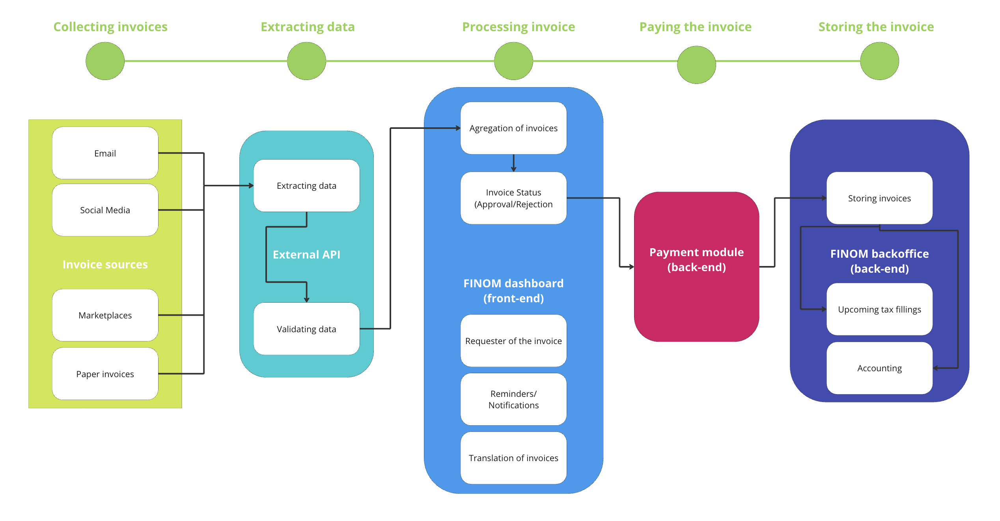
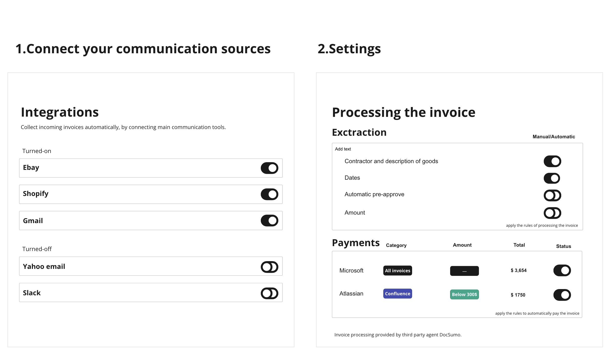
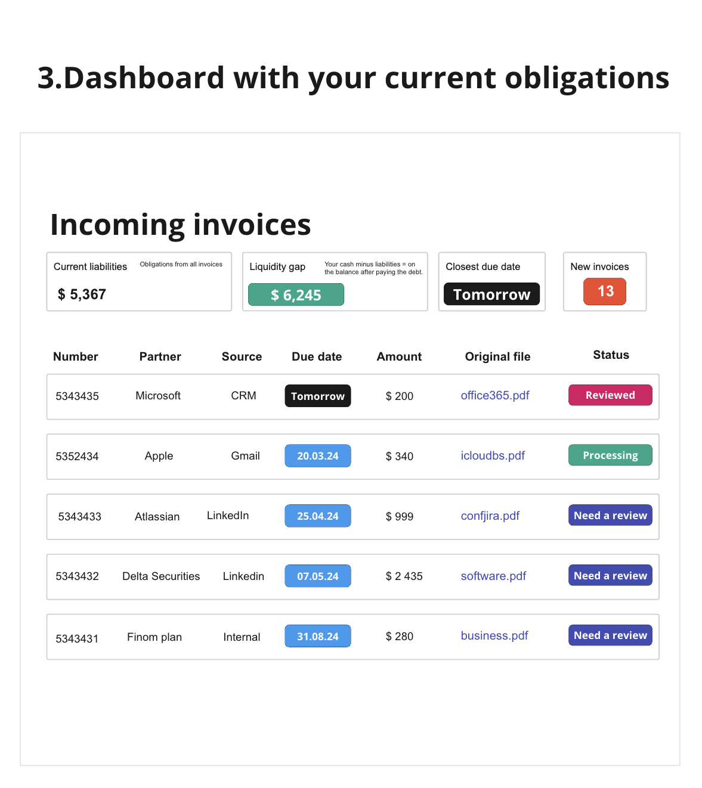

Составил техническую спецификацию системы автоматического сбора инвойсов для FINOM. Сделал акцент на сокращении ручного ввода данных и понятном интерфейсе, чтобы управление инвойсами для малого и среднего бизнеса было эффективным.

# Task 1 — Technical Specification

## 1 step. Understanding the assignment

1. Сначала я разложил бы задачу и прояснил, что именно нужно отдать. Допускаю, что я новый продакт-менеджер на проекте и раньше с инвойсами не работал. Меня только что наняли и делегировали эту задачу.
2. В Finanza есть продукт, который позволяет МСБ выставлять инвойсы и вести банковские счета, чтобы отправлять и получать платежи. Нужно спроектировать решение для сбора инвойсов в соответствии с обязательствами: сократить ручной ввод данных и сделать интерфейс простым. Что это значит для задания?
3. Это значит, что есть требования, результаты, текущая функциональность и сама цель:

### Current functionality (What we have)

- генерация исходящих инвойсов
- платёжный счёт, чтобы отправлять и получать платежи

### Implementation (Our goal)

- эффективный сбор входящих инвойсов

### Requirements (Our border conditions)

- максимально сократить ручной ввод данных
- интуитивный интерфейс

### Deliverables (Results at the end of the assignment)

- техническая спецификация
- визуальная блок-схема решения
- прототипы интерфейса (необязательно, но лучше сделать)
- описание того, как измерять успех функции.

1. Теперь понятно, чего нужно добиться. Следующий шаг — разобраться, как это реализовать.

## Step 2. Discovery process.

1. До задания я знал, что такое инвойс, но не знал особенностей транзакций, технологий, применения и ролей для бизнеса. **Поэтому сначала решил разобраться в предмете.**
2. Нужно понять, зачем важны входящие инвойсы и какие здесь работы. Зачем их вообще собирать?
    - Бухгалтерия и налоги — клиенту нужно контролировать финансовое здоровье дела: обязательства, входящие и исходящие деньги, общий денежный поток, деньги на счёте и подавать налоги после получения прибыли.
    - Юридическая защита — инвойс служит доказательством оплаты на случай неоплаты, отказа или любой другой ситуации, которую можно предъявить в суде как доказательство.

Плюс: финансовый анализ, маркетинг, тренды и паттерны. **Этот процесс критичен для бизнеса, обязателен, и на нём нельзя экономить.**

1. Теперь соберём информацию, как выглядит процесс «сбора входящих инвойсов». Немного исследования рынка. Для этого я бы:
    - посмотрел конкурентов: Stripe, Wise, Square и Revolut Business (точнее, но дольше, чем простой поиск)
    - просто спросил Google, ChatGPT и Perplexity (легко, но ответы широкие, не конкретные, точность под вопросом)
    - опросил текущих клиентов про входящие инвойсы: работы, боли и выгоды (долго и дорого)
    - я совместил разбор конкурентов и простой «поиск через AI-инструменты».

## Step 3. Market Research

Мои выводы. Вот что я узнал после исследования рынка:

**Поставщики сервисов**

- Есть отдельные решения для инвойсов вроде GetMyInvoice, Wave, Freshbook и Microsoft Invoice Capture (D365). Чтобы автоматизировать сбор, к ним нужно подключить каналы связи (Email, Shopify) и банковский счёт.
- У Qunto, Square и SumUp Stripe? есть OCR: они сканируют документы на разных ресурсах и импортируют их в кабинет мерчанта, где можно одобрить, отклонить и оплатить.
- Плюс есть сервисы, которые заточены на извлечение данных, а инвойсы — один из кейсов: DocuSumo, Laserfiche или Nanonets. Их API можно использовать для извлечения и согласования, остальное остаётся на вашей стороне.

**Форма инвойса**

- Бумажный инвойс, электронный инвойс.

**Каналы**

- Email, почта, инструменты для инвойсов.

**Юридические требования**

- У инвойсов есть обязательные поля, они должны следовать гайдлайнам и

**Какая автоматизация есть**

- Сервисы дают гибкую автоматизацию (можно автоматизировать всё или только импорт инвойсов, саму оплату, согласование, сверку и т.д.)

**Технический флоу сбора инвойсов**

1. Собрать инвойсы из источника в поддерживаемом формате: PDF, XML, docx.
2. Извлечь ключевую информацию (сумма, срок оплаты, товары и т.д.) с помощью OCR (optical character recognition).
3. Показать все инвойсы на дашборде. Отобразить срок оплаты и суммы.
4. Дать клиенту одобрить, отклонить и оплатить инвойс.

## Step 4. Designing the solution

1. Теперь мы немного больше знаем про сами инвойсы, конкурентов и лучшие практики и можем прикинуть, как внедрить это у себя. Предложу несколько вариантов:

- **Интеграция с внешним OCR-провайдером —** мы (как Finom) подключаемся к провайдерам вроде DocSumo через API. Они извлекут входящие инвойсы из Email, маркетплейсов и магазинов и сохранят их в нашей системе, где мы покажем их на дашборде, а клиент обработает по-разному (оплатить, одобрить, запросить ещё информацию, отправить напоминание).
- **Собрать всё внутри —** из соображений безопасности делаем всё у себя. Свои обученные AI-алгоритмы, свой OCR, масштабируемая инфраструктура (больше клиентов — больше мощностей под AI) и целое подразделение инженеров, которое эту инфраструктуру поддерживает.
- **No-code сборка —** на Zapier, Docupilot и Typeform собираем флоу без кода.

1. Как выбрать правильный? Зададим критерии и поставим каждому варианту от 1 до 3 баллов, потом сложим. Вариант с меньшей суммой требует меньше ресурсов и сейчас уместнее.

**Меньше сумма — лучше**

|  | Стоимость разработки | Стоимость сервиса | Безопасность | Усилие клиента | Соответствие нашим требованиям | Сколько внедрять | Итого |
| --- | --- | --- | --- | --- | --- | --- | --- |
| **Интеграция с внешним OCR** | **1/3** | **2/3** | **2/3** | **1/3** | **2/3** | **2/3** | **10** |
| Разработка внутри | 3/3 | 3/3 | 1/3 | 1/3 | 1/3 | 3/3 | 12 |
| No-code сборка | 1/3 | 1/3 | 3/3 | 3/3 | 3/3 | 1/3 | 12 |

- стоимость разработки — сколько стоит разработать?
- стоимость сервиса — сколько стоит поддерживать?
- безопасность — насколько это безопасно для клиентов? Это их банковский счёт, бизнес и деньги
- усилие клиента — насколько ему будет тяжело: подход, онбординг, активация
- соответствие нашим требованиям — свести ввод данных к нулю и интуитивный дизайн
- сколько внедрять — сколько займёт релиз? недели? месяцы?

1. **По итогам скрининга я выбрал интеграцию с внешним OCR.** Ещё по нескольким причинам:
- мы всё ещё не знаем, будут ли клиенты пользоваться функцией. На гипотезу лучше не тратить много.
- у нас мало времени, чтобы писать своё или гарантировать безопасность no-code решения.
- наше решение — эксперимент, но ошибки мы не терпим, качество должно быть надлежащим, мы банковский сервис. Лучше взять решение, которое уже работает и у которого много похожих на нас клиентов.

Пора готовить спецификацию решения. Будем интегрироваться с внешним провайдером, чтобы извлекать инвойсы.

## Step 5. Specification

### Frontmatter

| **Автор** | Leonid Mikhalev |
| --- | --- |
| **Согласующие** | Product Lead, CPO |
| **Участники** | Product Manager, System Architect |
| Команда | Invoicing Team |
| **В курсе** | Devs, QA, CPO, Product Lead, CEO |
| Создано | 10.02.2024 |

### Summary

Чтобы оплатить входящий инвойс, вы выходите из FINOM и идёте во внешний источник: почту, Shopify, Amazon и т.д. Потом нужно найти и скачать инвойс, скопировать всю информацию и перенести её на страницу нужного способа оплаты. На поиск и скачивание инвойса, снятие данных, проверку, заполнение форм и оплату уходит ценное время. Мы хотим автоматизировать процесс, автоматизировав сбор инвойсов через внешний API.

### 📰Glossary

invoice — коммерческий документ, который продавец выставляет покупателю по сделке. Инвойс подтверждает покупку, фиксирует условия сделки, способ оплаты и обмен реквизитами.

incoming invoice — инвойс, который получил покупатель (клиент FINOM) и по которому нужно заплатить продавцу конкретную сумму за конкретные товары.

OCR — Optical Character Recognition, технология, которая переводит изображения или текст в машиночитаемый формат. Благодаря OCR можно извлечь все поля из инвойса и заполнить форму автоматически.

Zapier — популярный инструмент автоматизации процессов вроде отправки писем и сбора логов.

DocSumo — корпоративное решение с OCR, которым мы можем пользоваться, чтобы собирать входящие инвойсы.

Microsoft Invoice Capture (365D) — часть подписки Microsoft 365, которая тоже позволяет собирать и распознавать инвойсы.

### Context

**Откуда проблема** — инвойсы приходят из разных каналов, плюс у аккаунт-менеджера на стороне клиента есть другие контрагенты, и получается настоящая каша: источники и клиенты в разных каналах, и всё это только чтобы сверить и оплатить инвойсы.

**Как проблема бьёт по пользователям** — владельцы бизнеса тратят дополнительное время (оценка в часах) на сбор, агрегацию, сверку и оплату. В итоге они теряют деньги на этом неэффективном процессе.

**Влияние на цели компании** — для бизнеса FINOM это значит, что объём инвойсов не растёт, а значит не растёт объём транзакций и нет дополнительной выручки с комиссий. Плюс есть риск оттока: у конкурентов эта функция есть.

**Почему задачу стоит решать** — это потенциально даёт возможность увеличить выручку и повысить удовлетворённость клиентов.

### Product Requirements

1. Система должна точно извлекать нужные поля из инвойсов: номер инвойса, данные поставщика, дату инвойса, срок оплаты, позиции, суммы и любую другую существенную информацию. Ошибаться в этом процессе нельзя. Это запрещено.
2. Система должна работать с разными форматами инвойсов (XML, JSON, CSV, UBL), форматами файлов (doc, pdf, epub) и разными языками (ES, EN, DE, NE).
3. Система должна бесшовно стыковаться с текущими системами FINOM: бухгалтерским софтом, CRM и ERP. Интеграция должна позволять легко переносить извлечённые данные в нужные формы или базы. Старые инвойсы тоже должны выгружаться в систему.
4. Система должна поддерживать разные входные каналы для инвойсов: автоизвлечение и ручную загрузку с телефона и веба.
5. Система должна соблюдать местные законы и международные стандарты комплаенса, особенно по чувствительным финансовым данным. Систему нужно аудировать и использовать все доступные технологии безопасности: шифрование, клонирование данных и локальное хранение.
6. У системы должны быть отчёты и аналитика, чтобы после релиза видеть, как клиенты работают с инвойсами: доля ошибок, время обработки. Эти инсайты используем, чтобы находить, что улучшать и оптимизировать.
7. У системы должен быть понятный интерфейс для тех, кто с ней работает. Интуитивный и простой, с drag-and-drop, поиском и уведомлениями.
8. Систему нужно закрыть гайдами, FAQ и статьями, команду поддержки нужно обучить.
9. Система должна исключать ручной ввод данных: он добавляет риск ошибок и в итоге съедает больше времени и денег.

### Technical Requirements

1. Система должна масштабироваться под растущий объём инвойсов, потому что бизнесы клиентов FINOM растут. Больше клиентов — больше инвойсов, больше продаж — больше инвойсов. Она также должна выдерживать сезонность и всплески обработки.
2. Система должна держать текущий объём пользователей и быть готовой обработать ещё больше. По скорости производительность должна быть идеальной.
3. Система не должна быть дорогой: мы платим за каждый инвойс.
4. Система должна быть интегрирована с основными бухгалтерскими, ERP и CRM системами, чтобы функцию приняли без швов.

### Out of scope

- Исходящие инвойсы — не часть этого проекта, текущая функциональность это закрывает.

### **Assumptions**

- Бюджет на эксперимент с этой функцией есть.
- Служба безопасности согласна встроить внешнее ПО в нашу систему.
- Мы найдём подходящие условия партнёрства с внешними провайдерами и внутренними стейкхолдерами.

## **Step 6. Current and suggested solution.**

**Сторона клиента** — клиент идёт в каналы связи: мессенджеры, соцсети, почту и маркетплейсы — и вручную скачивает все инвойсы. После скачивания вручную копирует обязательные данные, вставляет их в платёжную форму, делает сверку и оплачивает инвойс.

**Сторона бизнеса** — мы видим только успешные и неуспешные оплаты по инвойсам и никак иначе не можем помочь клиентам со входящими запросами.

**Плюсы этого решения** — для нас и для клиентов оно «бесплатное» (психологически), безопасность этих каналов связи — не наша забота, внедрить легко, флоу всем известен.

**Минусы этого решения** — занимает много времени, невнимательность ведёт к ошибкам, в итоге теряются и время, и деньги.

### **Suggested Solution / Design**

**Сторона клиента** — клиент один раз подключает каналы связи (Email, CRM, Facebook) к аккаунту FINOM. Когда кто-то присылает ему инвойс, проверять источники кроме дашборда внутри FINOM не нужно. Инвойсы появятся там автоматически, и клиент увидит источник инвойса, канал связи, срок оплаты, запрошенную сумму и т.д. Если клиент хочет оплатить, все обязательные данные извлекутся из инвойса на страницу оплаты, когда он выберет получателя. Скачивать, копировать данные и заполнять формы вручную не нужно. Плюс алгоритм помогает со сверкой и проверкой корректности данных.

**Сторона бизнеса** — мы можем обучать OCR-модель, чтобы менять точность, и смотреть число инвойсов, собранных автоматически, и время на оплату инвойса (автоматизация должна его сократить). Контроля больше: можно влиять на метрики и помогать клиентам освоить функцию, потому что это происходит на нашей стороне.

**Плюсы этого решения** — никакие данные вводить не нужно, клиент управляет всем с простого дашборда внутри FINOM. Исходные требования закрыты.

**Минусы этого решения** — для нас это будет стоить денег (юнит-экономику, скорее всего, придётся пересчитать), и мы принимаем риск безопасности внешнего провайдера.

## Step 7. Business logic and design.

Система забирает инвойсы из разных каналов, извлекает из них данные и загружает данные на дашборд клиента, где он может их обработать (отклонить, одобрить, сохранить, отложить).

### UX/UI presentation

Клиенты смогут подключить самые популярные инструменты связи и настроить границы автоматизации. Если суммам они нам не доверяют, остальное можем сделать мы, а финансы они заполнят вручную.

Клиенты также смогут настроить автоплатёж: автоматически платить за товары, подписки и услуги. Если сумма небольшая, а отправитель запроса надёжный, платёж можно автоматизировать. Эти правила настраиваются.

Клиенты увидят все инвойсы из разных каналов: исходные файлы, суммы и сроки оплаты. Ближайший срок, остаток средств после оплаты всех инвойсов и т.д.

## Step 8. Risks

1. **Безопасность данных —** интеграция внешних систем значит, что чувствительные финансовые данные уходят нашему OCR-провайдеру. Но мы (как FINOM) — банк, и наши данные — это финансы реальных компаний. Меня беспокоит безопасность данных: несанкционированный доступ, утечки или раскрытие конфиденциальной информации.

**Что делаем —** проводим оценку безопасности внешнего провайдера: политики, практики и сертификаты. Убеждаемся, что у провайдера есть шифрование и контроль доступа. Где можно, обезличиваем данные, чтобы снизить риск раскрытия чувствительной информации.

---

1. **Приватность данных —** у каждой юрисдикции свои требования к приватности, а клиенты из разных стран, поэтому нужно соблюдать местные законы и стандарты вроде GDPR, HIPAA или PCI DSS.

**Что делаем —** проверяем, что OCR-провайдер соответствует GDPR, HIPAA или PCI DSS. Также можем заключить соглашение об обработке данных (DPA) или похожий договор, чтобы зафиксировать требования и ответственность по защите данных.

---

1. **Работа вендора** — надёжность и стабильность внешнего провайдера может и будет влиять на клиентов FINOM. Есть риск перебоев, даунтайма или даже того, что вендор закроется и сорвёт операции.

**Что делаем —** проверяем репутацию вендора, финансовую устойчивость и историю надёжности сервиса. Это базовая вещь, которую крупные компании делают с партнёрами и новыми связями, и нам тоже стоит. Ищем рекомендации других клиентов или отраслевых партнёров.

---

1. **Перерасход —** такие OCR-провайдеры могут быть довольно дорогими, и с ростом бизнеса FINOM поддерживать текущую реализацию будет стоить всё больше. Плюс вендор может поднять цены в любой момент.

**Что делаем —** считаем затраты и выгоду и финансовый анализ полной стоимости решения. Можем спрогнозировать затраты по темпу роста и решить, насколько длинным будет сотрудничество. Плюс я бы начал думать про внутреннее решение.

---

## Step 9. Stages and Deliverables

Вот как решение выглядит в результатах.

1. **Поиск решения.**

Кто нужен — Product Manager, стейкхолдеры (сбор требований)

1. **Переговоры об эксклюзивных условиях**

Кто нужен — PM, стейкхолдеры, чтобы получить лучшую сделку

1. **Обсуждение реализации с системными архитекторами, SecOps, QA и ключевыми стейкхолдерами**

Кто нужен — команда QA, разработчики, PM, SecOps, риск-аналитики и ключевые стейкхолдеры.

1. **Начать проектирование дашборда в аккаунте FINOM (и другие инкременты на нашей стороне, чтобы интеграция прошла и ожидания сошлись).**

Кто нужен — PM, чтобы поделиться видением и сделать прототип.

1. **Фаза исследования (необязательно) — здесь можно проверить решения с клиентами (показать прототипы и т.д.), но это зависит от времени и ресурсов.**

Кто нужен — PM, чтобы спроектировать опросы и UX-тесты, дизайнеры, чтобы сделать прототип в Figma.

1. **Счёт за решение и интеграцию с OCR-провайдером.**

Кто нужен — стейкхолдеры и бухгалтерия, чтобы проверить условия и получить одобрение, и разработчики (бэкенд и фронтенд), чтобы внедрить решение.

1. **Тестирование внедрённого решения.**

Кто нужен — QA, PM, UX-тесты с членами команды (примерно 5–7 человек, чтобы найти возможные баги и трение в интерфейсе)

1. **Обучающие материалы вокруг функции и онбординг поддержки, бухгалтерии и QA.**

Кто нужен — маркетинг, копирайтер (или это может сделать PM) и бизнес-аналитики для документации.

1. **Настройка аналитики и онбординг ключевых людей: бухгалтерия, поддержка, QA.**

Кто нужен — фронтенд-разработчики для аналитики, PM для онбординга функции и презентации

1. **Итерации по производительности и измерение успеха.**

Кто нужен — PM, QA, разработчики, вся команда

1. **Решение о будущем проекта. Делать своё или остаться с внешними вендорами.**

Кто нужен — PM, ключевые стейкхолдеры, риск-аналитики, бухгалтерия.

## Step 10. Measuring Success

Метрики, которые я бы трекал с этим решением:

| Метрика | Описание |
| --- | --- |
| Извлечение данных | Можно трекать долю правильно извлечённых полей от общего числа полей в инвойсе. Так понимаем корректность интегрированного решения. |
| Время обработки | Можно смотреть время на обработку каждого инвойса, потом оптимизировать и сравнивать со статус-кво, когда процесс был полностью ручным. |
| Удовлетворённость клиентов | Собирать базовый фидбек пользователей и стейкхолдеров: удобство, надёжность и эффективность решения. |
| Пропускная способность | Число инвойсов, обработанных за единицу времени (например, в час или в день). Выше пропускная способность — выше эффективность и масштабируемость решения. |

# Task 2 — from 4 weeks to 2 weeks.

**Руководство настаивает на сроке поставки в 2 недели. Вот что я бы сделал как владелец проекта.**

1. Урезать объём решения. Это значит работать либо с нашими требованиями, либо с внешним провайдером. Обычно можно сделать частичную интеграцию, которую быстрее внедрить и протестировать. Например, дашборд можно вынести из разработки и отправлять инвойсы клиенту на почту.
2. Исходя из приоритета задачи, я бы собрал и соединил все доступные ресурсы на этом проекте, забрав их с проектов, которые могут подождать.
3. После урезания объёма или приоритизации проектов я бы поговорил со всеми стейкхолдерами и управлял ожиданиями: если режем объём работ, с теми же ресурсами отдадим меньше, или больше, если людей будет больше, но это требует денег.

### Time to finish the assignment — 25 hours.

1. подготовка — включая исследование, discovery и проектирование решений — 15 часов.
2. блок-схемы — 1 час.
3. прототип — 1 час.
4. техническая спецификация — 8 часов.

### Sources

StackOverflow [https://stackoverflow.blog/2020/04/06/a-practical-guide-to-writing-technical-specs/](https://stackoverflow.blog/2020/04/06/a-practical-guide-to-writing-technical-specs/)

Stripe — [https://docs.stripe.com/invoicing](https://docs.stripe.com/invoicing)

GoCardless — [https://gocardless.com/features/invoicing/](https://gocardless.com/features/invoicing/)

DocSumo — [https://www.docsumo.com/blog](https://www.docsumo.com/blog)

Easy —  [https://easy-software.com/en/newsroom/electronic-invoice-formats-standard-confusion-in-europe/](https://easy-software.com/en/newsroom/electronic-invoice-formats-standard-confusion-in-europe/)
