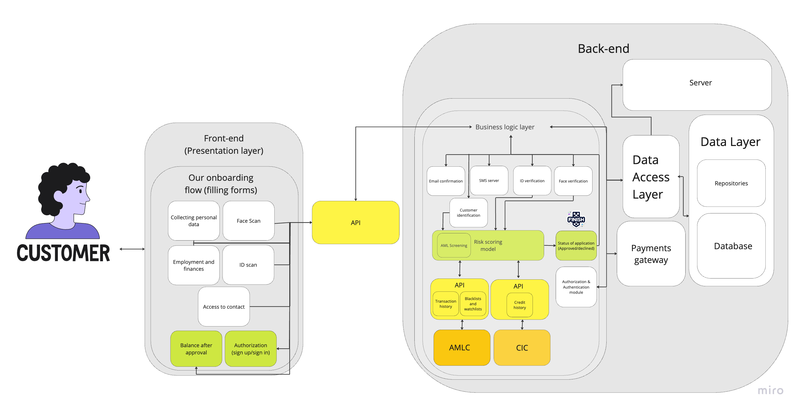

Developed a comprehensive mobile onboarding process for Salmon Credit Line, focusing on user acquisition and retention. Collaborated with marketing and design teams to create a seamless user journey from awareness to engagement.

Content

1. Main actions of the project
2. Feedback for designer’s flow
3. Architecture of IT systems

---

1. We have business requirements. We have some border conditions and business goals, and in order to succeed we need to decompose the task. 
2. So, we need to set up an online acquisition channel. How does online acquisition look on mobile? It includes these steps:
- awareness (the client sees the commercial)
- consideration (the client entered the Store and thinking about downloading our app).
- onboarding (the client opened the app)
- maintaining relationships (the client has used app for a while)

1. Now it looks more clear, what increments we need to provide to succeed in every stage:

**Stage: he sees the commercial.** 

## **1 step. Awareness. How people will acknowledge Salmon RCL?**

💡 The goal of this stage — design the process “from the idea of RCL to acquiring customers”, including creating commercials, and calculating economics. List of increments after this stage down below.

Our marketing specialist already knows what acquisition channels we need to test at the beginning, but I decided to challenge the flow and make a process more transparent for the team, so here are all the steps:
					

1. Find channels where we want to buy traffic (bit of research, asking locals, and marketers for expertise, cost per click). Who do we need:
    - Product Manager — helping marketers, and conducting research
    - Marketer — to learn more about channels, to test channels, provide knowledge about marketing indicators,
2. Learn the rules of the place and create a commercial aligning with them and regulators. Who do we need:
    - Marketers — the idea, and concept of the ad.
    - Lawyer/Compliance officer — to check if the commercial doesn’t violate laws/rules of the platform, commercial laws, banking ads regulation, wording, and what we can say, or can’t.
    - Designer — to design a commercial for different placements.
    - Product manager (myself) — to help the marketer better understand the audience, and help the designer find the best way to execute this ad. The product manager is charged with managing the process.
    - Stakeholders — to approve the final version (If we are lacking time, skip the step)
3. Calculate a simple unit-economics model to make sure, the model works at least on paper — using data from marketing research (as Outreach, CPC, CAC, COGS) and business indicators (as Margin, our interest rates, fees, defaults). Who do we need:
    - Risk manager — to better understand the influence of this campaign on Salmon’s financials (reserves, liquid assets, debt facilities, FCF)
    - Product manager — to design the model, and collect all data together under Excel formulas.
    - Stakeholders — check if unit economics aligns with our business deadlines, and match the expectations of lenders and agreements with partners.
4. Create the budget plan (P&L) for the experiment and approve it. During creating the plan, we need to understand: how long we’ll run the ad. how much do we need to finance it? length of the experiment? How fast we get the expected numbers in borrower accounts? charged interests? Are there any financial risks involved as lack of liquidity? 
- Risk manager — to forecast risks, costs of experiment, influence, and impact on our finances.
- Product manager — collect all info together and calculate.
- Stakeholders — for final presentation and approve. 

We also should consider that we’ll have different cohorts of users, some of them are good for business, and some are not, so we also need to manage traffic by channel, and segments, to understand properly who we acquire and how many of them. Here are my assumptions on potential segments:
    - took a loan and overpaid (closed the loan within interest-free period) —  (not profitable)
    - took a loan and didn’t overpay, was charged with monthly interest, but paying accurately  — (profitable)
    - took a loan, didn’t overpay, was charged with interest, missed the deadline, was charged with penalties for every day of delay —  (profitable)
    - took a loan, didn’t return anything, and filled for a default — (not profitable)

### Deliverables at the end of the Awareness stage:

- Channels where we’ll run our commercials, with step-by-step strategies.
- Prepared commercials in the form of videos, pictures, gifs, etc.
- Unit-economics model to forecast results and manage expectations.
- P&L — overall financial view on this project. Our investments and business impact.

---

**Stage: he enters the AppStore/Google and thinks about downloading our app**

## **2 step. Сonsideration (Decision-making). How will we earn trust? Why us?**

💡 The goal of this stage — design the process of earning trust against clients, and creating reputation, as they’ll decide if should they trust us with their money.

Usually, this stage includes working with reviews, ASO, FAQ, website, press releases. Some of them are already fine, but others require attention and effort from the team: 

1. **Reviews** — The App Store should represent reviews, ratings, and how Salmon as a company interacts with the current customer base. I thought about working with all stores, but they’re fine in the App Store and Google Play, where we get the majority of traffic. 

Excepting **AppGallery**. Review, rating, and comments fields are empty there, which is not a representation of trust. I would do something about it, but it depends on the final impact. At first, I had concerns about an actual number of Huawei users in the Philippines and the potential upside of acquiring more. But after discovering the data, which says there are 9 million Huawei users in Philippines, they’re gone. We need to implement reviews for Huawei too, so we need: 
    - Mobile developer(Android) — to implement the script allowing to trigger review pop-up and release open testing version to App Gallery. Source: [AppGallery Documentation](https://developer.huawei.com/consumer/en/doc/AppGallery-connect-Guides/agc-comments-introduction-0000001063018306)
    - Product Manager — test the open testing version, trigger the pop-up, and see how submitting testimonials works.

But if we have already implemented this feature, then why we don’t have them in AppGallery?  We actually didn’t ask. (bug) It was an inappropriate moment? Users are not happy? To resolve this open question, we need to look at the amount of requests for review, the actual user base in our analytics panel.

1. **FAQ/Help Center** — We don’t launch new products, but we should bring some explanation and clarity about the new flow in Salmon’s app. For that purpose, we can add simple guidelines to our FAQ. Users should understand how online onboarding differs from POS and will affect it. Who do we need:
    - Marketer (Copywriter) — will write guides according to release and features in it.
    - Product Manager — checking the final result, testing the final solution.
2. **App page in Stores** — Online onboarding is a completely different way to start using Salmon, by filling out the form in the app, without visiting a local merchant. Our goal — to make this statement pretty clear.  For that purpose we need to update: screenshots of the app, update “Description”, add info into “What’s new”, etc. 
    - ASO Specialist, who’ll release new builds with updates in ASO, pictures, etc.
    - Marketer (Copywriter) — to write new texts on Google Play, AppStore, and AppGallery pages.
    - Product Manager — help the designer to represent this update to users, and manage this project.
    - Designer — to design new materials for stores (mockups)
3. **ASO** — We need to optimize our app’s page in Google Play, AppGallery, and App Store. It won’t help with paid traffic directly, but can potentially bring some organic or referral traffic (word of mouth), so we better make sure, we’ve optimized our pages in stores. Who do we need:
    - ASO Specialist, external contractor, who’ll optimize keywords, proper pictures, subtitle, app name, etc.
    - Product Manager — find a contractor, write TA, accept the job, and make sure everything is done.

We can skip the ASO step if we’ve already done it, but I would double-check. 

### Deliverables at the end of the Consideration (Decision-making) stage:

- Completed ASO for our apps in the App Store, Google Play, and AppGallery.
- FAQ/Help Center with proper guidelines about online onboarding.
- Completed App Store page with new description, screenshots, mentioning new flow.
- Reviews for AppGallery (Huawei)

---

**Stage: he has downloaded and opened the app**

## Step 3. Onboarding. First contact with the client. How to help him with a new product?

💡 The goal of this stage — design the coolest onboarding flow for new users. Perfect onboarding is a must, as we are planning to spend a lot of money on paid traffic, we can’t afford to lose clients at this stage of the funnel.

Our designer already made a potential onboarding flow in Figma, but if he didn’t here is how I would do that:

1. First of all, we should think about onboarding goals. Why do we need one? What things we must implement? Here are some goals for our onboarding:
    - helping users reach the app's core value: showing the key value and how to reach the a-ha moment.
    - Increasing user adoption and retention: aims to help users learn about the app and find value in it, ultimately increasing user adoption and retention.
    - providing a frictionless experience: the onboarding process should be as short as possible.
    - introducing users to the application: helping them to become competent users and start using core features, to get the main value.
    
    For this stage, we need:
    
    - Product Manager — to make a simple prototype of possible onboarding flow.
    - Designer — to collaborate with product manager on onboarding design.
    - One of the stakeholders — to gather requirements from him, understand the business concept, to implement the onboarding according to them.
2. But… we are a fintech lending company, so we have restrictions and additional factors to consider:
    - We can’t onboard users without getting crucial data, KYC is a must.
    - We can’t mislead our clients with dark patterns. Not acceptable.
    - We can’t mislead our clients in terms of financial products. All slogans and plans must be clear.
    - We must make onboarding flow painless, because we request a lot of data, which means filling out long forms = users find it annoying, they could leave the app and forget it. Fewer clicks = better. Revolut has 24 to open an account.
    - The crucial goal for our onboarding — passing the KYC and getting your credit limit, according to the filled data. **It means we shouldn’t collect data, that we won’t use in the KYC process and risk scoring.**
    
    Who do we need here: 
    
    - Risk manager — to identify all risks related to commercials, terms of financial products, etc.
    - Product Manager — to implement these restrictions on the onboarding flow.
    
    **Shortly, our main goals in the Onboarding stage:** 
    
    - **our client should pass KYC**
    - **show how to use credit line, provide a credit line after risk scoring**
    - **Encourage the user to use the credit line**
    
    **Plus we have secondary goals:**
    
    - **Fewer clicks, faster onboard**
    - **Shorter as possible without impacting our risk-scoring model**
    
3. Knowing all of that, we can start the process of planning. Somebody already solved a similar puzzle, so I would check the best practices here — competitors and similar financial apps. 

I’ve checked platforms for references such as — Built for Mars, Mobbin, UIGarage, and Pageflows.

Key inspirations among similar apps: Revolut, Curve, Chime

Analyzed competitors: GCash, GoTyme, Maya 

Who do we need here:

- Product Manager — to conduct a short research on best practices

1. Here are some patterns in their onboarding: 
- Presenting core features before signup (because fintech is complex, and it’s nice to show what you are offering.
- Collecting less data, than traditional banks (impacts the risk score, but easier and cheaper to acquire users). Less clicks for users.
- Some of the competitors (GCash, Lloyd) have web onboarding with long forms to fill. We can use it as an advantage as we can onboard online now.

1. Now we can design our own, knowing all of that. How would I do that from scratch? 
- Share my vision and goals of this onboarding flow with the designer, and presented him simple prototype, and references.
- Ask the designer to create a flow in Figma, according to our design system, onboarding goals,
- Discuss crucial data collection with the Risk manager. What we must request? What is necessary for the risk scoring model and KYC?

Who do we need here:

- Product Manager — to iterate on the process, deliver the result.
- Product designer — to design the flow in Figma.
- Risk manager — to provide info about crucial aspects of Onboarding related to KYC/AML, Risk scoring.

1. Ooh, we already have the flow, the designer made it. Let’s review it with insights we’ve got from short research: 

### Reviewing the designer’s onboarding flow for Salmon. My feedback

💡 Goal of this stage — to evaluate a quality of potential onboarding in our app. To challenge it a bit and make sure we’ve chosen the best options to implement it.

**I checked onboarding in Figma, and here are things I like:**

- Email domain autofilling
- 5 minutes till approval is pretty fast.
- Design is pleasing to the eye.
- I like the idea, that the user, is just filling forms, but we as magicians running risk scoring behind the scenes. This is a snowball of variables.
- Verification services (ID screening) are seamless, looks like in-house development.

**Things I would change in the current onboarding flow shortly:**

- We have **33** different pages in our flow and we need approximately **58** clicks to pass the onboarding (plus you need to fill all fields). I would optimize it a bit.
- I left comments on “What I would change” on the original flow in Figma.

[https://www.figma.com/file/TD6Xe7fiNTVdDMHAeJm0gz/Test-task---Leonid-Mikhalev-Online-acqusition?type=design&node-id=0%3A1&mode=design&t=dmMb3VwjFf9OBgg1-1](https://www.figma.com/file/TD6Xe7fiNTVdDMHAeJm0gz/Test-task---Leonid-Mikhalev-Online-acqusition?type=design&node-id=0%3A1&mode=design&t=dmMb3VwjFf9OBgg1-1)

- Plus I proposed the flow (the red one) with **26** screens and only **55** clicks + automating autofiling wherever it’s possible. There are explanations for some solutions on the red flow. Check it out.

---

### **How would I make decisions on improvements of the flow?**

💡 Goal of this stage — describe process of incremental improvements in onboarding flow.

I would align on specific parameters, starting from goals:

- Our business goals — we want to gather 1000 issued loans in the first month, for that goal we need to onboard as many people as we can. Why do we need 1000? Because we need to optimize our risk-scoring model. What’s the budget? Money is not endless. When the risk-scoring model is done, we can discuss new goals, and according to them we’ll iterate on the onboarding changes.
- Onboarding goals — to get 1000 issued loans, 1000 must pass the onboarding, which means 1000 passed KYC, IDs, accounts, etc. So the onboarding must be efficient as hell. Shorten the process, making it painless, and less effort to become a user and get a loan without damaging our margin.
- Analytics — checking the onboarding funnel metrics will be useful to understand the performance of the flow. Do we lose users somewhere? Where exactly? Or do they struggle and spend more time filling in data?
- Feedback and tests — I would ask for feedback from early users + every employee to create an account on a test version of Salmon and pass the flow. Again collect the feedback. What do they say? Was it intuitive or extremely hard to understand?
- Tracking anomalies — Errors (bugs) could cause unexpected behavior, losing customer data. That’s why we need to test our solution a lot and check analytics.

Who do we need here:

- Product Manager — to analyze these sources of data and make a practical decision about improvements.
- Stakeholder — to make sure, we are on the same page in terms of goals, actions, deadlines.
- Product Analyst — to gather insights and anomalies from product analytics, provide that brief to the product.

---

1. Let’s get back to our onboarding stage. W**e have a design, and we need to implement it in the app.** 

Who do we need here:

- Product Manager — to provide more context on business logic, how the flow works, iterate on the process, and serve as a mediator between engineers and the business side.
- Mobile developers — to implement this onboarding flow for Android and IOS apps.
- Backend developers — to implement background systems, like Risk scoring models, KYC process, gathering and storing data.
- Risk Manager — to make sure, the implemented KYC, and scoring modules work perfectly, and we didn’t make any mistakes during implementation.

This flow is complex, with many sides involved, so I’m going to create a simple brief view of IT systems:

### “Bird view” on IT systems  - Salmon Architecture during Onboarding stage

**Glossary**

**AMLC — The Anti-Money Laundering Council of the Philippines (AMLC) is a government agency established to combat money laundering and other financial crimes in the country**

**CIC — The Credit Information Corporation (CIC) is a government-owned and controlled corporation providing credit information system in the Philippines.**

1. To make our scheme more accurate, we must discuss nuances with technical side. Who do we need to find the best technical solution:
- CTO — to approve technical solution in terms of efficiency (scalability, etc), provide some feedback for potential improvements.
- Product manager — iterate on the increment, deliver the final result.
- Backend developer — to discuss first steps on implementing this architecture.

1. When we finish implementation, we can go the next stage. Testing the solution. It’s not the time to release the App Store, at least for now. We have new flow, totally new way to become one of our users, plus we want to acquire them through paid traffic. We can’t fail here. How would I test new onboarding in real app? 

We can bring QA engineer, ask him to implement autotests. But autotests are expensive and take time to implement them. What about manual testing? Well, even if we have 3-4 QA engineers, there is no guarantee they would find all bottle necks and bugs. I prefer to choose another way:

- Uploading the build (Testflight) to our employees and ask them to pass Onboarding stage. If 10-15 people finish the onboarding, we have more chances to find problems in current flow. 

Obviously we need to collect feedback. The simplest way would be — Google Forms, the hardest — inviting everyone for 5 minute online call, and watching him, passing the onboarding. Let’s go with Google Forms and ask everyone about issues in the process.
- Next stage or alternative way would be — release the update for a small group of real users. We risk more, if we start here, so we better test onboarding on our employees first.

It’s an iterative process. So we will collect feedback and iterate again and again. Who do we need:

- Mobile developer — to implement test build of the app.
- Employees — 10 minutes of their time (10-15 people) for passing onboarding and giving feedback.

1. Updating Product Analytics system — we need to track new user flow, so we could analyze their behavior, track bottle necks, and find anomalies. We need only:
- Mobile developer — to identify new events, their properties and update tracking code.

1. But after we’ve done, it’s time to release onboarding for the public — Google Play, App Store, AppGallery. We already created a new page in App Store and other stores, wrote a description with help from Copywriter. We only need: 
- Mobile developer — to release the update.

1. Make it public. I would write a press release for our website, post in Facebook with this update, so we could get a wave of attention. Some local news will mention this update for sure, as some banks in Phillipines require offline or web onboarding. But we are proposing 5 minute approve on mobile. Who do we need:
- Copywriter — to write a press release and post on social media.
- Product Designer — to design a picture for press-release and posts on social media.
- Product Manager — to manage the process, report to stakeholders.

---

### Deliverables at the end of the Onboarding stage:

- Completed design of onboarding flow in Figma
- Releasing Salmon app with online onboarding.
- Bird view on Salmon’s architecture during Onboarding stage.

---

We made a design, implemented in the app, connected product analytics. So it’s time to talk about recurrent activities here. Onboarding isn’t the finish point, but a process, so we need to do keep going with enhancing the flow. Here is how: 

### Stage 4. Maintaining relationships with clients (Retention)

💡 Goal of this stage — design the process of retaining customers inside the product.

1. Conduct research about user needs — to better understand how their preferences change as we change the product. Pain points, key jobs, expectations, feedback, these are things we should know and update through the time. 
2. Personalize onboarding — the user base will grow, and our clients are different so we’ll segment them by behavior, goals. They should have onboarding adapted for their needs. We can implement different flows and  A/B test them, to find the one, which converts better and helps this specific segment. 
3. Build CJM and search for bottle necks — CJM will help us to identify all points where customer interacts with us, comes to the product, asks for help. All of it to properly understand value chain for specific segment or a client. 
4. Change the flow according to changed business goals and user needs — product will change, we’ll deliver new features. We must prioritize initiatives,  don’t forget about key products and features. More product streams = more advocates of users. We must cut the deal with them. The perfect condition here — compromise between business requirements and user needs. 
5. Intitate a loyalty program —  our interest is to encourage users  to spend money from RCL, and reward them for such activity. This is the way to build long-term relationships. Top credit products as Klarna or Tabby have the cashback program, which motivates users to stay and spend money this way, not by searching another way. 
6. Help to reach the goal painfully — in context of credit product (or any financial product), we must provide clear terms, client shouldn’t expect any suprpises, and we better send push notifications to remind him about repayment days.

### Deliverables at the end of the Maintaining relationships stage:

- Concept of potential loyalty program
- Finished CJM (repetitive)
- Personalized onboarding for different segments (repetitive)
- Conducted research and collected feedback (repetitive)

---

## **Success metrics for 1-3-6 month after launch.**

💡 Goal of this stage — to identify how close we are to our goals. Also could be used to make changes in the product/onboarding flow for better conversion, margin,etc.

### 1 month after the launch

- Downloads from the stores — users who we acquired actually downloaded the app.
- Passed Onboarding (Adoption rate) — they passed the KYC and were approved.
- Issued loans (Signing the agreement) — they sign the agreement and got the credit line. We need 1000 in first month
- Ratio Onboarding/Signing the agreement — do people agree with the terms, or they think its unfair, too expensive, etc. Ratio of who signed after onboarding.
- Loan Approval rate — ratio of folks, who was approved/declined. Indicator for Risk-scoring accuracy.
- Loan Portfolio Growth — increasing the size of loan portfolio

### 3 months after the launch

- CAC — acquisition budget / customers acquired over given period
- Loan Portfolio Yield - ratio of interest, fees income / average gross loan portfolio. Ratio between revenue from loans / current liabilities
- Loan Default Rate — ratio of clients, who couldn't pay his debt and filled for restruction/bunkruptcy.
- Size of Loan portfolio — How much did we lend? What’s the dynamics?
- Clients in interest-free period/clients who’s been charged with interest — ratio will show, the quality of our leads, as “too smart” clients will pay within interest-free period. Majority of them would be bad for our model.

**Plus**

- **All metrics we’ve tracked after 1 month**
    - Downloads from the stores — users who we acquired actually downloaded the app.
    - Passed Onboarding (Adoption rate) — they passed the KYC and were approved.
    - Issued loans (Signing the agreement) — they sign the agreement and got the credit line. We need 1000 in first month
    - Ratio Onboarding/Signing the agreement — do people agree with the terms, or they think its unfair, too expensive, etc. Ratio of who signed after onboarding.
    - Loan Approval rate — ratio of folks, who was approved/declined. Indicator for Risk-scoring accuracy.
    - Loan Portfolio Growth — increasing the size of loan portfolio

### 6 months after the launch

- Net interest income
- Net fee and commission income
- Net interest Margin — interest rate on assets/interest on liabilities
- Pull Through Rate — ratio between issued loans / applications submitted during a period. It will show as the health of our finances, and allow to forecast where will we need another financing for Salmon,etc.

**Plus**

- **All metrics we’ve tracked after 1-3 month**
    - Downloads from the stores — users who we acquired actually downloaded the app.
    - Passed Onboarding (Adoption rate) — they passed the KYC and were approved.
    - Issued loans (Signing the agreement) — they sign the agreement and got the credit line. We need 1000 in first month
    - Ratio Onboarding/Signing the agreement — do people agree with the terms, or they think its unfair, too expensive, etc. Ratio of who signed after onboarding.
    - Loan Approval rate — ratio of folks, who was approved/declined. Indicator for Risk-scoring accuracy.
    - Loan Portfolio Growth — increasing the size of loan portfolio
    - CAC — acquisition budget / customers acquired over given period
    - Loan Portfolio Yield - ratio of interest, fees income / average gross loan portfolio. Ratio between revenue from loans / current liabilities
    - Loan Default Rate — ratio of clients, who couldn't pay his debt and filled for restruction/bunkruptcy.
    - Size of Loan portfolio — How much did we lend? What’s the dynamics?
    - Clients in interest-free period/clients who’s been charged with interest — ratio will show, the quality of our leads, as “too smart” clients will pay within interest-free period. Majority of them would be bad for our model.
    

### Didn’t mention it, but definitely would implement:

1. In case user urgently leaves the app, or it has crashed, we better store (partially) or fully filed forms in cash. It can be painful to make another 50 clicks through 35 screens. We could lost this client.
