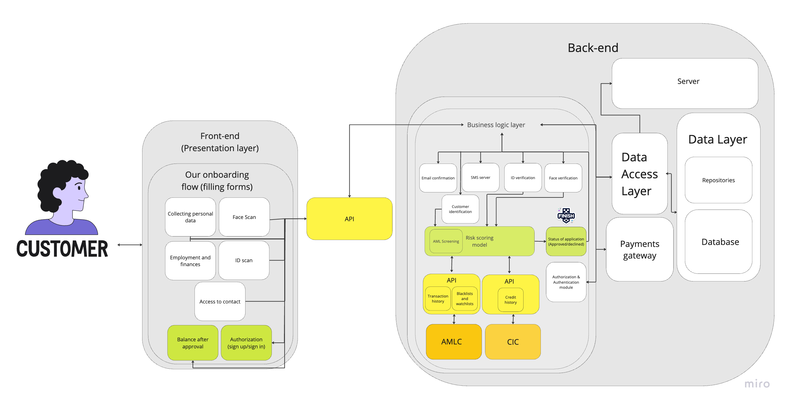

Разработал комплексный мобильный онбординг для Salmon Credit Line с фокусом на привлечение и удержание пользователей. Вместе с командами маркетинга и дизайна собрал непрерывный путь пользователя от осведомлённости до вовлечения.

Содержание

1. Основные действия проекта
2. Обратная связь по флоу дизайнера
3. Архитектура IT-систем

---

1. У нас есть бизнес-требования. Есть граничные условия и бизнес-цели, и чтобы добиться результата, задачу нужно разложить.
2. Нужно запустить канал онлайн-привлечения. Как онлайн-привлечение выглядит на мобильном? В него входят такие шаги:
- осведомлённость (клиент видит рекламу)
- рассмотрение (клиент зашёл в магазин приложений и думает, скачивать ли наше приложение).
- онбординг (клиент открыл приложение)
- поддержание отношений (клиент какое-то время пользуется приложением)

1. Теперь понятнее, какие инкременты нужны, чтобы пройти каждый этап:

**Этап: он видит рекламу.**

## **Шаг 1. Осведомлённость. Как люди узнают о Salmon RCL?**

💡 Цель этого этапа — спроектировать процесс «от идеи RCL до привлечения клиентов», включая создание рекламы и расчёт экономики. Список инкрементов после этого этапа ниже.

Наш маркетолог уже знает, какие каналы привлечения тестировать в начале, но я решил оспорить флоу и сделать процесс прозрачнее для команды. Вот все шаги:

1. Найти каналы, где мы хотим покупать трафик (немного исследований, спросить местных и маркетологов, стоимость клика). Кто нужен:
    - Продакт-менеджер — помогает маркетологам и проводит исследование
    - Маркетолог — чтобы лучше узнать каналы, протестировать их и дать знание о маркетинговых показателях,
2. Изучить правила площадки и сделать рекламу, которая им соответствует и соответствует регуляторам. Кто нужен:
    - Маркетологи — идея и концепт рекламы.
    - Юрист / комплаенс — проверить, что реклама не нарушает законы и правила платформы, рекламное право, регулирование банковской рекламы, формулировки и то, что можно и нельзя говорить.
    - Дизайнер — сделать рекламу под разные размещения.
    - Продакт-менеджер (я) — помочь маркетологу лучше понять аудиторию и помочь дизайнеру найти лучший способ исполнить эту рекламу. Продакт ведёт процесс.
    - Стейкхолдеры — утвердить финальную версию (если не хватает времени, шаг пропускаем)
3. Посчитать простую модель юнит-экономики, чтобы убедиться, что модель хотя бы на бумаге работает — на данных маркетингового исследования (охват, CPC, CAC, COGS) и бизнес-показателях (маржа, наши ставки, комиссии, дефолты). Кто нужен:
    - Риск-менеджер — лучше понять влияние этой кампании на финансы Salmon (резервы, ликвидные активы, долговые линии, FCF)
    - Продакт-менеджер — собрать модель и свести все данные в формулы Excel.
    - Стейкхолдеры — проверить, что юнит-экономика совпадает с бизнес-сроками и с ожиданиями кредиторов и договорённостями с партнёрами.
4. Составить бюджет (P&L) эксперимента и утвердить его. При составлении плана нужно понять: как долго крутим рекламу, сколько нужно на финансирование, длина эксперимента, как быстро получаем ожидаемые цифры на счетах заёмщиков, начисленные проценты, есть ли финансовые риски вроде нехватки ликвидности.
- Риск-менеджер — прогноз рисков, стоимости эксперимента, влияния на наши финансы.
- Продакт-менеджер — собрать информацию и посчитать.
- Стейкхолдеры — финальная презентация и утверждение.

Нужно также учесть, что когорты пользователей будут разными: часть полезна бизнесу, часть нет. Поэтому трафиком нужно управлять по каналам и сегментам, чтобы понимать, кого мы привлекаем и сколько их. Мои допущения по возможным сегментам:
    - взял кредит и переплатил (закрыл кредит в беспроцентный период) — (не прибыльный)
    - взял кредит и не переплатил, ему начислили ежемесячный процент, но платит аккуратно — (прибыльный)
    - взял кредит, не переплатил, ему начислили процент, пропустил срок, ему начислили пени за каждый день просрочки — (прибыльный)
    - взял кредит, ничего не вернул и подал на дефолт — (не прибыльный)

### Результаты к концу этапа осведомлённости:

- Каналы, где будем крутить рекламу, с пошаговыми стратегиями.
- Готовая реклама: видео, картинки, гифки и т.д.
- Модель юнит-экономики, чтобы прогнозировать результат и управлять ожиданиями.
- P&L — общая финансовая картина проекта. Наши вложения и влияние на бизнес.

---

**Этап: он заходит в App Store / Google и думает, скачивать ли наше приложение**

## **Шаг 2. Рассмотрение (принятие решения). Как мы заработаем доверие? Почему мы?**

💡 Цель этого этапа — спроектировать процесс завоевания доверия клиентов и создания репутации, потому что они решат, доверять ли нам свои деньги.

Обычно на этом этапе работают с отзывами, ASO, FAQ, сайтом, пресс-релизами. Часть уже в порядке, но остальное требует внимания и усилий команды:

1. **Отзывы** — в App Store должны быть отзывы, рейтинг и то, как Salmon как компания общается с текущей базой. Я думал про все магазины, но в App Store и Google Play, откуда основной трафик, всё в порядке.

Кроме **AppGallery**. Там пустые поля отзывов, рейтинга и комментариев, а это не выглядит как доверие. Я бы что-то с этим сделал, но это зависит от итогового эффекта. Сначала я сомневался в реальном числе пользователей Huawei на Филиппинах и в потенциале привлечь больше. Но после данных о 9 миллионах пользователей Huawei на Филиппинах сомнения пропали. Отзывы нужны и для Huawei, поэтому нужны:
    - Мобильный разработчик (Android) — скрипт, который вызывает попап отзыва, и открытая тестовая версия в App Gallery. Источник: [AppGallery Documentation](https://developer.huawei.com/consumer/en/doc/AppGallery-connect-Guides/agc-comments-introduction-0000001063018306)
    - Продакт-менеджер — проверить открытую тестовую версию, вызвать попап и посмотреть, как отправляется отзыв.

Но если функция уже реализована, почему отзывов в AppGallery нет? Мы просто не просили. (баг) Момент был неудачный? Пользователи недовольны? Чтобы закрыть этот вопрос, нужно посмотреть число запросов на отзыв и реальную базу в аналитике.

1. **FAQ / центр помощи** — мы не запускаем новые продукты, но должны объяснить новый флоу в приложении Salmon. Для этого можно добавить простые инструкции в FAQ. Пользователь должен понимать, чем онлайн-онбординг отличается от POS и как на него повлияет. Кто нужен:
    - Маркетолог (копирайтер) — напишет гайды под релиз и его функции.
    - Продакт-менеджер — проверит результат и протестирует решение.
2. **Страница приложения в магазинах** — онлайн-онбординг это совсем другой способ начать пользоваться Salmon: заполнить форму в приложении, не заходя к локальному мерчанту. Цель — сделать это утверждение очень ясным. Для этого нужно обновить скриншоты, «Описание», добавить информацию в «Что нового» и т.д.
    - ASO-специалист, который выпустит новые сборки с обновлениями ASO, картинками и т.д.
    - Маркетолог (копирайтер) — новые тексты на страницах Google Play, App Store и AppGallery.
    - Продакт-менеджер — помочь дизайнеру показать это обновление пользователям и вести проект.
    - Дизайнер — новые материалы для магазинов (мокапы)
3. **ASO** — нужно оптимизировать страницу приложения в Google Play, AppGallery и App Store. Это не поможет платному трафику напрямую, но может дать органику или реферальный трафик (сарафанное радио), поэтому лучше убедиться, что страницы в магазинах оптимизированы. Кто нужен:
    - ASO-специалист, внешний подрядчик, который оптимизирует ключевые слова, картинки, подзаголовок, название и т.д.
    - Продакт-менеджер — найти подрядчика, написать ТЗ, принять работу и убедиться, что всё сделано.

Шаг ASO можно пропустить, если он уже сделан, но я бы перепроверил.

### Результаты к концу этапа рассмотрения:

- Готовое ASO приложений в App Store, Google Play и AppGallery.
- FAQ / центр помощи с понятными инструкциями про онлайн-онбординг.
- Готовая страница в App Store с новым описанием, скриншотами и упоминанием нового флоу.
- Отзывы для AppGallery (Huawei)

---

**Этап: он скачал и открыл приложение**

## Шаг 3. Онбординг. Первый контакт с клиентом. Как помочь ему с новым продуктом?

💡 Цель этого этапа — спроектировать самый сильный онбординг для новых пользователей. Хороший онбординг обязателен: мы собираемся много тратить на платный трафик и не можем терять клиентов на этом шаге воронки.

Дизайнер уже сделал возможный флоу онбординга в Figma, но если бы нет, я бы сделал так:

1. Сначала про цели онбординга. Зачем он нужен? Что обязательно реализовать? Вот цели:
    - помочь пользователю дойти до основной ценности приложения: показать ключевую ценность и как добраться до a-ha момента.
    - повысить принятие и удержание: помочь узнать приложение и найти в нём ценность, и тем самым повысить adoption и retention.
    - дать опыт без трения: онбординг должен быть как можно короче.
    - познакомить с приложением: помочь стать уверенным пользователем и начать пользоваться основными функциями, чтобы получить главную ценность.

    На этом этапе нужны:

    - Продакт-менеджер — простой прототип возможного флоу онбординга.
    - Дизайнер — вместе с продактом над дизайном онбординга.
    - Один из стейкхолдеров — собрать у него требования, понять бизнес-концепцию и сделать онбординг по ним.
2. Но мы финтех-кредитная компания, поэтому есть ограничения и дополнительные факторы:
    - Нельзя онбордить пользователя без ключевых данных, KYC обязателен.
    - Нельзя вводить клиентов в заблуждение тёмными паттернами. Это неприемлемо.
    - Нельзя вводить клиентов в заблуждение по финансовым продуктам. Все слоганы и планы должны быть ясными.
    - Онбординг должен быть без боли, потому что мы просим много данных, а длинные формы раздражают: пользователь может уйти и забыть приложение. Меньше кликов — лучше. У Revolut 24 шага, чтобы открыть счёт.
    - Главная цель онбординга — пройти KYC и получить кредитный лимит по заполненным данным. **Значит, не собираем данные, которые не используем в KYC и риск-скоринге.**

    Кто нужен:

    - Риск-менеджер — все риски, связанные с рекламой, условиями финансовых продуктов и т.д.
    - Продакт-менеджер — заложить эти ограничения во флоу онбординга.

    **Коротко, главные цели этапа онбординга:**

    - **клиент должен пройти KYC**
    - **показать, как пользоваться кредитной линией, и выдать линию после риск-скоринга**
    - **побудить пользователя воспользоваться кредитной линией**

    **Плюс вторичные цели:**

    - **меньше кликов, быстрее онбординг**
    - **как можно короче, не ломая модель риск-скоринга**

3. Зная это, можно планировать. Кто-то уже решал похожую задачу, поэтому я бы посмотрел лучшие практики — конкурентов и похожие финансовые приложения.

Я посмотрел референсы на Built for Mars, Mobbin, UIGarage и Pageflows.

Ключевые вдохновения среди похожих приложений: Revolut, Curve, Chime

Разобранные конкуренты: GCash, GoTyme, Maya

Кто нужен:

- Продакт-менеджер — короткое исследование лучших практик

1. Вот паттерны их онбординга:
- Показ основных функций до регистрации (финтех сложный, и полезно показать, что вы предлагаете).
- Сбор меньшего объёма данных, чем у традиционных банков (это влияет на риск-скор, но привлекать пользователей проще и дешевле). Меньше кликов.
- У части конкурентов (GCash, Lloyd) веб-онбординг с длинными формами. Мы можем использовать это как преимущество, потому что теперь можем онбордить онлайн.

1. Теперь можно проектировать свой флоу. Как бы я делал с нуля?
- Поделился бы с дизайнером видением и целями этого флоу, показал простой прототип и референсы.
- Попросил дизайнера собрать флоу в Figma по нашей дизайн-системе и целям онбординга,
- Обсудил с риск-менеджером сбор критичных данных. Что обязательно запросить? Что нужно модели риск-скоринга и KYC?

Кто нужен:

- Продакт-менеджер — итерировать процесс и довести результат.
- Продакт-дизайнер — собрать флоу в Figma.
- Риск-менеджер — дать информацию о критичных для онбординга аспектах KYC/AML и риск-скоринга.

1. О, флоу уже есть, дизайнер его сделал. Разберём его с выводами короткого исследования:

### Разбор онбординга дизайнера для Salmon. Моя обратная связь

💡 Цель этого этапа — оценить качество возможного онбординга в приложении. Немного его оспорить и убедиться, что мы выбрали лучшие варианты реализации.

**Я посмотрел онбординг в Figma, и вот что мне нравится:**

- Автозаполнение домена email
- 5 минут до одобрения — довольно быстро.
- Дизайн приятный глазу.
- Нравится идея, что пользователь просто заполняет формы, а мы как фокусники считаем риск-скоринг за кадром. Это снежный ком переменных.
- Сервисы верификации (проверка ID) бесшовные, похоже на внутреннюю разработку.

**Что я бы коротко изменил в текущем онбординге:**

- Во флоу **33** разных экрана, и чтобы пройти онбординг, нужно примерно **58** кликов (плюс заполнить все поля). Я бы немного это оптимизировал.
- Я оставил комментарии «что я бы изменил» на исходном флоу в Figma.

[https://www.figma.com/file/TD6Xe7fiNTVdDMHAeJm0gz/Test-task---Leonid-Mikhalev-Online-acqusition?type=design&node-id=0%3A1&mode=design&t=dmMb3VwjFf9OBgg1-1](https://www.figma.com/file/TD6Xe7fiNTVdDMHAeJm0gz/Test-task---Leonid-Mikhalev-Online-acqusition?type=design&node-id=0%3A1&mode=design&t=dmMb3VwjFf9OBgg1-1)

- Плюс я предложил флоу (красный) на **26** экранов и только **55** кликов, с автозаполнением везде, где можно. На красном флоу есть пояснения к некоторым решениям. Посмотрите.

---

### **Как я принимал бы решения об улучшениях флоу?**

💡 Цель этого этапа — описать процесс пошаговых улучшений онбординга.

Я бы согласовал конкретные параметры, начиная с целей:

- Бизнес-цели — мы хотим 1000 выданных кредитов в первый месяц, для этого нужно онбордить как можно больше людей. Зачем 1000? Потому что нужно оптимизировать модель риск-скоринга. Какой бюджет? Деньги не бесконечны. Когда модель риск-скоринга готова, можно обсуждать новые цели и под них итерировать изменения онбординга.
- Цели онбординга — чтобы получить 1000 выданных кредитов, 1000 человек должны пройти онбординг, то есть пройти KYC, ID, счета и т.д. Значит онбординг должен быть максимально эффективным. Сократить процесс, сделать его без боли и с меньшим усилием, чтобы стать пользователем и получить кредит, не повредив маржу.
- Аналитика — метрики воронки онбординга покажут, как флоу работает. Теряем ли пользователей где-то? Где именно? Или они мучаются и тратят больше времени на заполнение?
- Обратная связь и тесты — я бы собрал фидбек ранних пользователей и попросил каждого сотрудника завести аккаунт на тестовой версии Salmon и пройти флоу. Снова собрать фидбек. Что говорят? Было интуитивно или крайне трудно понять?
- Отслеживание аномалий — ошибки (баги) могут давать неожиданное поведение и потерю данных клиента. Поэтому решение нужно много тестировать и смотреть аналитику.

Кто нужен:

- Продакт-менеджер — разобрать эти источники данных и принять практическое решение об улучшениях.
- Стейкхолдер — убедиться, что мы одинаково понимаем цели, действия и сроки.
- Продакт-аналитик — собрать инсайты и аномалии из продуктовой аналитики и отдать бриф продакту.

---

1. Вернёмся к этапу онбординга. **Дизайн есть, его нужно внедрить в приложение.**

Кто нужен:

- Продакт-менеджер — дать контекст бизнес-логики, как работает флоу, итерировать процесс и быть посредником между инженерами и бизнесом.
- Мобильные разработчики — реализовать этот онбординг для Android и iOS.
- Бэкенд-разработчики — фоновые системы: модели риск-скоринга, процесс KYC, сбор и хранение данных.
- Риск-менеджер — убедиться, что внедрённые KYC и скоринг работают правильно и при реализации не было ошибок.

Флоу сложный, сторон много, поэтому я сделаю простую схему IT-систем:

### «Вид сверху» на IT-системы — архитектура Salmon на этапе онбординга

**Глоссарий**

**AMLC — The Anti-Money Laundering Council of the Philippines (AMLC) is a government agency established to combat money laundering and other financial crimes in the country**

**CIC — The Credit Information Corporation (CIC) is a government-owned and controlled corporation providing credit information system in the Philippines.**

1. Чтобы схема была точнее, нюансы нужно обсудить с технической стороной. Кто нужен, чтобы найти лучшее техническое решение:
- CTO — утвердить техническое решение с точки зрения эффективности (масштабируемость и т.д.) и дать обратную связь по возможным улучшениям.
- Продакт-менеджер — итерировать инкремент и довести финальный результат.
- Бэкенд-разработчик — обсудить первые шаги внедрения этой архитектуры.

1. Когда внедрение закончено, можно идти дальше. Тестирование решения. Выпускать в App Store ещё рано, по крайней мере сейчас. У нас новый флоу, совсем новый способ стать нашим пользователем, плюс мы хотим привлекать их платным трафиком. Здесь нельзя провалиться. Как бы я тестировал новый онбординг в реальном приложении?

Можно привлечь QA и попросить автотесты. Но автотесты дорогие и долго делаются. Ручное тестирование? Даже если QA-инженеров 3–4, нет гарантии, что они найдут все узкие места и баги. Я бы выбрал другой путь:

- Выложить сборку (Testflight) сотрудникам и попросить пройти этап онбординга. Если 10–15 человек закончат онбординг, больше шансов найти проблемы текущего флоу.

Фидбек собирать обязательно. Самый простой способ — Google Forms, самый тяжёлый — позвать каждого на 5-минутный онлайн-звонок и смотреть, как он проходит онбординг. Возьмём Google Forms и спросим всех о проблемах процесса.
- Следующий этап или альтернатива — выпустить обновление на маленькую группу реальных пользователей. Если начать отсюда, риск выше, поэтому лучше сначала проверить онбординг на сотрудниках.

Это итеративный процесс. Будем собирать фидбек и итерировать снова и снова. Кто нужен:

- Мобильный разработчик — тестовая сборка приложения.
- Сотрудники — 10 минут их времени (10–15 человек) на прохождение онбординга и фидбек.

1. Обновление продуктовой аналитики — нужно трекать новый флоу пользователя, чтобы анализировать поведение, узкие места и аномалии. Нужен только:
- Мобильный разработчик — определить новые события, их свойства и обновить код трекинга.

1. Когда это сделано, пора выпускать онбординг публично — Google Play, App Store, AppGallery. Новая страница в App Store и других магазинах уже есть, описание написано с копирайтером. Нужен только:
- Мобильный разработчик — выпустить обновление.

1. Сделать это публичным. Я бы написал пресс-релиз на сайт и пост в Facebook про это обновление, чтобы получить волну внимания. Местные новости точно упомянут обновление: часть банков на Филиппинах требует офлайн- или веб-онбординг. А мы предлагаем одобрение за 5 минут на мобильном. Кто нужен:
- Копирайтер — пресс-релиз и пост в соцсетях.
- Продакт-дизайнер — картинка для пресс-релиза и постов.
- Продакт-менеджер — вести процесс и отчитаться стейкхолдерам.

---

### Результаты к концу этапа онбординга:

- Готовый дизайн флоу онбординга в Figma
- Релиз приложения Salmon с онлайн-онбордингом.
- Вид сверху на архитектуру Salmon на этапе онбординга.

---

Мы сделали дизайн, внедрили его в приложение, подключили продуктовую аналитику. Пора говорить о повторяющихся действиях. Онбординг — не финиш, а процесс, поэтому флоу нужно продолжать улучшать. Вот как:

### Этап 4. Поддержание отношений с клиентами (удержание)

💡 Цель этого этапа — спроектировать процесс удержания клиентов внутри продукта.

1. Исследовать потребности пользователей — лучше понимать, как меняются предпочтения, когда меняется продукт. Боли, ключевые работы, ожидания, фидбек — это нужно знать и обновлять со временем.
2. Персонализировать онбординг — база вырастет, клиенты разные, поэтому сегментируем их по поведению и целям. У них должен быть онбординг под их потребности. Можно сделать разные флоу и A/B-тестировать их, чтобы найти тот, который лучше конвертирует и помогает конкретному сегменту.
3. Построить CJM и искать узкие места — CJM покажет все точки, где клиент с нами взаимодействует, приходит в продукт, просит помощь. Это нужно, чтобы понять цепочку ценности для сегмента или клиента.
4. Менять флоу под изменившиеся бизнес-цели и потребности пользователей — продукт будет меняться, появятся новые функции. Нужно приоритизировать инициативы и не забывать ключевые продукты и функции. Больше продуктовых потоков — больше адвокатов пользователей. С ними нужно договариваться. Идеальное состояние — компромисс между требованиями бизнеса и потребностями пользователя.
5. Запустить программу лояльности — нам выгодно побуждать пользователей тратить деньги с RCL и награждать за это. Так строятся долгие отношения. Топовые кредитные продукты вроде Klarna или Tabby имеют кэшбэк, который мотивирует оставаться и тратить деньги так, а не искать другой способ.
6. Помочь дойти до цели без боли — в кредитном (или любом финансовом) продукте условия должны быть ясными, клиент не должен ждать сюрпризов, и лучше слать пуши с напоминанием о днях платежа.

### Результаты к концу этапа поддержания отношений:

- Концепт возможной программы лояльности
- Готовая CJM (повторяемо)
- Персональный онбординг для разных сегментов (повторяемо)
- Проведённое исследование и собранный фидбек (повторяемо)

---

## **Метрики успеха через 1, 3 и 6 месяцев после запуска.**

💡 Цель этого этапа — понять, насколько мы близки к целям. Также можно использовать это, чтобы менять продукт и флоу онбординга ради лучшей конверсии, маржи и т.д.

### Через 1 месяц после запуска

- Скачивания из магазинов — привлечённые пользователи действительно скачали приложение.
- Прошли онбординг (adoption rate) — прошли KYC и были одобрены.
- Выданные кредиты (подписание договора) — подписали договор и получили кредитную линию. В первый месяц нужно 1000
- Отношение онбординга к подписанию договора — согласны ли люди с условиями или считают их нечестными, слишком дорогими и т.д. Доля тех, кто подписал после онбординга.
- Доля одобрения кредита — отношение одобренных к отказам. Индикатор точности риск-скоринга.
- Рост кредитного портфеля — увеличение размера портфеля

### Через 3 месяца после запуска

- CAC — бюджет привлечения / привлечённые клиенты за период
- Доходность кредитного портфеля — отношение процентного и комиссионного дохода к среднему валовому портфелю. Отношение выручки по кредитам к текущим обязательствам
- Доля дефолтов — доля клиентов, которые не смогли выплатить долг и подали на реструктуризацию / банкротство.
- Размер кредитного портфеля — сколько выдали? Какая динамика?
- Клиенты в беспроцентном периоде / клиенты, которым начислили процент — отношение покажет качество лидов: «слишком умные» клиенты заплатят в беспроцентный период. Большинство из них плохи для нашей модели.

**Плюс**

- **Все метрики, которые смотрели через 1 месяц**
    - Скачивания из магазинов — привлечённые пользователи действительно скачали приложение.
    - Прошли онбординг (adoption rate) — прошли KYC и были одобрены.
    - Выданные кредиты (подписание договора) — подписали договор и получили кредитную линию. В первый месяц нужно 1000
    - Отношение онбординга к подписанию договора — согласны ли люди с условиями или считают их нечестными, слишком дорогими и т.д. Доля тех, кто подписал после онбординга.
    - Доля одобрения кредита — отношение одобренных к отказам. Индикатор точности риск-скоринга.
    - Рост кредитного портфеля — увеличение размера портфеля

### Через 6 месяцев после запуска

- Чистый процентный доход
- Чистый комиссионный доход
- Чистая процентная маржа — ставка по активам / процент по обязательствам
- Pull Through Rate — отношение выданных кредитов к поданным заявкам за период. Покажет здоровье финансов и позволит прогнозировать, где Salmon понадобится новое финансирование и т.д.

**Плюс**

- **Все метрики, которые смотрели через 1–3 месяца**
    - Скачивания из магазинов — привлечённые пользователи действительно скачали приложение.
    - Прошли онбординг (adoption rate) — прошли KYC и были одобрены.
    - Выданные кредиты (подписание договора) — подписали договор и получили кредитную линию. В первый месяц нужно 1000
    - Отношение онбординга к подписанию договора — согласны ли люди с условиями или считают их нечестными, слишком дорогими и т.д. Доля тех, кто подписал после онбординга.
    - Доля одобрения кредита — отношение одобренных к отказам. Индикатор точности риск-скоринга.
    - Рост кредитного портфеля — увеличение размера портфеля
    - CAC — бюджет привлечения / привлечённые клиенты за период
    - Доходность кредитного портфеля — отношение процентного и комиссионного дохода к среднему валовому портфелю. Отношение выручки по кредитам к текущим обязательствам
    - Доля дефолтов — доля клиентов, которые не смогли выплатить долг и подали на реструктуризацию / банкротство.
    - Размер кредитного портфеля — сколько выдали? Какая динамика?
    - Клиенты в беспроцентном периоде / клиенты, которым начислили процент — отношение покажет качество лидов: «слишком умные» клиенты заплатят в беспроцентный период. Большинство из них плохи для нашей модели.

### Не упомянул, но точно сделал бы:

1. Если пользователь срочно выходит из приложения или оно падает, лучше хранить частично или полностью заполненные формы в кэше. Ещё 50 кликов через 35 экранов — это больно. Такого клиента можно потерять.
